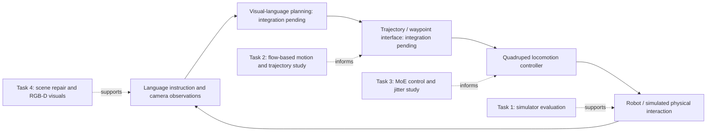
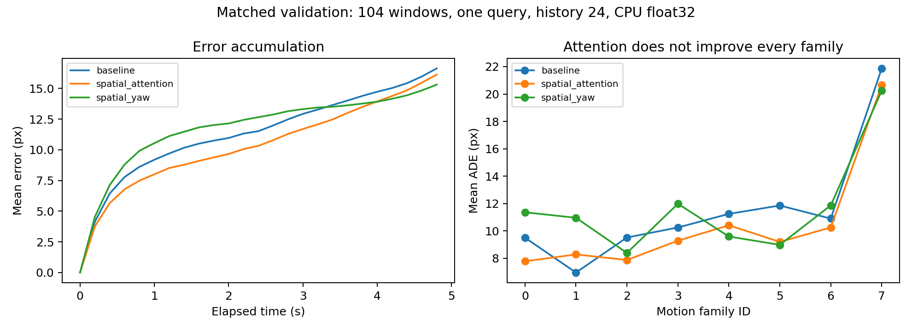
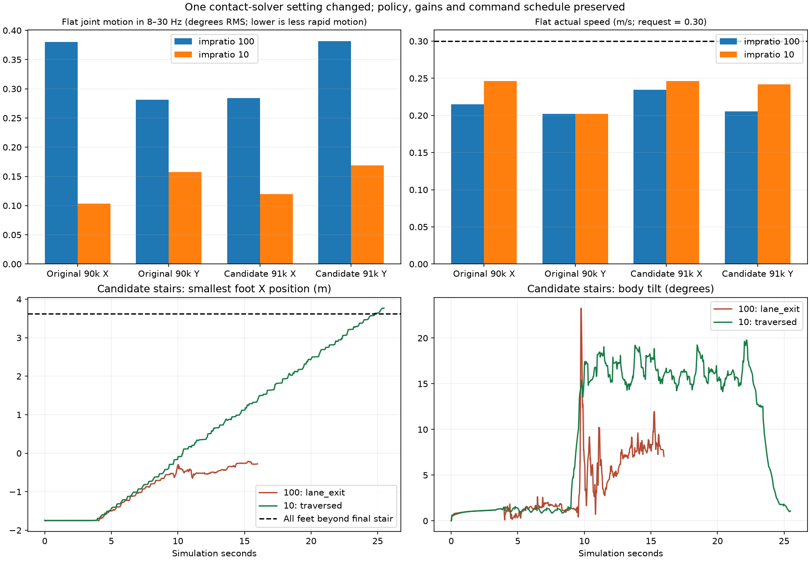
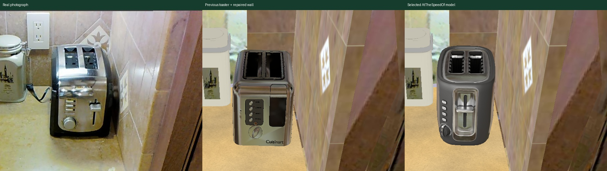

# VLM-Based Robot Navigation — UGP Mid-Evaluation

**Vivekananda Y24 · Evidence reviewed on 10 October 2026**

This project studies the components needed for a quadruped to follow natural-language navigation instructions using visual understanding and executable locomotion. Work so far covers simulator selection, visual trajectory estimation, locomotion/control diagnostics, and realistic scene repair. **A complete language-to-robot navigation system is not yet demonstrated by the saved artifacts.**

For the presentation, start with [the 12-minute slide guide](docs/mid_evaluation/PRESENTATION_GUIDE.md). The [review package](docs/mid_evaluation/README.md) includes source-indexed figures, copied metric JSON/CSV files, and [claim-to-evidence documentation](docs/mid_evaluation/EVIDENCE_INDEX.md).

## Project objective and how the tasks connect

The intended system connects a language/visual planner to geometric trajectory interpretation and a low-level quadruped controller. A useful scene must provide meaningful observations and credible physical interaction. The tasks below investigate these requirements separately; their interfaces still need integration and end-to-end evaluation.



Task 1's demonstration uses **Unitree Go2 / Genesis**. Task 3 uses **SvanM2 / MuJoCo-mjlab / MoE**. Task 4 uses a **Habitat/NavMesh scene prototype**, whose agent is not an articulated quadruped. These are distinct experimental systems, not already connected modules of one working robot stack.

## Progress at the mid-evaluation

| Task | Work completed / recorded | Strongest supported outcome | Remaining gap |
| --- | --- | --- | --- |
| [1 — Simulator evaluation](Task_1_Simulator_Evaluation/README.md) | Simulator design comparison; Genesis office/Go2 controller and demo | Visual-only office plus a physical plane avoids the reported detailed-mesh collision memory problem | Quantitative benchmarking, furniture collision, and reproducible asset/environment manifest |
| [2 — GQFT trajectory estimation](Task_2/README.md) | Baseline reproduction, historical augmentation, attention/yaw studies, matched validation and contract audits | Recovered fixed-history-24 yaw test ADE **8.783 vs 9.631 px**; concrete flow/pitch/label defects identified | History-selection caveat, consistent supervision study, and navigation integration |
| [3 — MoE locomotion diagnostics](Task_3/README.md) | Hardware-log audit; recording/replay tools; reward/rate/gain/contact studies | Matched contact-setting intervention reduces flat band RMS and changes four stair pairs from failure to completion | Validated hardware contract/contact model and reliable measured robot improvement |
| [4 — Kitchen repair / rendering](Task_4/README.md) | Photo-calibrated object/surface repair, licensed assets, viewers, split physics/Gaussian RGB-D | Latest saved scene has **4.378M Gaussians**, **23 comparison groups**, and reviewed placement checks | Held-out visual quality, dynamic scene synchronization, and articulated robot physics |

## Task 1 — Establishing a usable simulator

The initial study compared Genesis, Isaac Sim/Isaac Lab, Unreal/Unity, Habitat, and MuJoCo/MJX under recorded local hardware constraints. Genesis was selected for the initial demonstration. Other simulator entries are design assessments, not a measured cross-engine performance benchmark.

Loading the detailed office as collision geometry reportedly caused an out-of-memory failure. The implementation makes the office mesh visual-only (`collision=False`, `convexify=False`) and supplies floor support with `plane.urdf`. `run_go2.py` maps the pretrained policy's joint order, builds its observation vector, and supplies stand/walk keyboard modes.

**Outcome:** a recorded Go2/office demonstration and practical scene-loading workaround. **Limitation:** the visual furniture does not supply obstacle collision in this setup, and the script/demo do not establish photorealistic ray-traced rendering or complete navigation. See [the task report and reproduction dependencies](Task_1_Simulator_Evaluation/README.md).

## Task 2 — Reproduction, model attempts, and failure analysis

GQFT estimates camera motion and projected ground trajectories from optical flow. The released baseline's locked-test result was reproduced before exploring three improvement tracks:

| Attempt | Recorded result | Evaluation conclusion |
| --- | --- | --- |
| Historical flip augmentation | Best training-time validation ADE improved from 9.094 to 8.737 px in one run | No final aug_v2 test improvement established; flips are discontinued and archived |
| Spatial Attention | Better matched validation ADE, worse test ADE/FDE; no valid selected history | Useful regional-aggregation hypothesis, unsuccessful test improvement |
| Spatial + Yaw | Recovered checkpoint/test record improves fixed-history-24 pixel errors | Best saved test record, with a disclosed mismatch between validation-selected and tested history |

### Saved fixed-history-24 locked-test comparison

| Model | ADE (px) ↓ | FDE (px) ↓ | Endpoint within 10 px ↑ |
| --- | ---: | ---: | ---: |
| Released baseline | 9.630945 | 15.847433 | 39.17% |
| Spatial Attention | 10.090982 | 16.591120 | 37.50% |
| Spatial + Yaw | **8.783099** | **13.322794** | **45.00%** |

The yaw record gives **8.80% lower ADE / 15.93% lower FDE** than baseline. Its eight queries repeat the same extended anchor rather than eight independent tasks. Historical validation selected history 12, while test used 24; the later standardized sweep selects 16. This is a fixed-history result, not a completed selected-history benchmark. Existing test records were copied; no test evaluation was rerun for this review. [Metric snapshots and derived summary](docs/mid_evaluation/evidence/task2/summary.json).

Matched CPU validation on 104 windows at history 24 gives ADE **11.2625 / 10.2826 / 11.6358 px** for baseline / Attention / Spatial + Yaw. Yaw improves validation FDE but worsens mean ADE. These metrics use a different protocol from training-time validation and the historical test; compare within each table.



The October failure audit also identified double flow normalization, opposite pitch conventions, an incorrect episode query anchor, and an augmented checkpoint mislabeled “baseline” in legacy overlays. An oracle projection check found that pixel labels using sequence-floor height can conflict with a fixed 1.2 m projector: exact 3-D motion still gives a maximum **65.525 px** discrepancy. Current strict architecture loaders and explicit optional fixed-rig supervision address these contracts; the paired supervision experiment remains planned. [Full task analysis](Task_2/README.md).

## Task 3 — Explaining jitter and stair outcomes

The SvanM2 investigation progressed from reported jitter to deployment-contract checks, hardware logs, saved policy inputs/outputs, matched simulations, and controlled reward/gain/contact experiments. The historical hardware audit found target-bound and command/timing discrepancies. Target oscillation strongly correlates with measured motion in the higher-rate log, but the physical cause remains unresolved.

The original90000/candidate90500 comparison improves early tracking and reduces target removal, while vibration changes have mixed signs. **None of its 12 distinct stair cases completes traversal.** Refreshed sensing changes trajectories without consistently fixing the task. A time-aware target-rate reward and 0.13 m swing-preference continuation were implemented/tested locally, but checkpoint identity and actual motion remain essential: older and newest “91000” are different policies.

### Later controlled simulator result

At gains `kp=18`, `kd=0.7`, request 0.30 m/s, a common 5–11 s window, and matched evaluation conditions, changing only `impratio` from 100 to 10 gives:

| Checkpoint / direction | Joint 8–30 Hz RMS: 100 → 10 | Mean actual speed: 100 → 10 |
| --- | ---: | ---: |
| Original90000 / forward | 0.380 → 0.103° | 0.215 → 0.246 m/s |
| Original90000 / sideways | 0.281 → 0.157° | 0.202 → 0.202 m/s |
| Newest91000 / forward | 0.284 → 0.120° | 0.235 → 0.246 m/s |
| Newest91000 / sideways | 0.382 → 0.169° | 0.205 → 0.242 m/s |

All four tested nominal-start stair pairs—two checkpoints × two gains—complete a twelve-riser, 10 cm staircase at 10 and fail at 100. Additional sensing/start comparisons support contact sensitivity. These are paired deterministic simulator cases, not independent seeds or a hardware success-rate estimate. [Recorded findings](docs/mid_evaluation/evidence/task3/contact_findings.json).



**Interpretation:** contact enforcement changes the closed-loop motion/observation/policy response. This is strong simulator evidence. It does not establish a faulty MoE gate, a universal gain remedy, or a validated robot fix; real hardware has no `impratio` switch. The deployed control contract and calibrated contact/delay response must be established before a hardware claim. [Full task report](Task_3/README.md).

## Task 4 — Repairing observations and separating rendering from physics

The Matterport3D/RxR kitchen study compares damaged scan assets to calibrated real photographs, replaces or reconstructs props, repairs bounded wall/counter geometry, preserves licensed materials, and records fit/placement evidence. The selected toaster is a CC BY 4.0 model by AtTheSpeedOf; its Hamilton Beach branding is an acknowledged approximation to the Black & Decker reference.



The split prototype uses sensorless Habitat/Bullet with a static proxy/NavMesh, publishes camera pose/intrinsics/frame ID, and renders RGB/depth in a separate CUDA Gaussian process. Depth is expected optical-axis Z, with invalid pixels stored as NaN. It is not guaranteed first-surface depth, and the NavMesh agent is not an articulated robot.

| Latest saved all-kitchen evidence | Result / qualification |
| --- | --- |
| Visual checkpoint | 4,378,360 Gaussians |
| Scene coverage / comparisons | 32 props, five counters, two sinks, rangetop; 23 labelled groups and five wide views |
| Reviewed placement audit | 33 objects including rangetop; zero issues after two documented size exceptions |
| One production frame at 800 × 640 | 99.0068% valid depth; not a depth-accuracy guarantee |
| One CUDA raster measurement | 12.0576 ms, excluding encoding/network/browser |

The initial Gaussian model and dense-corner repair expose a tradeoff: local finite-depth/mesh consistency improves, while reference PSNR falls **27.52→18.79 dB** and held-out scores remain about **7.28/10.48 dB**. Those scores belong to earlier revisions; the final all-kitchen revision needs a new matched held-out evaluation. **Photorealism and 1,000 FPS end-to-end RGB-D are not demonstrated.** [Task report](Task_4/README.md) · [Saved evidence](docs/mid_evaluation/evidence/task4/).

## What the investigation established

1. **Contracts can dominate apparent model failure.** Flow normalization, pitch, query anchors, label height, observation timing, bounds, and contact settings changed interpretation before another architecture change was warranted.
2. **Aggregate improvement needs matched protocols.** Training validation is not locked test; fixed history is not selected history; equal commands/durations and known hashes matter; repeated queries are not independent samples.
3. **Implementation checks and task performance are separate.** A reward smoke, placement audit, camera bridge, or fast raster kernel can pass while locomotion, novel-view appearance, or navigation still fails.
4. **Negative results guide controlled work.** Attention regression, mixed reward outcomes, and poor held-out reconstruction narrowed the next experiments instead of proving broad success.

## Next milestones

| Priority | Concrete next step | Completion evidence |
| --- | --- | --- |
| 1 | GQFT paired label-consistency study with explicit architecture/annotation protocol | Matched validation, direct 3-D/pixel errors, history gate, frozen provenance |
| 2 | Revalidate deployed SvanM2 control and measured contact/delay assumptions | Matching bounds/rates/scales/hashes and calibrated response evidence |
| 3 | Evaluate final repaired scene on fixed held-out cameras | Photo/depth metrics, unchanged masks/targets, end-to-end latency and failure cases |
| 4 | Integrate planner, trajectory/waypoint interface, robot control, and versioned scene | Language-task success, SPL/path efficiency, collisions/falls, tracking, and latency |
| 5 | Package ablations and repeatability | Independent starts/seeds where appropriate, source/config hashes, figures, and limitations |

Publication planning remains a project goal. The previous README's deadline claims are not treated as verified current deadlines or evidence of submission.

## Repository organization and viewing

```text
VLM_Based_Robot_Navigation/
├── README.md                         # This mid-evaluation overview
├── docs/mid_evaluation/              # Slides, evidence index, portable metrics and figures
├── Task_1_Simulator_Evaluation/      # Go2 script, demo, current and historical evaluation
├── Task_2/                          # Current GQFT task report and separate model checkout
├── Task_3/                          # SvanM2 notes, analysis tools, saved experiments, local checkout
├── Task_4/                          # Kitchen repair reports, comparisons, local snapshots and launchers
├── genesis-world/                   # Genesis submodule and local simulator assets
├── reference_materials/             # Literature, learning notes, and retained source archives
└── workflow.md                      # Original project workflow
```

[The repository guide](docs/mid_evaluation/REPOSITORY_GUIDE.md) explains which files are portable, local-only, or server-dependent. Existing raw runs and model/source repositories are preserved. The parent repository does not automatically include uncommitted nested-repository work or server data.

Open the copied figures and task reports offline, or validate the package with:

```bash
python3 docs/mid_evaluation/tools/validate_package.py
```

For saved Task 3 dashboards, use the local HTTP command in [Task 3](Task_3/README.md). For the existing ISL kitchen, use the launcher in [Task 4](Task_4/README.md), which requires SSH/network access and may start missing server services. This review used local files only; it did not run training, reevaluate test, connect to the robot, or verify server availability.
