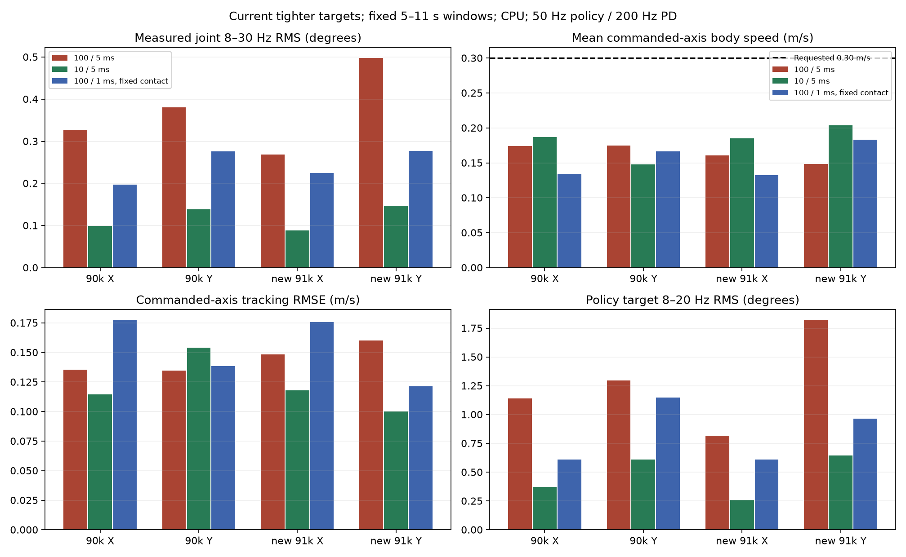
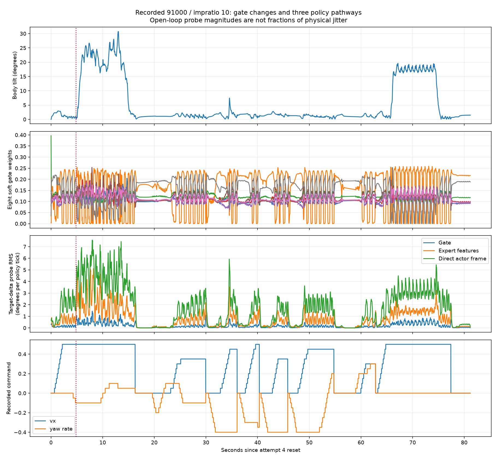
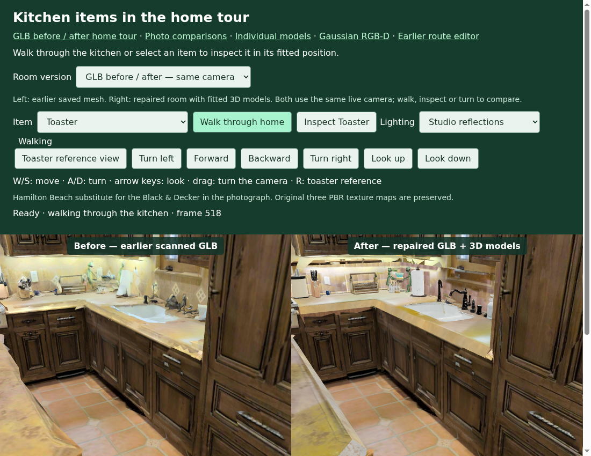

# VLM-Based Robot Navigation — Mid-evaluation

**Vivekananda Y24 · Mid-evaluation research record**

Research objective: language-conditioned quadruped navigation using visual motion estimation, executable locomotion and calibrated scene observations. Current results are component experiments across Go2/Genesis, SvanM2/MuJoCo and Habitat; an integrated language-navigation benchmark is pending.

Supervisor direction: **unify VLM goal interpretation, trajectory estimation and RL execution**; investigate **masked attention in GQFT** to reduce unreliable motion evidence. [Integration interfaces and milestones](docs/INTEGRATION_PLAN.md) · [Masking experiment](Task_2/MASKED_ATTENTION_PLAN.md). Exact mask definition and integrated evaluation remain pending.

## Problems, evidence and engineering decisions

| Project / problem | Cause or contributor supported by analysis | Attempt → outcome | Next experiment / feedback needed |
| --- | --- | --- | --- |
| [1 · Simulator](Task_1_Simulator_Evaluation/README.md) — detailed office exceeds the reported 4 GB VRAM budget | Collision/convex-hull processing reported as the memory bottleneck; no numerical memory trace | Disable visual-mesh collision, retain support plane → Go2 office demo; furniture collision absent | Compare simplified furniture proxies; measure peak VRAM, collision correctness and physics/render latency |
| [2 · GQFT](Task_2/README.md) — inconsistent trajectory errors across protocols | Double flow normalization, pitch/anchor/checkpoint mismatches; ground-plane label conflict in 3/104 validation windows | Strict adapters and architecture loading; Attention/Yaw variants → yaw fixed-history test ADE 9.631→8.783 px, but mixed validation | Paired ground-label experiment before architecture expansion; agree on camera/history protocol |
| [3 · MoE locomotion](Task_3/README.md) — vibration, tracking loss and incomplete stairs | Strong contact–policy–coupled-actuator interaction; differing bounds/sensing/contracts; hardware initiating cause unresolved | Reward/gain/sensing probes, then matched contact intervention → current limits: 63.5–70.5% lower flat band RMS; 3/6 vs 0/6 stair completions | Calibrate deployed actuator/contact contract; evaluate speed, heading, support and vibration together |
| [4 · Kitchen observations](Task_4/README.md) — distorted geometry, approximate props and weak novel views | Scan defects, unsupported procedural material export and limited appearance coverage | Current v8 tray/background repair; 23 calibrated views / 30 model routes; separate Gaussian branch has 4.378M points | Validate geometry/collisions and held-out RGB/depth; integrate calibrated observations |

## Experimental results and protocol boundaries

| Measurement | Recorded result | Interpretation |
| --- | --- | --- |
| GQFT test, history 24 | ADE 9.630945→8.783099 px; FDE 15.847433→13.322794 px | Yaw: 8.80% / 15.93% lower; validation history differs; one repeated anchor |
| GQFT Attention, matched 104-window CPU validation | ADE 11.2625→10.2826 px | Its test ADE worsens to 10.090982 px; validation improvement is not uniform generalization |
| MoE current tight-limit CPU study, 34 cases | Contact ratio 100→10: 63.5–70.5% less flat 8–30 Hz joint RMS; stairs 0/6→3/6 | Two policies × three deterministic starts; original sideways tracking regresses; no hardware fix established |
| MoE older wider-limit study | Four nominal policy/gain stair pairs: 0/4→4/4 | Separate actuator contract; cannot replace the current study |
| Current v8 PBR product scene | 23 calibrated views, 30 model routes, 33 props screened; original toaster geometry and maps preserved | Saved checks; zero support/overlap flags in conservative screening, approximate shapes and scan gaps remain |
| Gaussian branch | 4,378,360 points; one-frame valid depth 99.0068%; CUDA raster 12.0576 ms | Depth coverage is not accuracy; kernel time is not full RGB-D latency; final held-out quality pending |

## Research decisions requiring guidance

| Project | Proposed controlled test | Measures / decision |
| --- | --- | --- |
| Simulator | Same scene with visual mesh + progressively simplified collision proxies | Collision behavior, VRAM, step latency and controller tracking |
| GQFT | Same Attention/no-yaw/no-flip model; only `sequence_floor` vs `fixed_rig` supervision varies | Projection oracle, ADE/FDE, direct 3-D error and selected-history gate; preserve legacy benchmark |
| Locomotion | Verified deployed bounds/gains/history first; isolated contact, then reward ablations | Tracking RMSE, heading/lane errors, torque/target limits, band RMS, foot-support traversal; identify real lag/slip |
| Scene observations | Freeze camera split and geometry; compare product mesh and Gaussian branch separately | Held-out RGB metrics, measured-depth error, silhouette/support audit, p50/p95 full latency |

## Selected plots and scene comparisons

**GQFT — matched validation error and motion families.** Attention improves aggregate ADE but regresses on constant-arc motion. [Interpretation and protocols](docs/mid_evaluation/presentation/TASK2_VISUAL_ANALYSIS.md).

**MoE — current target bounds, matched contact intervention.** Compare vibration and tracking together; current stairs are 0/6 versus 3/6, not a hardware success rate.

**MoE — recorded gate, expert and direct-actor pathways.** Saved-input decomposition, not a closed-loop causal experiment. [Audit](Task_3/notes/24_GATE_FREQUENCY_AND_VLM_AUDIT_20261011.md).

**RxR kitchen — earlier saved mesh / repaired v8 mesh, same camera.** Before textures are reduced for browser memory; this is a polygon/PBR comparison. [Revision and provenance](Task_4/kitchen_tray_background_repair/README.md).

## Source, diagrams and references

Each task README records **problem → required fix → supported cause → analysis → attempted change → measured outcome → next experiment**. Independent block diagrams are linked inside each task; [diagram files](docs/mid_evaluation/diagrams/README.md) include PNG/SVG and generation code.

[Source/change index](docs/mid_evaluation/CODE_INDEX.md) · [Evidence index](docs/mid_evaluation/EVIDENCE_INDEX.md) · [Paper venues, years and upstream references](docs/mid_evaluation/REFERENCES.md) · [Repository layout](docs/mid_evaluation/REPOSITORY_GUIDE.md)

GQFT and SvanM2 are separate Git repositories registered as submodules; parent tools contain trajectory/control diagnostics and mesh/render services. Data, weights and large scenes are external runtime inputs. Technical checks do not establish live server or hardware availability. [Slide text and presentation assets](docs/mid_evaluation/presentation/SLIDE_TEXT.md) are separate from these technical reports.

[Presentation PDF and complete speaking script](mid-eval/README.md) · [Publication groups](docs/mid_evaluation/PUBLICATION_PLAN.md).
