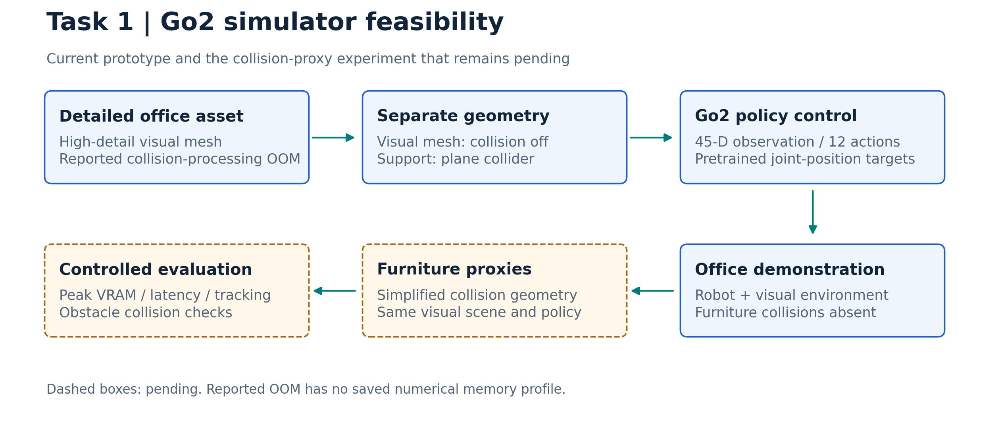

# Task 1 — Go2 simulator feasibility

## Problem and required fix

Execute quadruped control inside a detailed office on the recorded RTX 3050 / 4 GB VRAM platform. The initial detailed collision mesh reportedly caused out-of-memory errors. The required fix is a collision-valid environment within that budget, with reproducible assets and timing measurements.

## Cause and analysis

Collision/convex-hull processing of the office mesh is the reported bottleneck. Disabling it allowed the visual prototype to proceed, but no saved peak-VRAM trace establishes a numerical root-cause profile. Visible furniture without collision cannot validate navigation or obstacle avoidance.

## Attempts, rationale and outcomes

| Attempt | Analysis that motivated it | Change / result | Remaining issue |
| --- | --- | --- | --- |
| Simulator comparison | Hardware budget versus renderer/physics requirements | Genesis selected; Isaac, Unity/Unreal, Habitat and MuJoCo alternatives assessed | No measured cross-engine benchmark |
| Detailed office collision | Reported mesh-processing OOM | Full detailed collision abandoned for prototype | Numerical memory attribution missing |
| Separate visual and collision geometry | Render mesh detail need not enter collision processing | `Office+2.glb`: collision/convexify false; plane supports Go2 | Furniture collision absent |
| Pretrained control integration | Policy and robot use different joint interfaces | 45-D observations, 12 position targets, joint remapping and stand/walk modes | External policy, hardcoded path; language control pending |
| Offline high-quality rendering | Live preview and final images have different resource demands | Proposed runtime/render separation | Ray-traced benchmark pending |

## Code and control contract

[run_go2.py](run_go2.py): GPU Genesis, `dt=0.02`, two substeps, one inference/scene step in walk mode. Observation dimensions: gyro 3 + gravity 3 + command 3 + joint position 12 + joint velocity 12 + previous action 12. Policy order FR/FL/RR/RL; stand gains 150/5, walk gains 40/1. Targets are standing-pose offsets.

Dependencies: Genesis, PyTorch, NumPy, CUDA/display, matching `rl_sar` policy and `genesis-world/office-env/Office+2.glb`. [Recorded demo](videos/Genesis_without_physics.mp4) has no synchronized configuration manifest; its filename does not verify physics. [Initial evaluation](notes/INITIAL_EVALUATION.md).

## Next experiment and guidance needed

Hypothesis: simplified furniture proxies can restore useful collisions without processing the complete visual mesh. Hold the scene/controller fixed; compare proxy complexity using peak VRAM, initialization time, physics/render p50/p95 latency, tracking RMSE and obstacle collision checks. Guidance needed: collision approximation acceptable for this navigation study and target workstation/runtime budget.

Source reference: [Genesis upstream](https://github.com/Genesis-Embodied-AI/Genesis). Genesis is a software dependency here; no paper venue is assigned to this local demonstration.
