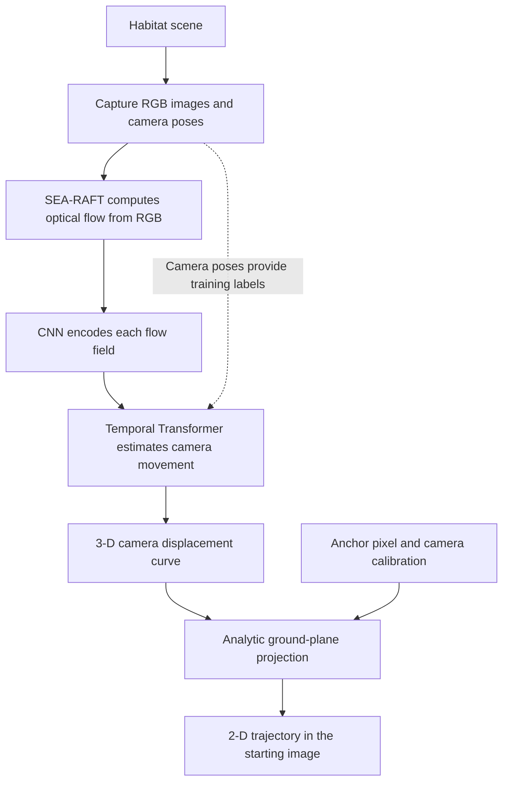
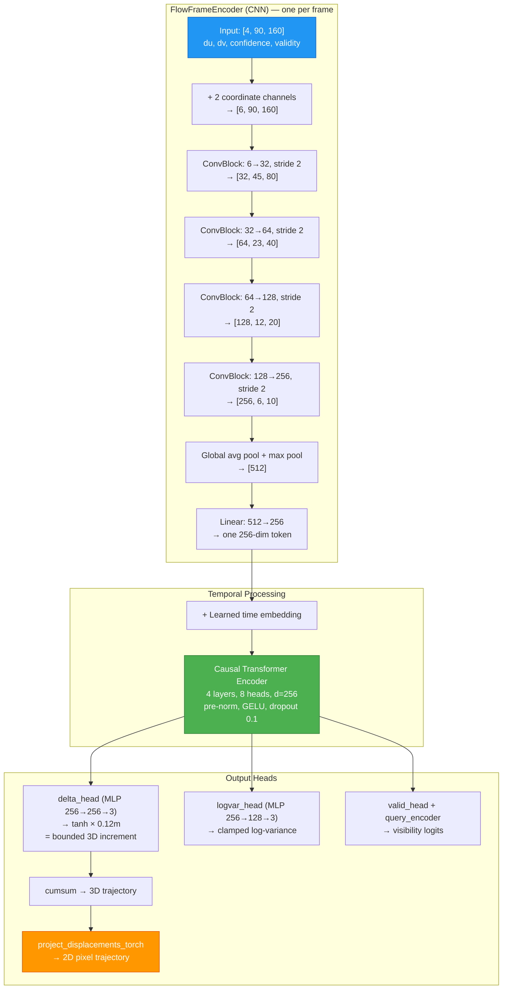
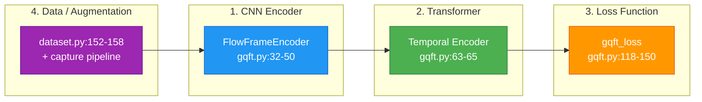
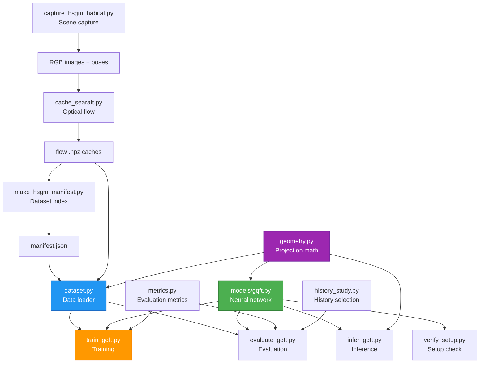

# GQFT Codebase — Complete File-by-File Reference

> **Repository**: [`Task_2/gqft_algorithm_sharing_vivekananda`](/home/vivekananda/UGP_1_VLM/VLM_Based_Robot_Navigation/Task_2/gqft_algorithm_sharing_vivekananda)
>
> This document explains every Python file in the GQFT codebase, the full data flow, the role of every neural network component, the recorded baseline results, known issues, and where improvements/novelty should be focused.

---

## Overall Data Flow



This folder implements a camera-motion reconstruction system called **GQFT — Geometry-Constrained Query Flow Transformer**. It takes optical flow from a video, estimates how the camera moved, and draws that movement as a trajectory in the video's starting image.

This is a component of the broader navigation project. Language understanding, goal selection, obstacle-aware planning, and robot control are **not** implemented in these scripts.

---

## Key Concepts

Three concepts make the scripts easier to understand:

- **Optical flow** describes how image pixels move between two consecutive images. `du` is horizontal movement; `dv` is vertical movement.
- **Camera displacement** describes how the camera itself moved in 3-D, measured in metres.
- **Query/anchor** is the pixel from which the projected trajectory begins. It is a geometric starting point, not a natural-language instruction or navigation goal.

Also, **history 24** means 24 optical-flow intervals, requiring 25 RGB images. At the configured 5 Hz, that covers 4.8 seconds and produces up to 25 trajectory points. The network reconstructs movement within that observed window; it has no separate decoder predicting future movement beyond it.

---

## Fixed Sensor Contract

| Setting | Value |
|---------|-------|
| Original RGB image | 960 × 540 |
| Horizontal field of view | 135° |
| Camera height | 1.2 m |
| Camera pitch | 30° downward |
| Capture rate | 5 Hz |
| Cached flow grid | 160 × 90 |
| Maximum trained history | 30 flow intervals |
| Selected history | 24 flow intervals |
| Extended projection canvas | 960 × 810 |
| Default anchor | (480, 809) |

The extra 270 pixels extend the coordinate canvas below the visible image. They are **not** additional captured image pixels.

---

## File-by-File Breakdown

### 1. [`step2/capture_hsgm_habitat.py`](/home/vivekananda/UGP_1_VLM/VLM_Based_Robot_Navigation/Task_2/gqft_algorithm_sharing_vivekananda/step2/capture_hsgm_habitat.py) — Scene Capture & Dataset Generation

This script generates the simulated video dataset.

It loads a Matterport3D scene into Habitat, generates camera movements through that scene, renders RGB images, and records the true camera poses.

**Key functions:**

- **`build_sim()`** constructs the simulator and configures the camera using the settings above. It also checks that Habitat has a navigation mesh — a representation of where the agent can move.

- **`motion_commands()`** generates forward speeds and turning rates for **eight motion families**: straight motion, constant arcs, gradually increasing turns, S-curves, smooth random curves, stop-go motion, straight-then-turn motion, and gentle alternating turns.

- **`plan_trajectory()`** integrates those commands into positions and headings. It tries different starting locations and checks each movement against the navigation mesh. If an obstacle prevents enough of a requested movement, it rejects that trajectory and tries another.

- **`camera_pose_zup()`** converts Habitat's coordinate conventions into the conventions used by the rest of this project. The saved world uses a vertical Z axis; camera coordinates use X right, Y down, and Z forward.

- **`write_sequence()`** renders the images and saves:
  ```
  sequence/
      rgb/
          <timestamp>.png
      groundtruth.txt
      calibration.txt
      meta.json
  ```
  `groundtruth.txt` contains timestamp, camera position, and camera orientation. `calibration.txt` contains focal lengths and image centre. `meta.json` records the scene, motion family, camera settings, frame count, and other sequence details.

- **`main()`** handles command-line arguments and generates multiple sequences. Its defaults are 24 sequences with 49 RGB frames each.

> **Distinction from notes**: physics is disabled, and the script directly sets the Habitat agent's pose before rendering. This generates camera observations along checked paths; it does not simulate quadruped walking or motor control.

---

### 2. [`step2/cache_searaft.py`](/home/vivekananda/UGP_1_VLM/VLM_Based_Robot_Navigation/Task_2/gqft_algorithm_sharing_vivekananda/step2/cache_searaft.py) — Optical Flow Extraction

This script converts RGB images into optical flow. It runs a pretrained SEA-RAFT model on consecutive RGB images. SEA-RAFT stays frozen; this script prepares inputs for GQFT rather than training the flow model.

**Key functions:**

- **`load_model()`** imports SEA-RAFT from an external checkout and loads its configuration and weights. It supports local checkpoints, `.safetensors` files, or loading the configured pretrained model.

- **`read_rgb()`** reads an image with OpenCV, converts BGR to RGB, and creates a PyTorch tensor.

- **`infer_batch()`** estimates flow in **both directions**:
  ```
  Image A → Image B: forward flow
  Image B → Image A: backward flow
  ```
  The reason for both directions is **consistency checking**. If a pixel moves from A to B, following the backward flow should approximately return to its starting position.

- **`warp()`** samples the backward flow at the locations reached by the forward flow. The script then measures the round-trip error and rejects unreliable vectors or vectors whose endpoints leave the image.

- **`mixture_scale()`** converts SEA-RAFT's uncertainty outputs into an uncertainty scale. Forward and backward uncertainty are combined into a confidence value.

**Flow normalization** (critical detail):
```
horizontal channel = du / original image width
vertical channel   = dv / original image height
```
Consequently, cached values describe fractions of the original image dimensions, not movement measured in pixels of the smaller flow grid.

**Output per sequence:**
```
flow_searaft_160x90.npz

flow:       [T, 90, 160, 2]
confidence: [T, 90, 160]
valid:      [T, 90, 160]
```
It also writes `flow_searaft_meta.json` with confidence, validity, and consistency statistics. Existing caches are skipped unless `--overwrite` is supplied.

---

### 3. [`step2/make_hsgm_manifest.py`](/home/vivekananda/UGP_1_VLM/VLM_Based_Robot_Navigation/Task_2/gqft_algorithm_sharing_vivekananda/step2/make_hsgm_manifest.py) — Dataset Index / Manifest

A manifest is a JSON file describing which sequences exist, where they are stored, and which split each belongs to.

This script scans sequence metadata and uses the supplied scene lists to assign training, validation, and test splits. It rejects a scene appearing in multiple split lists.

**Why whole-scene splits matter**: different clips from the same house share appearance and layout. Keeping whole houses separate makes evaluation a better check of performance in an unseen environment.

**Validation checks:**
```
number of RGB images
    = number of ground-truth poses
    = frame count recorded in metadata
```
With `--require-flow`, it includes only sequences whose flow-cache file exists.

**Current manifest contents:** 194 sequences: 144 training sequences from four scenes, 26 validation sequences from one scene, and 24 test sequences from one scene.

> **Dependency note:** it imports constants from the capture script, so even this bookkeeping utility currently imports Habitat-related libraries.

---

### 4. [`step2/geometry.py`](/home/vivekananda/UGP_1_VLM/VLM_Based_Robot_Navigation/Task_2/gqft_algorithm_sharing_vivekananda/step2/geometry.py) — 3D ↔ 2D Projection Mathematics

This file is **central** to understanding what GQFT learns. It contains the mathematics connecting 3-D movement to a 2-D image path.

**Key components:**

- **`CameraModel`** (dataclass) stores resolution, focal lengths, image centre, camera height, and pitch. `camera_model_from_mapping()` reconstructs these settings from a manifest or checkpoint.

- **`quat_xyzw_to_matrix()`** converts saved quaternion orientations into rotation matrices.

- **`load_tum_camera_trajectory()`** reads the pose file containing:
  ```
  timestamp tx ty tz qx qy qz qw
  ```

- **`canonical_ground_normal_camera()`** calculates the ground's orientation relative to the pitched camera.

- **`query_ground_anchor()`** turns a selected pixel into a 3-D floor point. Conceptually, it casts a ray from the camera through that pixel and finds where the ray intersects an infinite flat ground plane.

- **`project_query_path()`** creates **training labels**. It expresses the true camera movement relative to the first camera pose, adds that movement to the selected ground anchor, and projects the resulting points into the starting image:
  ```
  3-D path point = ground anchor + camera displacement

  pixel u = fx × X/Z + cx
  pixel v = fy × Y/Z + cy
  ```
  Thus, the target is a translated copy of the camera-motion curve drawn from the anchor. It is **not** the ordinary tracking of one physical scene point through successive images.

  This function also calculates **validity**. A point must be in front of the camera and inside the configured canvas. Once a trajectory leaves the valid region, all subsequent points are marked invalid.

- **`project_displacements_torch()`** performs the equivalent calculation using PyTorch. Because its coordinate calculations are **differentiable**, an error in the projected path can send gradients back into the neural network.

> **Key constraint**: The geometry assumes a flat ground plane and ignores obstacles during projection. Its role is to enforce the camera-projection relationship.

---

### 5. [`step2/dataset.py`](/home/vivekananda/UGP_1_VLM/VLM_Based_Robot_Navigation/Task_2/gqft_algorithm_sharing_vivekananda/step2/dataset.py) — Training Data Loader

This is the reusable PyTorch dataset module.

**Class structure:**

- **`WindowSpec`** identifies a sequence and a starting frame.

- **`FlowPathDataset.__init__()`** reads the manifest, selects a split, and creates overlapping windows, normally with starting positions five frames apart.

- **`_load_sequence()`** reads flow, confidence, validity, ground-truth poses, and metadata. It checks their shapes, verifies that there is one fewer flow field than poses, and checks that pose pitch/roll agrees with the fixed camera rig. Recently used sequences are cached in memory to reduce repeated disk reads.

- **`_sample_history()`** chooses a window length from the available values:
  ```
  2, 3, 4, 6, 8, 12, 18, 24, 30
  ```
  Training uses random choices. Evaluation can request a fixed length, and its sampling is repeatable.

- **`_sample_queries()`** chooses anchor pixels. Without the virtual extension, it samples locations in the lower image. With the extension, it uses the extended bottom-centre anchor. In that mode, requesting multiple queries repeats the same anchor.

- **`__getitem__()`** builds one sample by slicing a flow window, zeroing invalid flow, stacking four channels, selecting the corresponding poses, and calling `project_query_path()` to generate labels.

**For history 24 and one query, the principal tensors are:**

| Tensor | Shape |
|--------|-------|
| `flow/features` | `[24, 4, 90, 160]` |
| `query pixel` | `[1, 2]` |
| `target pixel path` | `[1, 25, 2]` |
| `target validity` | `[1, 25]` |
| `3-D displacement` | `[25, 3]` |

The four feature channels are: horizontal flow, vertical flow, confidence, and flow validity.

**Horizontal-flip augmentation** (already implemented, lines 152–158): During training, with 50% probability it mirrors all four feature maps, negates horizontal flow, mirrors the query and target pixel coordinates, and negates the camera-X displacement. The intention is to expose the model to mirrored motion examples. It changes sampled examples dynamically; it does not double the dataset's recorded length.

- **`collate_windows()`** combines samples into a batch. Because their histories can differ, it pads shorter samples with zeros and produces `history_mask` to identify real observations.

> **Normalization note**: Coordinates are normalized by the original image dimensions. Therefore, the extended anchor's normalized vertical coordinate is 809/539 ≈ 1.50; normalized coordinates are **not** always confined to [0,1].

---

### 6. [`step2/models/gqft.py`](/home/vivekananda/UGP_1_VLM/VLM_Based_Robot_Navigation/Task_2/gqft_algorithm_sharing_vivekananda/step2/models/gqft.py) — ⭐ THE NEURAL NETWORK (Most Important File)

This file defines the neural network architecture and its loss function.

#### Architecture Diagram



#### Component Details

| Lines | Component | What It Does |
|-------|-----------|-------------|
| 15–23 | `GQFTConfig` | Hyperparameters: `d_model=256`, 4 Transformer layers, 8 heads, `max_step=0.12m`, `canvas_height` for extended projection |
| 26–29 | `ConvBlock` | `Conv2d → GroupNorm → GELU` building block. Each block halves spatial resolution |
| 32–50 | `FlowFrameEncoder` | **The CNN**: Takes one flow frame `[4,H,W]`, appends 2 learned coordinate channels (normalized x,y grid) → 4 conv blocks → global `avg+max` pool → linear projection → one 256-dim ego-motion token. **This is where per-frame visual understanding happens** |
| 53–108 | `GQFT` (forward) | **The full model assembly**: CNN encoder → time embeddings → causal Transformer → delta head → cumsum → analytic projection → validity prediction |
| 62 | `time_embed` | Learned positional embeddings, one per frame position (shape `[1, max_history, 256]`) |
| 63–65 | `temporal` | **THE TRANSFORMER** — `nn.TransformerEncoder` with causal attention mask. Each timestep can only attend to itself and all **previous** timesteps |
| 66 | `delta_head` | MLP: `256 → 256 → 3`, predicts bounded 3D camera displacement per frame |
| 67 | `logvar_head` | MLP: `256 → 128 → 3`, predicts uncertainty (log-variance), clamped to `[-6, 3]` |
| 68 | `start_state` | Learned initial state vector for the "before any observation" position |
| 69 | `query_encoder` | MLP: `2 → 256 → 256`, encodes the normalized query pixel location |
| 70–72 | `time_for_valid`, `query_for_valid`, `valid_head` | Joint time-query interaction for visibility prediction |
| 82 | Causal mask | `torch.triu(..., diagonal=1)` — upper-triangular boolean mask enforcing autoregressive attention |
| 84 | `torch.tanh(...) * max_step_m` | **Key**: bounds each per-frame step to ±0.12 metres — prevents wild predictions |
| 86 | `torch.cumsum(delta, dim=1)` | **Key**: turns per-frame increments into a full cumulative 3D trajectory |
| 89–91 | Analytic projection | Calls `project_displacements_torch()` — pure geometry, no learnable parameters |
| 100–104 | Visibility computation | Joint encoding of temporal state + query location → sigmoid → probability that each trajectory point is visible |

#### How the Transformer Works Here

The Transformer is the **temporal backbone** of GQFT:

**Input**: Each video frame's optical flow is compressed by the CNN into a single 256-dim token. 24 frames → 24 tokens.

**Causal attention pattern**:
```
Frame 1  token → can attend to: [1]
Frame 2  token → can attend to: [1, 2]
Frame 3  token → can attend to: [1, 2, 3]
...
Frame 24 token → can attend to: [1, 2, ..., 24]
```

**Output**: Each output token is a context vector encoding "everything the model knows about the camera's motion up to this frame." These context vectors feed the three output heads (delta, logvar, validity).

**Config**: 4 layers × 8 attention heads × 256 dimensions, pre-norm architecture, GELU activation, 0.1 dropout.

#### The Loss Function — 5 Components

| Component | Weight | What It Teaches | Code Lines |
|-----------|--------|----------------|------------|
| `motion` | **4.0** | Match cumulative 3-D displacement in metres (smooth L1 vs ground truth, β=0.01) | 121–123 |
| `motion_nll` | 0.05 | Relate predicted variance to increment errors — penalizes overconfident wrong predictions | 124–128 |
| `path` | 1.0 | Match the projected 2-D trajectory in normalized pixel coordinates (smooth L1, β=0.005) | 130–134 |
| `endpoint` | 1.0 | Match the last target-valid path point specifically | 137–141 |
| `visibility` | 0.25 | Binary cross-entropy for "is this point still in frame?" | 143–145 |

```
total = 4.0 × motion
      + 1.0 × path
      + 1.0 × endpoint
      + 0.25 × visibility
      + 0.05 × uncertainty (motion_nll)
```

`_masked_mean()` supports these losses by averaging only the relevant, non-padding values.

> **The 4× motion weight is significant** — the model is trained to prioritize getting the 3D displacement right over the 2D projection accuracy. The 2D path follows automatically from correct 3D motion via the analytic projection.

---

### 7. [`step2/train_gqft.py`](/home/vivekananda/UGP_1_VLM/VLM_Based_Robot_Navigation/Task_2/gqft_algorithm_sharing_vivekananda/step2/train_gqft.py) — Training Loop

This script runs the full training process.

**Key functions:**

- **`parse_args()`** reads the training configuration from command line.

- **`validate_unseen_manifest()`** verifies that training and validation scenes are separate and have usable flow data. **This is a hard safety check against data leakage.**

- **`distributed_setup()`** reads the process settings supplied by `torchrun` and assigns GPUs. Training requires CUDA, but the code supports one GPU or several; three A40s describe the released run, not a hard requirement.

- **`main()`** constructs datasets, loaders, the GQFT model, the AdamW optimizer, and a learning-rate schedule.

**Learning rate schedule:**
```
Phase 1 (warmup, 0 → 500 steps):   linear ramp from ~0 to lr
Phase 2 (decay, 500 → 10000 steps): cosine decay from lr to 0.05 × lr
```

**The training loop** repeatedly performs:
```
Load batch → forward pass → calculate losses
    → backpropagation → gradient clipping (max norm 1.0) → weight update
```

It uses **bfloat16 mixed precision** by default. Non-finite losses or gradients cause an update to be skipped (the `finite_streak` counter resets to 0).

**Multi-GPU behavior**: With multiple GPUs, samples are distributed across processes via `DistributedSampler` and gradients are synchronized via DDP. Only the main process (rank 0) writes outputs and runs validation.

**Helper functions:**
- `move_batch()` transfers tensors to device
- `atomic_json()` and `save_checkpoint()` write through temporary files to prevent partially written outputs

**Outputs:**
```
runs/gqft_aug_v1/
    run_config.json    — CLI args + device info
    metrics.jsonl      — per-step training + validation metrics
    best.pt            — best checkpoint by validation ADE
    last.pt            — most recent checkpoint
    STABLE.json        — written when stability conditions are met
```

**Stability gate** (lines 267–269): Training is "stable" only after:
- ≥ 1000 steps completed
- ≥ 250 consecutive finite gradients
- ≥ 2 validation evaluations
- best val ADE ≤ 98% of initial val ADE
- current val ADE ≤ 125% of best val ADE

`STABLE.json` records that these conditions were met. It does **not** stop training.

**Resume vs init-checkpoint:**
- `--resume` restores full training state (optimizer, scheduler, step counter)
- `--init-checkpoint` loads only weights to begin a **new** experiment

> **Important**: Several CLI defaults differ from the released setup. Loading the checkpoint supplies its saved settings, but a new training run needs the intended camera, extension, query count, and history configuration passed explicitly.

---

### 8. [`step2/metrics.py`](/home/vivekananda/UGP_1_VLM/VLM_Based_Robot_Navigation/Task_2/gqft_algorithm_sharing_vivekananda/step2/metrics.py) — Prediction Quality Measurement

**`PathMetricAccumulator`** collects prediction errors across batches:

| Metric | Meaning |
|--------|---------|
| `ade_px` | Average Euclidean pixel error over target-valid trajectory points |
| `fde_px` | Average error at each trajectory's last target-valid point |
| `endpoint_5px` | Fraction of endpoints within 5 pixels |
| `endpoint_10px` | Fraction of endpoints within 10 pixels |
| `length_mae` | Average error in the number of valid trajectory points |

For example, if a target contains 25 valid points and the model returns a valid prefix of 22, its length error is 3 points.

**Predicted validity** combines the learned visibility decision, geometric validity, and the non-padding mask. The predicted path ends permanently at its first invalid point.

**`evaluate_loader()`** switches the model into evaluation mode, runs inference over batches without gradients, gathers metrics, and restores training mode when needed.

> **Important interpretation**: ADE/FDE measure reconstructed image trajectories. They do **not** measure navigation success or collision avoidance.

---

### 9. [`step2/history_study.py`](/home/vivekananda/UGP_1_VLM/VLM_Based_Robot_Navigation/Task_2/gqft_algorithm_sharing_vivekananda/step2/history_study.py) — History Length Selection Logic

This module studies how much observation history is sufficient.

**Key components:**

- **`truncate_model_input()`** shortens the flow input while retaining the full reference targets.

- **`FixedTaskHistoryView`** applies this operation to a loader, allowing different history lengths to use the same underlying sequence windows and anchors.

- **`cross_sequence_nearest_neighbors()`** finds the most similar Transformer representation from a **different** sequence using cosine similarity. It then measures how different those samples' true 3-D motion curves are.

  The idea: two nearly identical learned representations associated with very different motions indicate **ambiguity**.

- **`SignatureRetrievalAccumulator`** collects representations and ground-truth curves. Its `_balanced_samples()` method spreads the sample budget across sequences, and `compute()` reports retrieval and ambiguity measurements.

**Thresholds:**
- A pair is considered "close" when cosine similarity ≥ 0.995
- A close pair is "ambiguous" when the mean difference between its ground-truth motion curves exceeds 0.10 m

- **`select_shortest_history()`** checks candidates from shortest to longest. It chooses the first whose retrieval error is within 2% of the best equal-or-longer candidate and whose ambiguity is at most 5%.

This is the rule that selected **history 24** in the saved experiment. Zero measured ambiguity applies to the sampled close pairs; it does not prove that every possible motion is distinguishable.

> **Why not just pick the lowest ADE?** History 4 has ADE 5.5 px (lower than history 24's 11.3 px), but it has 57.1% signature ambiguity — meaning the short history doesn't provide enough information to uniquely identify the motion. The ambiguity rule prevents selecting a history that "looks good" only because its short prefix hasn't diverged yet.

---

### 10. [`step2/evaluate_gqft.py`](/home/vivekananda/UGP_1_VLM/VLM_Based_Robot_Navigation/Task_2/gqft_algorithm_sharing_vivekananda/step2/evaluate_gqft.py) — Checkpoint Evaluation & History Selection

This script runs the complete evaluation pipeline.

- **`parse_histories()`** parses a comma-separated list of lengths, removes duplicates, and sorts them.

- **`main()`** loads the checkpoint, reconstructs the model and camera configuration, and rejects history lengths beyond the trained maximum.

  It builds one reference dataset using the longest requested history, then evaluates shorter input histories through `FixedTaskHistoryView`.

- **`evaluate_history()`** collects the pixel-path metrics and, when enabled, the representation-retrieval metrics from `history_study.py`.

**Split behavior:**
- On **validation** data: selects the shortest sufficient history
- On **test** data: reports results without selecting a history

Results can be saved to JSON.

> **Important interpretation**: the pixel metrics compare only the path prefix produced by each history. History 4 produces 5 points; history 24 produces 25. A lower ADE for history 4 does **not** establish better accuracy over the same time horizon. This is why history selection uses the separate retrieval/ambiguity rule instead.

---

### 11. [`infer_gqft.py`](/home/vivekananda/UGP_1_VLM/VLM_Based_Robot_Navigation/Task_2/gqft_algorithm_sharing_vivekananda/infer_gqft.py) — Single-Sequence Inference

This is the main inference entry point.

It loads the checkpoint's weights, architecture configuration, and camera calibration. It chooses CUDA when available or CPU otherwise, then reads the requested flow-cache window.

It stacks flow, confidence, and validity into `[1, T, 4, 90, 160]`, chooses the default anchor or a supplied `--query`, and runs GQFT with gradients disabled.

**Arguments:**

| Argument | Purpose |
|----------|---------|
| `--checkpoint` | Trained model file |
| `--flow-cache` | Cached optical flow `.npz` |
| `--history` | Number of flow intervals to use |
| `--start` | Window starting index |
| `--query` | Optional `u,v` anchor (default: extended bottom centre) |
| `--visible-only` | Retain only points inside the original image height |
| `--device` | `auto`, `cpu`, or a CUDA device |
| `--out` | Optional JSON output path |

**Postprocessing**: Requires learned visibility probability ≥ 0.5, analytic validity, and a valid timestep. Once any point fails, subsequent points are removed.

**Output JSON contains:**
- `trajectory_px` — the filtered pixel trajectory
- `complete_trajectory_px` — valid trajectory before optional cropping to original image
- `camera_centre_displacement_m` — the 3D metric displacements

> Here, "complete" means the valid trajectory before optional cropping. It has already passed the validity filtering.

> This script consumes cached optical flow. Producing that cache from RGB is the responsibility of `cache_searaft.py`.

---

### 12. [`verify_setup.py`](/home/vivekananda/UGP_1_VLM/VLM_Based_Robot_Navigation/Task_2/gqft_algorithm_sharing_vivekananda/verify_setup.py) — Environment & Checkpoint Verification

Checks the released checkpoint and basic environment:
1. Verifies the checkpoint file exists
2. Computes SHA-256 hash and compares against the expected value (`1cfc17e8...36ea3d`)
3. Loads the checkpoint and checks: architecture tag = "GQFT", image dimensions = 960×540, virtual extension = 270 px
4. Prints PyTorch, NumPy, and OpenCV versions, CUDA availability, checkpoint step, and saved best validation score

> This is a basic setup check. It does **not** test Habitat capture, SEA-RAFT, or dataset availability.

---

### 13. [`step2/__init__.py`](/home/vivekananda/UGP_1_VLM/VLM_Based_Robot_Navigation/Task_2/gqft_algorithm_sharing_vivekananda/step2/__init__.py) — Package Marker

Contains only a descriptive docstring. There is no processing, training, or inference logic. It identifies `step2/` as a Python package.

---

### 14. [`step2/models/__init__.py`](/home/vivekananda/UGP_1_VLM/VLM_Based_Robot_Navigation/Task_2/gqft_algorithm_sharing_vivekananda/step2/models/__init__.py) — Model Public Imports

Exposes the model's public API, allowing:
```python
from step2.models import GQFT, GQFTConfig, gqft_loss
```

---

## Recorded Baseline Results

The saved artifacts show that the baseline was trained and subsequently reproduced on ISL:

| Measurement | Result |
|-------------|--------|
| Best training-time validation ADE | 9.0938 px at step 6500 |
| Selected observation history | 24 intervals / 4.8 seconds |
| Locked test ADE | **9.6309 px** |
| Locked test FDE | **15.8474 px** |
| Test endpoints within 10 px | 39.17% |

These values come from the [training log](/home/vivekananda/UGP_1_VLM/VLM_Based_Robot_Navigation/Task_2/gqft_algorithm_sharing_vivekananda/results/training.log) and [ISL reproduction report](/home/vivekananda/UGP_1_VLM/VLM_Based_Robot_Navigation/Task_2/gqft_algorithm_sharing_vivekananda/results/isl_run_report.md).

> Training-time validation and the fixed-history study use different window/history settings, so their validation ADE values are **not** directly interchangeable.

**Validation History Study:**

| History | ADE (px) | FDE (px) | Signature Ambiguity |
|---------|----------|----------|---------------------|
| 4 | 5.505 | 8.831 | 0.571 |
| 8 | 7.540 | 10.681 | 0.444 |
| 12 | 8.685 | 11.601 | 0.176 |
| 16 | 9.621 | 13.259 | 0.133 |
| 20 | 10.484 | 14.660 | 0.125 |
| **24** | **11.317** | **16.543** | **0.000** |
| 30 | 13.125 | 24.462 | 0.000 |

Selected: **history 24** (shortest with ambiguity = 0).

---

## Known Issues & Important Findings

### 1. Augmentation geometric consistency issue
The horizontal flip mirrors pixels using `(width - 1) - u = 959 - u`, while the fixed principal point remains `cx = 480`. Exact image reflection would also change the principal point to 479. This makes the mirrored 2-D labels and analytically projected mirrored 3-D targets **slightly inconsistent**. Its effect on training results has not been measured.

### 2. CLI defaults vs released settings
Several source defaults differ from the released setup. Loading the checkpoint supplies its saved settings, but a new training run needs the intended camera, extension, query count, and history configuration passed explicitly via command-line arguments.

### 3. External dataset dependency
The full dataset is external to this copy. The manifest points to `/data/robotics/toshith/rgbd_vo_dataset/hsgm_sequences`, which is unavailable locally. Training must happen on the ISL server.

### 4. Known model limitations
- The target ray intersects an infinite flat ground plane and **ignores obstacles**
- The checkpoint is calibrated only for the fixed HSGM front camera and rate
- SEA-RAFT confidence is an input, but output uncertainty is **not yet calibrated** for automatic replanning
- Results measure trajectory reconstruction, **not** complete VLN-CE success
- Do not tune on `TbHJrupSAjP` (test scene); add new unseen validation scenes instead

---

## Where Improvements Are Needed & Where Novelty Lives

### The 4 Editable Surfaces



### What You CANNOT Change (hard constraints)
- Camera parameters (960×540, 135° FOV, 1.2m height, 30° pitch)
- SEA-RAFT optical flow extraction (frozen, not trainable)
- The analytic projection in `geometry.py` (this is math, not learning)
- The train/val/test scene split
- The evaluation protocol (ADE/FDE on locked test)

### Ranked Improvement Ideas

| Priority | Idea | Where to Edit | Why It Could Help | Novelty Level |
|----------|------|--------------|-------------------|---------------|
| **1** | **Attention-based flow aggregation** | Replace `mean+max pool` at [gqft.py:49](file:///home/vivekananda/UGP_1_VLM/VLM_Based_Robot_Navigation/Task_2/gqft_algorithm_sharing_vivekananda/step2/models/gqft.py) | Global avg+max pooling **discards spatial structure**. Cross-attention or spatial attention lets the model focus on informative flow regions | 🏆 **High — novel, paper-worthy** |
| **2** | **Adaptive history length** | Add a new head after the Transformer at [gqft.py:66-67](file:///home/vivekananda/UGP_1_VLM/VLM_Based_Robot_Navigation/Task_2/gqft_algorithm_sharing_vivekananda/step2/models/gqft.py) | Currently history=24 selected by brute-force. A learned "confidence" head could dynamically decide when enough history has been seen | 🏆 **High — novel, paper-worthy** |
| **3** | **Multi-scale CNN features** | Modify `FlowFrameEncoder` at [gqft.py:32-50](file:///home/vivekananda/UGP_1_VLM/VLM_Based_Robot_Navigation/Task_2/gqft_algorithm_sharing_vivekananda/step2/models/gqft.py) | Current CNN only uses single-scale features. FPN-style multi-scale would capture both fine motion details and coarse ego-motion | Medium — engineering |
| **4** | **Better loss weighting / curriculum** | [gqft.py:118-150](file:///home/vivekananda/UGP_1_VLM/VLM_Based_Robot_Navigation/Task_2/gqft_algorithm_sharing_vivekananda/step2/models/gqft.py) | Fixed loss weights. Dynamic weighting or curriculum (easy→hard motions) could improve convergence | Low — tuning |
| **5** | **More training scenes** | Run [capture_hsgm_habitat.py](file:///home/vivekananda/UGP_1_VLM/VLM_Based_Robot_Navigation/Task_2/gqft_algorithm_sharing_vivekananda/step2/capture_hsgm_habitat.py) on new Matterport scenes | Only 4 training scenes (144 sequences). More scenes = more generalization | Low — scaling |
| **6** | **Additional flow augmentations** | [dataset.py:152-158](file:///home/vivekananda/UGP_1_VLM/VLM_Based_Robot_Navigation/Task_2/gqft_algorithm_sharing_vivekananda/step2/dataset.py) | Already has horizontal flip. Could add: Gaussian noise on flow, dropout random flow pixels, temporal subsampling | Low — engineering |
| **7** | **Fix the flip cx inconsistency** | [dataset.py:156](file:///home/vivekananda/UGP_1_VLM/VLM_Based_Robot_Navigation/Task_2/gqft_algorithm_sharing_vivekananda/step2/dataset.py) | The 1-pixel principal-point mismatch during flip may introduce systematic noise | Low — bugfix |

### What Would Make a Paper-Worthy Contribution

For an **ICRA 2027** submission, the highest-novelty moves are:

1. **Attention-based flow aggregation (#1)** — replacing the global pooling with learned spatial attention means the model can focus on the most informative regions of the flow field (e.g., the ground plane, not the sky). This is architecturally novel.

2. **Adaptive history (#2)** — a learned stopping rule is more elegant than the brute-force sweep and could generalize to new environments without manual re-selection.

**But first**: run the augmentation experiment. If that alone beats 9.63 px, you have an initial result. Then layer novelty on top.

---

## File Dependency Graph



---

*Last updated: 9 September 2026. Based on source inspection and existing results; no file changes were made during this analysis.*
