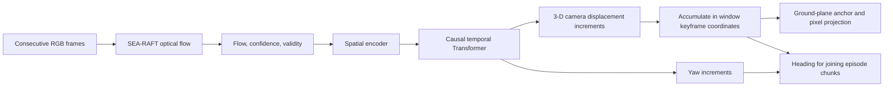

> Superseded evidence state: this earlier review predates recovered yaw artifacts and strict-loader repairs. Current results: [README.md](README.md).

# Task 2 review — 9 October 2026

Task 2's recorded objective is to reproduce GQFT and improve on locked-test ADE **9.630945 px**. Baseline reproduction is supported by saved results and the released checkpoint. Completion of the improvement objective is **not yet verifiable from the local artifacts**. Spatial + Yaw may have a completed server run, but its checkpoint, training record, validation sweep, and locked-test evaluation are missing locally.

This review covers the local Task_2 workspace. The ISL server was not contacted, no training or dataset evaluation was launched, and existing model/source/results files were left unchanged.

## What is actually completed

| Experiment | Evidence available | Verified result | Status |
|---|---|---|---|
| Released baseline | Checkpoint, server/laptop test JSON, validation history sweep | Test ADE 9.630945 px; FDE 15.847433 px; validation selects history 24 | Reproduced |
| `gqft_aug_v1` | Checkpoint, training log, validation sweep | Best training-time val ADE 9.093834 px; history metrics exactly match the released baseline | No measured improvement in these records |
| `gqft_aug_20260909_101417` | Checkpoint and training log | Best training-time val ADE 8.775427 px at step 5000 | Improvement on training-time validation; no final evaluation established here |
| `gqft_aug_v2` | Checkpoint, training log, validation sweep | Best training-time val ADE 8.737493 px; validation selects history 20 | Candidate with no local locked-test JSON |
| Spatial Attention | Validation/test JSON and written report | Val ADE at history 24: 10.376299 px versus baseline 11.316799 px; test ADE 10.090982 px, FDE 16.591120 px | Better validation ADE; worse test ADE/FDE; validation history selection returns null |
| Spatial + Yaw | Current source, four episode prediction JSONs, overlay images, progress claim | Claimed test ADE 8.78 px and FDE 14.21 px have no supporting local metric JSON/checkpoint | Implementation and qualitative artifacts exist; quantitative completion unverified |

Training-time validation and the fixed-history evaluation sweep use different window/history protocols. For example, baseline **9.093834 px training-time val ADE** and **11.316799 px fixed-history-24 val ADE** are different measurements. Compare candidates using the same evaluation protocol.

## Where we are stuck

### 1. The latest result cannot be traced to an experiment

`gqft_algorithm_sharing_vivekananda/docs/Toshith_Sir/03_Progress_Tracker/progress_tracker.md` marks the goal achieved with Spatial + Yaw ADE 8.78/FDE 14.21. There is no local `runs/gqft_spatial_yaw_v1/best.pt`, corresponding configuration/log, validation sweep, or test metrics file. `tools/evaluate_vln_spatial_yaw.py` refers to that checkpoint on the server.

The four `results/gqft_spatial_yaw_idx*.json` files contain per-leg XY predictions for prerecorded episodes, not the locked-test ADE/FDE evaluation payload. They establish that predictions were saved, but cannot establish the claimed benchmark result by themselves. The 8.78 figure also resembles the augmentation run's rounded training-time validation ADE; this coincidence does not establish its provenance.

**Next action:** inspect the existing server run and recover its artifacts before choosing another experiment. Missing locally does not mean the server run never happened.

### 2. Current source and local checkpoints describe different architectures

`step2/models/gqft.py` now always creates learned spatial attention and a yaw head. All four local best checkpoints have neither attention nor yaw weights. Inference, evaluation, and initialization use strict `model.load_state_dict(...)`, so these older checkpoints cannot load into the current architecture once dependencies are available.

**Next action:** preserve explicit baseline, Spatial Attention, and Spatial + Yaw variants with matching checkpoint configurations/loaders. Do not bypass missing weights with `strict=False`: randomly initialized added heads would invalidate comparisons. Recover the exact source revision for each saved experiment and record checkpoint hashes.

### 3. Spatial Attention did not pass the recorded history-selection protocol

`results/spatial_attn_val.json` has `shortest_sufficient_history: null`. At history 24 its ambiguity is **0.142857**, exceeding the **0.05** limit. None of the saved candidate histories satisfies the full selection rule. Its saved test evaluation nevertheless uses history 24.

**Next action:** document this as an existing diagnostic result and failed selection gate. Keep the selection rule fixed for future candidates; a learned stopping head does not automatically solve this failure. Any fixed-history comparison should be explicitly distinguished from a run using a validation-selected history.

### 4. Some reports make invalid comparisons

The Spatial Attention report's claimed 31.1%/32.8% 3-D improvements compare baseline **validation** retrieval gaps (0.165466/0.344687 m) to Spatial Attention **test** retrieval gaps (0.113988/0.231663 m).

The actual comparison on the same test protocol is:

| Metric | Baseline test | Spatial Attention test | Relative change |
|---|---:|---:|---:|
| ADE (px) | 9.630945 | 10.090982 | +4.78%, worse |
| FDE (px) | 15.847433 | 16.591120 | +4.69%, worse |
| NN full-curve gap (m) | 0.105959 | 0.113988 | +7.58%, worse |
| NN endpoint gap (m) | 0.216270 | 0.231663 | +7.12%, worse |

NN gaps measure differences between ground-truth curves retrieved through embedding similarity; they are **not direct predicted-trajectory errors**. Lower ambiguity with only a few close embedding pairs also needs cautious interpretation.

The augmentation tracker's history table reproduces baseline numbers even though the actual aug_v2 JSON differs. Its selected history 20 is supported by the actual aug_v2 JSON.

**Next action:** rebuild the comparison tables directly from metric JSONs, with split, history, reference-window protocol, checkpoint, and query/point counts attached.

### 5. The local execution environment and data are incomplete

- The local `.venv` imports PyTorch 2.8.0+cu128 but importing the project fails with `ModuleNotFoundError: No module named 'numpy'`.
- The server manifest's `/data/robotics/toshith/rgbd_vo_dataset/hsgm_sequences` is absent locally.
- The laptop manifest's `data/hsgm_flow_cache` is also absent locally.
- Spatial + Yaw episode evaluation imports external HSGM/SEA-RAFT modules and uses hardcoded server paths.
- `verify_setup.py` and `tools/visualize_trajectory.py` are deleted in the working tree, while several instructions still refer to them.

**Next action:** use the existing ISL environment/data for full evaluation, or deliberately restore a complete local environment and cache. Confirm current server state rather than assuming the September paths and GPU availability still hold.

## What the current pipeline does

Yaw has supervision in the current training code and is used for joining chunks in `tools/evaluate_vln_spatial_yaw.py`. It is not directly passed into the ordinary pixel projection; any benchmark ADE improvement from yaw supervision would act through the shared learned representation. `infer_gqft.py` does not currently export yaw in its JSON.

The model reconstructs camera motion from observed RGB/flow. Saved path overlays do not establish obstacle avoidance or navigation success. The geometry explicitly assumes an infinite obstacle-free flat ground plane. Robot/controller integration is a separate completion criterion if the intended deliverable extends beyond the stated Task 2 benchmark.

## Process to finish, in order

1. **Recover the latest experiment evidence.** On ISL, inspect `runs/gqft_spatial_yaw_v1`, its best checkpoint/config/log, and existing validation/test JSONs. Copy the matching source revision and artifacts into the handoff. First establish whether test evaluation already occurred.
2. **Make all three architecture versions reproducible.** Restore strict compatible loaders, record source/config/checkpoint hashes, and check inference on validation data under the unchanged camera contract: 960x540, 135-degree HFOV, 1.2 m height, 30-degree downward pitch, 5 Hz, normalized 160x90 flow, 270 px extension.
3. **Build one truthful experiment table.** Compare baseline, augmentation, attention, and attention+yaw under matched validation settings. Include ADE/FDE, visibility/length, selected history and ambiguity, parameter count, latency, and results by motion family. Report direct 3-D/yaw errors separately from embedding retrieval diagnostics.
4. **Choose the branch based on recovered evidence.** If the claimed Spatial + Yaw test result is supported and matches the benchmark contract, package that result and finish the deliverable. If only training/predictions exist, run validation first. If validation fails, analyze validation failures and choose one controlled change; do not immediately stack adaptive history, uncertainty, and more data.
5. **Respect the existing test protocol.** For a new validated candidate, freeze its checkpoint/config/history before the permitted locked-test report. Avoid duplicate test runs or choosing changes from already inspected test examples. Keep exploratory episode overlays separate from held-out benchmark evidence.
6. **Finish the handoff.** Update `Task_2_Deliverable.md`, `ROADMAP.md`, `IMPROVEMENTS_TRACKER.md`, and the supervisor tracker to agree with the verified metrics. Include runnable commands, matching checkpoint/source, validation/test JSONs, ablations, representative figures, and limitations. Integrate and measure controller/navigation behavior if that is required by the final project scope.

**Recommended immediate work:** recover and verify the Spatial + Yaw server artifacts. The evidence gap and architecture mismatch should be resolved before investing in new training.

## Checks performed in this review

- Read local task/handoff/progress documents, model/dataset/training/evaluation/inference code, and episode tools.
- Parsed saved metric JSONs and all three augmentation training logs.
- Loaded all four local best checkpoint payloads on CPU and inspected configs/state keys.
- Verified released baseline SHA-256: `1cfc17e8403156384203c61e9f5ba8c730f4a36caa76987f188f77c00c36ea3d`.
- Confirmed older checkpoints lack the current attention/yaw parameters by comparing saved keys with source.
- Checked Python source syntax without importing the project: passed.
- Attempted a project import in the local environment: stopped by missing NumPy. No inference or dataset reevaluation was performed.
