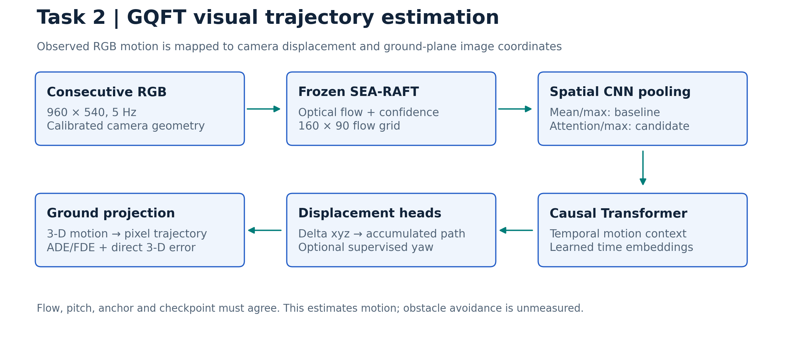
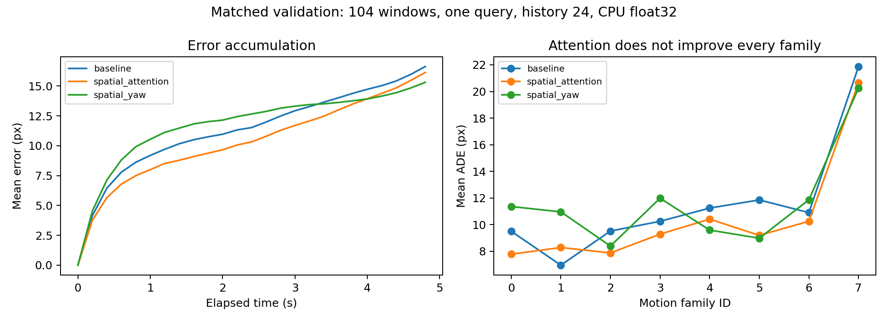
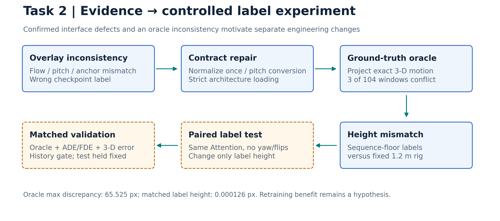

# Task 2 — GQFT trajectory estimation

**Solver analysis in one folder:** [SOLVER_REVIEW — start here](gqft_mask_review/SOLVER_REVIEW/START_HERE.html). Includes all solver PNGs, dashboards, raw analysis and reports from11–12 November.

**12 November consolidated handoff:** [GQFT approaches, results, research papers and next steps](gqft_mask_review/GQFT_APPROACHES_AND_RESEARCH.md) · [Word](gqft_mask_review/GQFT_APPROACHES_AND_RESEARCH.docx) · [PDF](gqft_mask_review/GQFT_APPROACHES_AND_RESEARCH.pdf). Read this for current status. The October and November pilots are complete. Central-floor frozen inference improves one-house validation but still fails the history gate; see [current status](gqft_mask_review/CURRENT_STATUS.md). Earlier dated notes below are preserved as history.

16 October: [Optional trainable confidence/ground-prior attention and yaw-local integration](gqft_mask_review/implementation_20261016/README.md) implemented and CPU verified. Default historical behavior remains bit-identical. Four matched pilot arms and an isolated server source bundle are prepared; no new training or deployment performed.

[Complete repository progress README and detailed GQFT file guide](REPOSITORY_PROGRESS_README.md) · [15 October GPU-2 masking isolation results](gqft_mask_review/ISOLATION_RESULTS.md) · [All source/documentation paths](REPOSITORY_FILE_INDEX.md).

Historical15 October result: [predeclared soft-attention trial](gqft_mask_review/SOFT_ATTENTION_RESULTS.md), retaining original max pooling, reduces validation ground mean 4.4917→4.4830 cm (0.19%) for the primary CNN-support policy. Coarse control gives 0.69%. Both sequence-level resampling intervals include zero; this is a small frozen-weight effect, not established generalization. No training launched; soft training requires its own explicit model mode.

Objective: reproduce the released GQFT baseline and improve visual trajectory estimation. Input is observed optical flow; outputs are camera displacement and ground-plane pixel trajectories, with optional yaw. Obstacle avoidance and language-navigation success are separate, unmeasured tasks.

## Problem and required fix

Trajectory quality varies across validation, test and episode overlays. The required fix is a consistent flow/camera/checkpoint/label contract, followed by a matched comparison that preserves the released benchmark.

## Model and data contract

`RGB → SEA-RAFT → normalized flow/confidence/validity → spatial CNN → causal Transformer → displacement increments → accumulated 3-D path → ground projection`.

Camera: 960×540, 135° HFOV, 1.2 m height, +30° downward-pitch convention, 5 Hz; flow grid 160×90; extended anchor region 270 px. Baseline pooling is mean+max; Attention replaces mean with learned weighted pooling and retains max. Yaw supervision adds a shared head and heading for episode joining.

## Attempts and outcomes

| Attempt | Change | Recorded outcome |
| --- | --- | --- |
| Baseline reproduction | Released source/checkpoint and camera contract | Test ADE/FDE 9.630945/15.847433 px |
| Historical horizontal flips | Mirror flow/query/3-D/pixel labels | Training-time best validation ADE 9.094 → 8.775/8.737 px; aug_v2 test improvement unestablished; branch discontinued |
| Spatial Attention | Learned regional aggregation | Better matched validation ADE; test regression; no valid selected history |
| Spatial + Yaw | Attention + supervised relative yaw | Recovered fixed-history test improvement; mixed matched validation results |
| Adapter audit | Normalize once, convert mounting-pitch sign, use trained anchor, strict checkpoint variants | Legacy flow/pitch/anchor defects and mislabeled augmented “baseline” overlays identified |
| Geometry oracle | Project exact ground-truth motion | Three of 104 validation windows conflict with fixed-height projection; maximum discrepancy 65.525 px |
| Controlled supervision plan | Attention without yaw/flips; vary only label ground plane | `sequence_floor` versus `fixed_rig` experiment specified; paired training pending |



## Quantitative comparison

Existing locked-test records, fixed reference/evaluation history 24:

| Model | ADE px ↓ | FDE px ↓ | Endpoint ≤10 px ↑ |
| --- | ---: | ---: | ---: |
| Baseline | 9.630945 | 15.847433 | 39.17% |
| Attention | 10.090982 | 16.591120 | 37.50% |
| Attention + Yaw | **8.783099** | **13.322794** | **45.00%** |

Yaw: 8.80% ADE / 15.93% FDE reduction. Historical validation selected history 12; test used 24; standardized validation selects 16. Eight yaw queries repeat the same anchor. This establishes a fixed-history result, not a completed selected-history benchmark or multi-seed generalization result.

Matched CPU float32 validation: scene `D7G3Y4RVNrH`, 104 windows, one query/window, reported history 24, reference 30, stride 5, no augmentation:

| Model | ADE px | FDE px | Direct mean 3-D error m | Selected history | Parameters |
| --- | ---: | ---: | ---: | --- | ---: |
| Baseline | 11.2625 | 16.6262 | 0.05197 | 24 | 3,986,823 |
| Attention | 10.2826 | 16.1270 | 0.04793 | None | 4,019,848 |
| Attention + Yaw | 11.6358 | 15.3053 | 0.05324 | 16 | 4,052,873 |

Selection: histories 4/8/12/16/20/24/30, ambiguity ≤0.05, retrieval tolerance 0.02. Embedding retrieval gaps are not direct 3-D prediction errors. Training-time validation, this CPU sweep, and test results use different protocols.

## Root-cause evidence and analysis-driven changes



The curves show point error at each timestep; they are not cumulative ADE. Motion-family averages expose regressions hidden by the aggregate score. [Plot interpretation and historical episode limitations](../docs/mid_evaluation/presentation/TASK2_VISUAL_ANALYSIS.md).

Cached flow was divided by 160/90 a second time in legacy episode tools. Habitat mounting pitch −30° was passed into a +30° downward-pitch geometry convention. Some “baseline” overlays used an augmented checkpoint. Corrected adapters and strict architecture inference remove these confounds.

Original labels use height above the sequence's first floor; inference uses fixed 1.2 m height. Exact 3-D motion gives worst-window history-24 oracle ADE 55.559 px; matching label height reduces maximum discrepancy to 0.000126 px. The optional `fixed_rig` mode is off by default and changes the annotation protocol, so its scores cannot replace the legacy benchmark.



## Next experiment and guidance needed

Supervisor feedback: investigate **masked spatial attention** to reduce unreliable motion evidence, and connect GQFT with VLM subgoals and RL locomotion. [Masking specification](MASKED_ATTENTION_PLAN.md) records existing masks, candidate changes and controlled evaluation. Frozen-weight hard masking was first tried on four episode 629 windows: mean ground error worsens 7.20→12.57 cm and mean pixel error worsens 33.18→43.38 px. These are diagnostic windows, distinct from the subsequent validation isolation below. All current local masking lab records, plots and summaries are consolidated in [gqft_mask_review](gqft_mask_review/README.md); keep future lab artifacts under `Task_2`. [Integration interfaces](../docs/INTEGRATION_PLAN.md) distinguish reconstructed camera motion from future waypoint planning. Matched masking training, history-selected masking evaluation and integration remain pending.

Completed 15 October: six frozen-weight pooling/support comparisons on GPU 2, over 104 validation windows and the same four episode windows. Validation ground mean is 4.492 cm original, 6.496 cm attention-mask only, 11.156 cm max-mask only, 25.113 cm joint hard mask and 4.758 cm when only rejected/RF-valid cells are reinstated. The direct neighbour perturbation control confirms valid neighbouring flow influences rejected features; input masking changes no cached values/features. Reinstating cells reverses most of the added error but still trails the original on aggregate validation. [Controls, projection failures and interpretation](gqft_mask_review/ISOLATION_RESULTS.md). No masking training or locked-test rerun occurred.

Current hypothesis: consistent projection supervision should reduce conflicting pixel/3-D objectives; regional flow aggregation remains useful but does not uniformly improve turning. Pending: paired label experiment, matched masking training/history gate, isolated yaw ablation and waypoint/controller integration. Pooling/support failure isolation is now complete for the fixed checkpoint and reported protocols.

## Source and verification

Source: [model](gqft_algorithm_sharing_vivekananda/step2/models/gqft.py), [strict loader](gqft_algorithm_sharing_vivekananda/step2/checkpoint.py), [episode contract](gqft_algorithm_sharing_vivekananda/step2/episode_contract.py), dataset/train/evaluation modules in `step2/`; CPU audits in `tools/`. [Detailed failure analysis](gqft_algorithm_sharing_vivekananda/docs/FAILURE_ANALYSIS.md) · [Metric snapshots](../docs/mid_evaluation/evidence/task2/summary.json).

```bash
cd Task_2/gqft_algorithm_sharing_vivekananda
CUDA_VISIBLE_DEVICES='' .venv/bin/python tools/verify_cpu_contracts.py
```

CPU checks cover strict variant loading, output equivalence to historical architectures, normalized-flow preservation, pitch/axis conversion, and contradictory configuration rejection. Dataset-dependent checks require the external cache. Training/inference weights are not included in the documentation evidence snapshots.

Guidance needed: preserve `sequence_floor` as the legacy benchmark while evaluating `fixed_rig` separately; select one camera/history/query protocol before paired training. Report pixel ADE/FDE, direct 3-D error, projection-oracle consistency and the history-selection gate. Upstream flow: [SEA-RAFT, ECCV 2024](https://www.ecva.net/papers/eccv_2024/papers_ECCV/html/1065_ECCV_2024_paper.php). GQFT is the supplied project codebase; no verified external paper venue is assigned to it.

Transformer details: [code-derived analysis](../docs/mid_evaluation/GQFT_TRANSFORMER.md), [complete pipeline SVG](../docs/mid_evaluation/diagrams/gqft_pipeline_detailed.svg), [temporal encoder SVG](../docs/mid_evaluation/diagrams/gqft_transformer_detail.svg). The query enters projection/validity after motion encoding; it is not a Transformer input.


Latest frozen-inference work: [12 November motion controls and paired visuals](gqft_mask_review/motion_fixes_20261112/README.md). [Open comparison](gqft_mask_review/motion_fixes_20261112/comparison.html). Central floor improves validation trajectory error; the history gate remains unsatisfied. Height correction is complete only for the five unambiguous recordings; original artifacts are retained.
