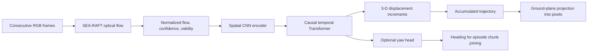
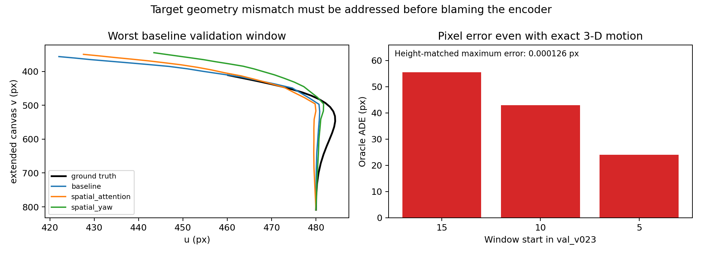

# Task 2 — GQFT reproduction, improvements, and failure analysis

**Mid-evaluation status, 10 October 2026:** the released baseline is reproduced. A recovered Spatial + Yaw test record improves fixed-history-24 ADE by **8.80%**, with a history-selection caveat. Recent analysis also identifies adapter and supervision defects that must be separated from model error.

[Project overview](../README.md) · [Portable quantitative evidence](../docs/mid_evaluation/evidence/task2/summary.json) · [Detailed failure analysis in the local model checkout](gqft_algorithm_sharing_vivekananda/docs/FAILURE_ANALYSIS.md)

## Objective and pipeline

Reproduce the released Ground Query Flow Transformer (GQFT) and investigate improvements over **9.630945 px locked-test ADE**. This component estimates camera motion and a projected ground trajectory from observed frames. It does not itself parse language, prove obstacle avoidance, or execute a robot navigation policy.



The preserved camera/data contract is 960 × 540 RGB, 135° horizontal field of view, 1.2 m mounting height, 30° downward pitch, 5 Hz sequences, normalized flow resized to 160 × 90, and a 270 px extended query region. Translation and pixel-projection semantics must stay consistent across training, inference, and evaluation.

## Attempts and outcomes

| Attempt | Hypothesis / intervention | Observed outcome | Interpretation |
| --- | --- | --- | --- |
| Released baseline reproduction | Recreate inference and evaluation from Sir's handoff | ADE 9.630945 px, FDE 15.847433 px; released checkpoint identified by SHA-256 | A quantitative reference exists |
| Historical horizontal-flip augmentation | Reduce left/right bias with transformed flow, queries, motion, and targets | Best training-time validation ADE: 9.0938, 8.7754, 8.7375 px across three recorded runs; no final locked-test improvement established for aug_v2 | Historical validation progress only; this branch is discontinued and archived |
| Spatial Attention | Replace uniform mean pooling with a learned weighted sum; retain max pooling | Better matched CPU validation ADE, but locked-test ADE 10.090982 px; validation history gate fails | Regional selection is useful in some cases, but this experiment does not improve the test benchmark |
| Spatial + Yaw | Add supervised yaw prediction to the shared representation and use heading in episode joining | Recovered fixed-history-24 test ADE 8.783099 px, FDE 13.322794 px | Best saved test pixel result, with protocol limitations below |
| Reproduce validation failures | Match windows/query/history/precision across the three architectures | Attention improves mean validation ADE; yaw improves FDE but worsens mean ADE at history 24 | A single aggregate test result does not establish uniform improvement |
| Audit flow and camera adapters | Compare episode preprocessing with the training contract | Double-normalized flow, opposite pitch convention, wrong query anchor, and a misnamed augmented “baseline” were identified | Historical overlays are unreliable evidence of model-to-model navigation improvement |
| Audit projection using exact 3-D labels | Test whether perfect motion can reproduce target pixels | Fixed-height projection disagrees with three validation windows; maximum oracle pixel discrepancy 65.525 px | Part of the observed error comes from inconsistent supervision geometry |
| Plan controlled ground-plane supervision | Compare `sequence_floor` and `fixed_rig` labels, holding architecture and training settings fixed | Experiment plan and CPU contract checks exist; new paired training is not recorded as completed | Next controlled experiment, not an achieved improvement |

Active experiments use **no horizontal flipping**. The augmentation numbers describe preserved history only. The nested checkout's [AGENTS.md](gqft_algorithm_sharing_vivekananda/AGENTS.md) records its current experiment boundaries.

## Saved locked-test results — fixed history 24

These are existing records recovered by the October audit, not evaluations rerun for this README. ADE is mean displacement error over evaluated trajectory points; FDE is endpoint displacement error. Lower is better.

| Model | ADE (px) | FDE (px) | Endpoint within 10 px | ADE change vs baseline |
| --- | ---: | ---: | ---: | ---: |
| Released baseline | 9.630945 | 15.847433 | 39.17% | Reference |
| Spatial Attention | 10.090982 | 16.591120 | 37.50% | 4.78% worse |
| Spatial + Yaw | **8.783099** | **13.322794** | **45.00%** | **8.80% better** |

Spatial + Yaw's FDE reduction is **15.93%**. Its saved JSON has 960 queries / 24,000 visible points versus 120 / 3,000 for the other models; the later audit reports that the eight queries repeat the same extended anchor, so these are not eight independent tasks. All use test reference history 24.

**Protocol caveat:** historical yaw validation selected history 12, while the test record used 24. The later standardized validation sweep selects 16. Report the test improvement as a **fixed-history-24 comparison**, not a completed validation-selected-history benchmark. Attention also has no valid selected history. No confidence interval or multi-seed improvement claim is established.

Portable copies of the three original test JSONs are in [the evidence directory](../docs/mid_evaluation/evidence/task2/). Their original paths and SHA-256 hashes are in [the evidence manifest](../docs/mid_evaluation/evidence/task2/manifest.json).

## Matched CPU validation analysis

One validation scene (`D7G3Y4RVNrH`), 104 windows, one query/window, reported history 24, reference history 30, stride 5, CPU float32, no augmentation. This differs from historical GPU/training-time validation and must be reported separately.

| Model | ADE (px) | FDE (px) | Direct mean 3-D trajectory error (m) | Selected history | Parameters |
| --- | ---: | ---: | ---: | --- | ---: |
| Baseline | 11.2625 | 16.6262 | 0.05197 | 24 | 3,986,823 |
| Spatial Attention | **10.2826** | 16.1270 | **0.04793** | None | 4,019,848 |
| Spatial + Yaw | 11.6358 | **15.3053** | 0.05324 | 16 | 4,052,873 |

The fixed history grid is 4, 8, 12, 16, 20, 24, 30. Selection retains ambiguity ≤0.05 and retrieval tolerance 0.02. Attention improves matched ADE by about 8.7%, but constant-arc ADE worsens from 6.961 to 8.285 px, and turning-window FDE worsens from 17.593 to 18.120 px. This is a mixed outcome, not evidence that attention solves all turns.


The saved CPU time per history-30 window is about 73.9–74.7 ms across models. This is a local model-analysis measurement, excluding optical-flow generation and full navigation execution; it is not end-to-end latency.

## Confirmed defects and what was repaired

1. **Flow normalization:** cached SEA-RAFT output is already normalized by original image dimensions. Legacy episode tools divided again by 160/90. The corrected adapter preserves normalized values and masks invalid vectors.
2. **Pitch / anchor contract:** Habitat mounting metadata uses −30°, while the learned downward-pitch convention uses +30°. The adapter converts the sign explicitly and uses the trained extended anchor. A one-metre-forward check changes from an incorrect 0.5 m to 1.0 m.
3. **Baseline provenance:** historical “baseline” episode tools loaded an augmented checkpoint. Those tools and overlays are preserved as historical artifacts; they are not a verified released-baseline comparison.
4. **Label/projector inconsistency:** original pixel labels use height above the sequence's first floor; inference assumes a fixed 1.2 m mounting height. Three of 104 validation windows differ by more than 1 cm. At the worst window, exact 3-D motion still yields history-24 oracle ADE 55.559 px. Matching the label height reduces maximum disagreement to about 0.000126 px. This is a demonstrated contract inconsistency, not a universal lower bound on model ADE.
5. **Checkpoint compatibility:** current `step2/checkpoint.py` detects mean/max, attention/max, and yaw architectures and loads strictly. Older descriptions of an unresolved loading mismatch predate this repair.



The optional `fixed_rig` label mode is **off by default**. Scores under repaired annotations must stay separate from the released benchmark. Nearest-neighbour embedding curve gaps are retrieval diagnostics, not direct 3-D prediction errors; earlier claims comparing validation gaps with test gaps are superseded.

## Code, evidence, and reproduction

| Location | Role |
| --- | --- |
| `gqft_algorithm_sharing_vivekananda/baseline/released_gqft/` | Preserved source, released checkpoint, baseline metrics |
| `.../step2/` | Model, geometry, data, training, evaluation, strict checkpoint loader |
| `.../runs/gqft_spatial_attention/`, `.../runs/gqft_spatial_yaw_v1/` | Recovered run artifacts |
| `.../analysis/` | Validation comparisons, geometry audit, contract verification, figures |
| `.../archive/` | Discontinued flips and superseded episode tools/reports |
| [CODEBASE_REFERENCE.md](CODEBASE_REFERENCE.md) | Earlier implementation walkthrough; cross-check with current source |
| [ROADMAP.md](ROADMAP.md) | Work tracker; use this report and the failure audit for result interpretation |

The model checkout is a separate Git repository represented by a gitlink in the parent repository; current local source/results include uncommitted work. The portable evidence bundled with this documentation does not update that gitlink or publish its source changes.

On ISL, the current model README records CPU-only analysis commands below. They require its existing data, compatible Python environment, and writable private project directory. They were not run again for this documentation review.

```bash
cd /data/robotics/toshith/vivekananda/gqft_algorithm_sharing_vivekananda
export PYTHONPATH="$PWD"
export PYTHONDONTWRITEBYTECODE=1
export CUDA_VISIBLE_DEVICES=''
export TMPDIR="$PWD/maintenance/tmp"
GQFT_PY=/data/robotics/toshith/envs/hsgm/bin/python
$GQFT_PY tools/verify_cpu_contracts.py
$GQFT_PY tools/analyze_failure_conditions.py --threads 2 --batch-size 4
$GQFT_PY tools/audit_label_geometry.py
```

## Next work and evaluation claim

Freeze provenance and validation protocols; run the paired label-consistency study after arranging its compute; report both annotation protocols and history-selection outcomes; then measure controller/navigation integration separately. Preserve the released baseline and choose new changes using validation evidence.

**Presentation statement:** “We reproduced GQFT, explored augmentation and attention/yaw variants, recovered an 8.8% fixed-history test ADE improvement, and isolated preprocessing and supervision defects. The result is a trajectory-estimation study; end-to-end language navigation remains to be evaluated.”
