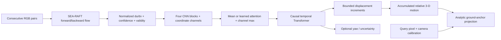

# Repository implementation, progress and next experiments

**GQFT updated: 19 October 2026; other task snapshots: 16 October.** This is the consolidated technical progress README for the whole workspace, with a detailed GQFT implementation guide. It lives in `Task_2` so the current lab work stays together.

The repository contains working component implementations for visual motion estimation, quadruped simulation/control, repaired indoor observations, and manual language/memory navigation data collection. **The components have not yet been evaluated as one autonomous VLM–GQFT–RL navigation system.** Training curves, scene renders, saved demos and human demonstrations establish different things; their results are separated below.

The latest source implementation adds **optional trainable confidence/ground-prior spatial attention and yaw-local integration**. Fifteen new CPU checks plus legacy checks pass. All four 500-step pilot arms completed on GPU 7. Matched validation at H24 favors yaw-local alone (ADE 11.3485 px versus pilot reference 12.4626 px), but both yaw-local arms fail the history gate. Masking worsens ADE within each integration mode. Retain the original checkpoint as working reference and diagnose ambiguity before a long combined run. [Completed pilot report](gqft_mask_review/pilot_results/20261019T101035Z_431613/validation_20261019T104120Z/REPORT.md), [implementation](gqft_mask_review/implementation_20261016/README.md).

## Reading map

| Need | Start here |
| --- | --- |
| Current implementation, progress, measured limits and future plan | This README |
| Interactive trained-model camera overlays, motion/error charts, attention and validation/history | [Offline comparison dashboard](gqft_mask_review/dashboard.html), [controls/source guide](gqft_mask_review/dashboard/README.md) |
| Exact masking experiment, controls, numbers and readable plots | [Masking isolation results](gqft_mask_review/ISOLATION_RESULTS.md) |
| New soft-attention policy, small gains, uncertainty and training boundary | [Soft-attention results](gqft_mask_review/SOFT_ATTENTION_RESULTS.md) |
| Earlier four-window masking review and preserved inputs | [Masking lab README](gqft_mask_review/README.md) |
| Every indexed source/configuration and Markdown path | [Repository file index](REPOSITORY_FILE_INDEX.md) |
| All included filenames, byte sizes and categories | [Full file inventory CSV](repository_inventory.csv) |
| Inventory scope, exclusions, directory totals and timestamp | [Inventory summary](repository_inventory_summary.json) |
| GQFT historical results and protocol boundaries | [Task 2 README](README.md) |
| Proposed component interfaces | [Integration plan](../docs/INTEGRATION_PLAN.md) |
| Presentation material | [Mid-evaluation PDF/script](../mid-eval/README.md), [slide text](../docs/mid_evaluation/presentation/SLIDE_TEXT.md) |

The generated inventory covers roughly 11,000 local files, including nested source repositories and retained artifacts. It excludes Git internals, private application state, environments, caches and browser profiles, and does not follow symlinks. Presence in the inventory is **not** a claim that every source file was audited or executed. External server datasets and assets are described here but are not enumerated by the local inventory.

## 1. Repository map and ownership

```text
VLM_Based_Robot_Navigation/
  README.md                       overview and selected evidence
  workflow.md                     project workflow
  .gitmodules                     three independently versioned source repositories
  Task_1_Simulator_Evaluation/     Go2/Genesis feasibility prototype
  Task_2/                         GQFT research, current masking lab, this report
    gqft_algorithm_sharing_vivekananda/   GQFT source repository
    gqft_mask_review/              canonical local masking artifacts and analysis
  Task_3/                         SvanM2 MoE control and jitter investigation
    xterra_mjlab/                  independent locomotion source repository
    tools/, notes/                analysis, experiments, explanations
  Task_4/                         kitchen mesh/PBR repair and Gaussian observations
  Task_5/                         dataset audits, manual collector, route/scenario work
  docs/                           integration plan, evidence, diagrams, presentation
  mid-eval/                       user-designed PDF and speaking script
  genesis-world/                  independent Genesis dependency/assets
  reference_materials/            papers, notes, agreements and preserved references
```

GQFT, `xterra_mjlab` and Genesis are submodules with their own Git histories. A parent commit does not automatically publish child source changes. Checkpoints, cached flow, raw sessions, scene models and videos may be local runtime inputs rather than tracked source. No commits, pushes or service deployments were performed for this report.

All new local masking work belongs in `Task_2/gqft_mask_review`. On ISL, the corresponding scripts/results are inside `/data/robotics/toshith/vivekananda/gqft_algorithm_sharing_vivekananda/gqft_mask_review`; earlier probes remain under that project's `analysis/`. Shared environments, datasets and released-baseline artifacts are preserved.

## 2. Progress across all tasks

| Area | Implemented / demonstrated | Remaining acceptance gap |
| --- | --- | --- |
| Task 1: simulator | Go2 visual office prototype, observation/action adapter, stand/walk control | Furniture collision proxies, measured memory/latency and collision correctness |
| Task 2: GQFT | Baseline reproduction; Attention/Yaw models; strict adapters; label oracle; optional hard masking; paired pooling/cell-restoration isolation | Validated improvement under one history/label protocol; matched training; robot camera/state interface |
| Task 3: locomotion | MoE checkpoint execution, target bounds, coupled PD, passive recording, reward/contact/solver investigations | Verified deployed actuator/reset/sensor contract; repeatable traversal and tracking; hardware cause/fix |
| Task 4: observations | Calibrated kitchen repairs, product/PBR assets, synchronized comparisons, separate Gaussian/physics services | Final held-out appearance/depth, comprehensive collisions and full RGB-D latency |
| Task 5: data and scenarios | Dataset distance audit; selectable manual collector; recorded human samples; long-route review; two-bag placement scenario | Autonomous policy/VLM inference, concurrent collector instances, route feasibility and integrated scenario evaluation |
| End-to-end navigation | Interfaces and milestones written | Grounded subgoal → checked local route → bounded controller command → measured success/collisions/latency |

“Implemented” means the source exists; “demonstrated” refers to the cited saved experiment. This report does not imply that every historical server/dashboard is currently running.

## 3. Task 2 — what GQFT actually does

GQFT reconstructs **observed camera motion** from optical-flow history. It predicts a relative 3-D displacement curve and projects it onto an anchor-dependent ground-plane image path. Its output is not, by itself, a future collision-free navigation route or a robot foot trajectory.



The query does **not** enter the temporal Transformer. It enters analytic projection and a separate learned validity head after motion encoding. The optional yaw head predicts relative heading; the analytic displacement projector does not use yaw to rotate each increment.

### 3.1 Data, camera and split contract

| Contract | Current released-data / diagnostic setting |
| --- | --- |
| RGB | 960×540; horizontal FOV 135° |
| Intrinsics | `fx=fy=198.82250993908562`, `cx=480`, `cy=270` |
| Camera mounting | 1.2 m height, +30° downward-pitch geometry convention |
| Capture | HSGM generated sequences use 5 Hz |
| Cached flow | 160×90; normalized `du/W`, `dv/H`; normalize once |
| Input channels | `[du, dv, confidence, validity]`, plus two structural XY channels in the CNN |
| Extended canvas | 960×810; common anchor `(480,809)` |
| Train | 144 sequences from `17DRP5sb8fy`, `5q7pvUzZiYa`, `VLzqgDo317F`, `mJXqzFtmKg4` |
| Validation | 26 sequences from `D7G3Y4RVNrH` |
| Locked test | 24 sequences from `TbHJrupSAjP`; reporting only |
| Matched validation windows | Reference history 30, stride 5, four starts per sequence → 104 windows |

Recorded episode PNGs are consecutive, with no resampling; their original timing must be verified before treating them as a 5 Hz benchmark. Habitat mounting −30° and GQFT downward-pitch +30° describe the same mount using different conventions. Generic dataclass defaults are not the released HSGM configuration: use the checkpoint/manifest camera.

`cache_searaft.py` performs forward/backward consistency checks. Full-resolution validity requires an in-image endpoint, finite confidence and cycle error no greater than `0.5 + 0.05 * flow_magnitude`. Confidence combines the forward/backward uncertainty scales. Area downsampling marks a cache pixel valid when at least 75% of its source region is valid, and zeroes invalid flow and confidence.

This existing **flow-cache mask** precedes the new **CNN feature-cell mask**. They are different stages. Neither is semantic segmentation of people, walls, doors or background.

### 3.2 Model internals

The trained Attention+Yaw checkpoint used in the isolation run has a 256-D representation, four causal temporal layers, eight heads and maximum history 30.

The spatial encoder has four `Conv2d(3×3, stride=2, padding=1)` → GroupNorm → GELU blocks with channels `6→32→64→128→256`. A 90×160 input becomes a 6×10 feature map. Each cell's local convolution footprint spans up to 31×31 input pixels, with 16-pixel centre spacing. GroupNorm additionally mixes spatial statistics, so the network's actual functional dependency is not strictly local.

Original pooling concatenates either spatial mean or learned attention-weighted pooling with **per-channel global max pooling**, then applies a learned linear layer to produce one token/frame. The attention variant learns a 1×1-convolution scoring network and softmax over 60 cells. Max pooling independently retains each channel's strongest spatial response; it is not the same operation as attention.

Time embeddings feed a causal Transformer with padding masks. `tanh(delta_head) * max_step_m` bounds each component of each motion increment; cumulative sums produce `T+1` poses including the zero origin. The optional yaw head similarly accumulates bounded yaw increments. Uncertainty/log-variance and learned validity are separate outputs.

The loss includes displacement, increment uncertainty, projected path, endpoint, visibility and optional yaw terms. The geometric projector intersects the query ray with the assumed ground plane, adds predicted camera displacement and projects to pixels. Analytic validity keeps a cumulative prefix: after the first canvas/depth failure, later points remain invalid even if raw coordinates return inside the canvas.

### 3.3 Source-by-source guide

Paths below are relative to `Task_2/gqft_algorithm_sharing_vivekananda`.

| Source | Implemented responsibility |
| --- | --- |
| `step2/capture_hsgm_habitat.py` | Habitat camera setup, motion families, trajectory capture, RGB/pose/calibration metadata |
| `step2/cache_searaft.py` | SEA-RAFT loading, forward/backward consistency, confidence, downsampling, normalized-flow cache |
| `step2/make_hsgm_manifest.py` | Scene-isolated train/val/test manifest and data/camera/readiness checks |
| `step2/dataset.py` | Cached sequence loading, temporal windows, query sampling, motion/yaw/pixel labels, explicit label ground plane, padded collation |
| `step2/geometry.py` | Camera model, rotations, ground-ray intersection, NumPy target projection and Torch inference projector |
| `step2/models/gqft.py` | CNN, pooling variants, optional reliability masks, causal temporal encoder, output heads and loss |
| `step2/checkpoint.py` | Architecture inference/consistency checks and strict checkpoint loading |
| `step2/episode_contract.py` | Normalized-flow packing, pitch/camera/axis contract and episode adapter utilities |
| `step2/train_gqft.py` | AdamW, schedule, AMP/DDP support, validation/checkpointing, explicit variant/mask/label flags and GPU guard |
| `step2/metrics.py` | Path ADE/FDE, endpoint thresholds, validity/length statistics and loader evaluation |
| `step2/history_study.py` | Matched reference-task history comparisons and cross-sequence signature ambiguity/retrieval selection |
| `step2/evaluate_gqft.py` | Strict checkpoint evaluation, history sweep, validation selection, mask-coverage metadata export |
| `infer_gqft.py` | Cached-input inference/export with checkpoint-derived architecture, camera and reliability fields |
| `tools/analyze_failure_conditions.py`, `failure_analysis.py` | Matched variant comparisons, timestep/motion-family failures and regional diagnostics |
| `tools/audit_label_geometry.py` | Exact-motion projection oracle and height/ground-plane diagnosis |
| `tools/plot_failure_evidence.py`, `write_evidence_report.py` | Human-readable evidence plots and reports |
| `tools/probe_spatial_mask.py` | Frozen original/masked checkpoint comparison on a flow window; attention/mask maps and predictions |
| `tools/probe_episode_mask.py` | Per-leg recorded-frame selection, CPU/GPU SEA-RAFT cache, camera checks, timestamped paired probe |
| `tools/review_episode_mask.py` | Scores saved probes against recorded planar poses and produces interpretable ground/pixel/mask figures |
| `tools/verify_cpu_contracts.py` | Strict variants, preserved output equivalence, normalized flow, geometry and malformed-config checks |
| `tools/verify_spatial_mask.py` | Mask semantics, invalid corruption, empty observations, normalization, max branch, causality, precision and checkpoint checks |
| `tools/evaluate_vln_spatial_yaw.py`, `batch_infer.sh` | Retained episode/batch evaluation entry points; inspect protocol before reuse |
| `maintenance/prepare_controlled_runs.py` | Controlled paired-supervision preparation/dry-run plan |
| `maintenance/organize_project.py`, `archive_legacy_episode_tools.py` | Reversible organization and legacy-tool preservation |
| `verify_setup.py` | Setup/dependency checks |

### 3.4 GQFT directories and artifact meaning

| Directory | Contents / interpretation |
| --- | --- |
| `baseline/released_gqft/` | Protected released source, checkpoint/results and baseline README |
| `runs/` | Existing trained runs and checkpoints; availability is a runtime dependency |
| `checkpoints/` | Checkpoint inputs/snapshots; do not infer architecture from filenames alone |
| `results/` | Manifests, run configurations/logs, validation/history/test JSON and batch inference artifacts |
| `analysis/` | Adapter/geometry/episode diagnostics; large server artifacts may not all be local |
| `experiments/spatial_attention_v1/` | Preserved architecture and source provenance |
| `experiments/spatial_ground_plane_control_v1/` | Paired-label plan; training pending |
| `experiments/masked_attention_v1/` | Earlier mask implementation/run notes and evidence snapshots |
| `visualizations/` | Historical baseline trajectories and episode overlays; not a substitute for reference-scored metrics |
| `archive/` | Discontinued flips, legacy adapters/plots and pre-repair source; retained, not active experiments |
| `docs/` | Training/data/inference explanations, detailed failure analysis and earlier supervisor notes |
| `maintenance/` | Organization/preparation scripts and project-local runtime caches |
| `reference_materials/` | GQFT-related retained references |

Some older `docs/02_DATA_PIPELINE.md` and `docs/03_TRAINING_AND_EVALUATION.md` text describes earlier flip augmentation, historical line numbers and a three-GPU training recipe. **Active source and current reports take precedence.** The active dataset has no flip augmentation; current training flags support explicit masks/labels, and generic CLI defaults do not reproduce the historical run automatically.

## 4. Task 2 — what has been implemented and measured

### 4.1 Historical model results

Existing test records at history 24 are retained; no test rerun was performed for the masking isolation.

| Model | Test ADE px | Test FDE px | Status |
| --- | ---: | ---: | --- |
| Released mean+max baseline | 9.630945 | 15.847433 | Reproduced reference |
| Attention+max | 10.090982 | 16.591120 | Worse test result despite validation ADE gain |
| Attention+max+Yaw | 8.783099 | 13.322794 | Fixed-history improvement; selection/protocol caveats remain |

Matched earlier CPU validation at history 24 / reference 30 reported baseline ADE 11.2625, Attention 10.2826 and Attention+Yaw 11.6358 px. These figures include the origin in the average. The new masking isolation excludes the zero-error origin and therefore reports unmasked yaw pixel mean **12.1207 px**. Do not compare those two averages as if the model changed.

History selection remains a separate gate: earlier matched results select baseline 24, Attention none and Yaw 16 under that study's retrieval/ambiguity rules. A frozen history-24 masking ablation does not complete a selected-history benchmark.

### 4.2 Adapter and supervision defects

Implemented corrections address double normalization of already-normalized flow, mounting-pitch sign, anchor/canvas configuration and strictly matching checkpoint architecture. CPU checks compare current output with preserved historical architectures.

The projection oracle isolated a separate supervision problem: three of 104 validation windows use sequence-floor camera height inconsistent with inference's fixed 1.2 m height. The maximum exact-motion projection discrepancy is 65.525 px; matching annotation height reduces the maximum to approximately 0.000126 px. `fixed_rig` is implemented as an explicit optional annotation mode, while `sequence_floor` remains default. Paired training to measure its effect has **not** been performed.

### 4.3 Current masking definition

The production feature is optional and defaults to `spatial_mask='none'`:

1. Input eligibility: validity channel >0.5 and all four channels finite. Optional confidence mode also requires confidence at least the explicitly chosen threshold.
2. Zero all four input channels at rejected pixels; leave structural XY coordinates intact.
3. Encode the image with the unchanged CNN.
4. Adaptive-average-pool pixel eligibility to the 6×10 feature grid. Keep cells with coverage ≥0.75 in the current probes.
5. Remove rejected cells from attention softmax **and** from per-channel max pooling.
6. For no retained cells, return a finite zero observation token and expose an observation flag. Preserve its time slot so temporal history can still infer motion.

Exports include input/feature coverage, observation flags, masks and attention weights. No objects or semantic categories are labeled. No trainable parameters were added, old checkpoint configurations remain compatible, and default mask-off outputs are preserved. This hard-mask diagnostic used frozen weights; the later soft-mode training pilot is recorded in section 4.7.

### 4.4 Initial episode experiment

On the first 24 flow pairs of episode 629 legs 0/2/3/4, frozen hard masking worsened mean ground error **7.203→12.570 cm** and mean pixel error **33.182→43.380 px**. Leg 3 lost forward-motion magnitude: 1.115 m reference, 1.080 m original, 0.660 m masked endpoint.

The early plot hid later masked points after leg 0's cumulative validity gate stopped at pose 2. Review plots now distinguish raw continuations from accepted prefixes and score predictions on the same reference-valid points. An apparent pixel improvement in one window does not establish improved metric ground motion.

All 31 originally consolidated files are protected by the [import manifest](gqft_mask_review/import_manifest.json). The raw leg-0 probe, available raw images and full episode pose archive are local; raw probes for the other three legs remain on the server, with their review artifacts local.

### 4.5 New causal isolation: completed, GPU 2

The same trained Attention+Yaw weights, CNN features, history, camera and query are reused in six policies. The original and joint-mask encoders match the production implementation bit for bit; all four episode original/joint predictions exactly match the previously saved probes. **Input masking changed zero cached inputs and zero CNN features in all 108 windows.**

| Intervention | Validation ground mean cm | Validation ground endpoint cm | Episode-629 ground mean cm |
| --- | ---: | ---: | ---: |
| Original pooling | 4.492 | 8.999 | 7.203 |
| Mask attention only | 6.496 | 16.270 | 7.357 |
| Mask max only | 11.156 | 26.003 | 9.490 |
| Mask both, current rule | 25.113 | 69.676 | 12.570 |
| Restore only rejected/RF-valid cells in both branches | 4.758 | 10.595 | 6.485 |
| Replace eligibility with convolution-footprint coverage | 4.798 | 10.896 | 6.302 |

Validation protocol: 104 windows from `D7G3Y4RVNrH`, reference 30, evaluated history 24, stride 5, one anchor, seed 20260820, `sequence_floor` labels, float32 and no augmentation. There are 2,496 post-origin target-valid pixel points; the episode comparison has 96. Threshold 0.75 is held fixed, not fitted to episode 629.

**Demonstrated findings:**

- Max-branch masking causes a larger individual aggregate regression than attention masking with this frozen checkpoint.
- The joint intervention has a harmful error-level interaction; its effect is larger than the sum of the two individual error changes.
- Restoring only coarse-rejected cells with ≥75% valid convolution support reverses **98.71% of the added validation ground error** in this experiment.
- A rejected cell responds to valid flow outside its adaptive mask bin but inside its convolution footprint. For leg 0/frame 9, the bin is 74.17% valid, the footprint 88.00% valid, and this one cell carries 82.09% of original attention. Perturbing 504 such neighbouring valid pixels changes its features; an equally sized outside-footprint control has zero effect with GroupNorm statistics frozen.
- Restored cells improve the four episode windows overall, but remain **5.93% worse than original on aggregate validation ground mean**. Episode improvement alone does not justify adoption.

The direct neighbour test establishes local flow influence. The restoration experiment establishes a causal effect of reinstating those feature cells. It does not assign all recovery exclusively to neighbouring flow: feature cells also contain coordinate and normalization information. GroupNorm's global dependence is measured separately. “All rejected cells are noise” is contradicted by the evidence; “all rejected cells should be kept” is also unestablished.

The current joint mask also causes 77 nonpositive-depth predictions on validation. The projector's Z clamp makes its raw pixel mean enormous; these are failed projections, not ordinary visible-image distances. Ground error, depth failure counts, median window pixel error and the unchanged shared scoring domain are recorded in the [full report](gqft_mask_review/ISOLATION_RESULTS.md).

The RF/restoration policies are **analysis-only interventions**. They are not silently installed as production behavior. The active model mask defaults to `none`, the released baseline is untouched, and no new checkpoint was trained.

### 4.6 Soft attention with original max retained: completed

The policy was declared before inference: multiply original attention by `0.25 + 0.75 * valid_coverage`, then renormalize. Primary coverage uses the 31×31 convolution footprint; coarse adaptive-grid coverage is a control. All cells retain some reliability weight. Max pooling and original CNN inputs/features stay unchanged. Spatially constant coverage preserves original behavior bit for bit.

| Frozen policy | Validation ground mean cm | Ground endpoint cm | Pixel mean px | Ground-mean change |
| --- | ---: | ---: | ---: | ---: |
| Original | 4.491709 | 8.999301 | 12.120684 | Reference |
| Hard attention only | 6.496007 | 16.270056 | 16.043385 | Worse |
| Soft coarse control | 4.460674 | 8.907689 | 12.071960 | 0.691% lower |
| Soft CNN-support primary | 4.483005 | 8.983151 | 12.107598 | 0.194% lower |

The primary passes its numerical guardrails but the mean ground gain is only **0.087 mm**. It improves 53/104 windows and 14/26 sequence averages. Resampling sequence averages, preserving their overlapping windows, gives a 95% percentile interval for its ground-error change of **−0.214 to +0.043 mm**. The control interval also includes zero. This is exploratory within-one-scene sensitivity, not a cross-scene estimate.

Nine CPU checks and downloaded-artifact checks passed. Original/hard-control validation metrics exactly reproduce the preceding experiment; max pooling stays bit-identical. No depth or prefix failures were added. Episode mean ground error is 7.20305→7.18910 cm for the primary, with two of four windows improving.

No floor sweep, episode tuning or retrospective primary switch was performed. The control's larger observed gain is reported without promoting it after viewing results. The subsequent differentiable soft modes and matched training pilot are recorded below. `--spatial-mask validity` performs hard joint masking and does not train this soft policy. [Complete frozen trial report](gqft_mask_review/SOFT_ATTENTION_RESULTS.md).

### 4.7 Trainable priors and yaw-local integration: source implemented

New spatial modes `soft_validity`, `soft_confidence` and `soft_confidence_ground` bias attention with floored valid/confidence evidence and optional calibrated ground-ray support. They retain original max pooling, support adaptive or convolution-footprint coverage, and optionally hard-gate attention below an explicitly configured coverage threshold (default zero). Ground-ray support is a hypothetical geometric prior, not actual floor segmentation. Existing hard modes and mask-off default remain supported.

`motion_integration='yaw_local'` with `predict_yaw=True` rotates bounded local increments by **previous predicted yaw about the pitched camera's world-up axis** before summation. Local NLL targets use inverse rotation with previous ground-truth yaw; displacement/path targets remain camera0. Existing labels already have keyframe-frame displacement, so old cumsum is correct and remains default. There is no silent reinterpretation of old checkpoints.

CLI, config persistence, inference exports and strict warm-start guards are implemented. A change of increment frame requires explicit `--reinitialize-motion-heads`, preserving freshly seeded delta/logvar heads while strictly loading backbone/yaw weights. Resume requires matching configuration. Fifteen CPU checks cover sign/axis/targets, gradients, bfloat16, empty frames, strict checkpoint round trip and agreement with the earlier real-checkpoint soft-validity probe; legacy output checks still pass.

Completed 19 October: reference, confidence/ground mask only, yaw-local only, both. All arms predict yaw and initialize identical reset motion heads. Each completed 500 steps, batch 6, seed 20260820, with matching data/labels/history/optimizer. The staged source remains under the server lab; the original server code was not replaced. [Implementation, source bundle and commands](gqft_mask_review/implementation_20261016/README.md).

Matched validation used 104 windows from 26 sequences, reference history 30, one extended anchor, sequence-floor labels and CUDA bfloat16 autocast on GPU 7. H24 ADE/FDE (px): reference **12.4626/17.4344**; masking only **12.8267/18.8231**; yaw-local only **11.3485/13.3930**; combined **11.8091/14.1293**. The original pretrained yaw checkpoint scores **11.6926/15.3060** under this same protocol, retaining its trained heads and different training budget. Training-time mixed-history ADE values (9.8412, 9.7691, 8.9469, 9.0909) are a separate protocol.

Selected histories among 4, 8, 12, 16, 20, 24, 30 are reference 16, masking 20, yaw-local none, combined none, original pretrained 16. At H24 yaw-local ambiguities are 0.1667 and 0.2000, above the 0.05 threshold. All checkpoints/source hashes and finite training streaks were checked; no empty-mask frames occurred. One seed and 500 steps do not establish generalization. Diagnose the yaw-local signature failures and repeat matched reference/yaw-only seeds before a larger budget. The locked test was not evaluated. [Full report and evidence](gqft_mask_review/pilot_results/20261019T101035Z_431613/validation_20261019T104120Z/REPORT.md).

### 4.8 Canonical masking lab files

```text
Task_2/gqft_mask_review/
  README.md                         initial four-window scored review
  ISOLATION_RESULTS.md              authoritative new experiment explanation
  summary.png/.csv/.json            initial review summary
  import_manifest.json              preserved imported-file hashes
  summarize_reviews.py              reproduces the initial aggregate review
  isolate_masking.py                frozen six-policy runner, validation/episode modes
  verify_isolation.py               CPU equivalence and neighbour-control checks
  write_isolation_report.py         verifies downloaded results; creates readable figures
  SOFT_ATTENTION_RESULTS.md         new soft trial, effect size and sequence sensitivity
  soft_attention_plan.json          immutable predeclared policy/protocol
  probe_soft_attention.py           original-max soft-attention diagnostic runner
  verify_soft_attention.py          normalization/limits/max/checkpoint-input controls
  write_soft_attention_report.py    artifact verification and sequence-block resampling
  soft_attention/20261015_gpu2_v1/   validation/episode reports, plots and verifications
  verify_trainable_attention.py     trainable modes: geometry, gradients, compatibility
  prepare_attention_pilot.py        writes commands/plan; never starts training
  implementation_20261016/          specification, CPU verification, staged-source bundle
  summarize_training_pilot.py       verifies matched configurations and builds pilot report
  pilot_results/                   preserved training logs, hashes and matched validation
  ep629/legNN/timestamp/             scored reviews; raw probe locally available for leg 0
  inputs/ep629/                     pose archive and available raw images
  evidence/                         earlier notes/provenance, preserved snapshots
  isolations/
    20261015_gpu2_pooling_v1/         earlier five-policy validation result, preserved
    20261015_gpu2_pooling_v2/         authoritative six-policy result
      episodes/, validation/        report.json, windows.jsonl, pooling_ablation.png
      neighbour_support.png         valid-neighbour vs adaptive-bin explanation
      restored_cells_paths.png      reference/original/hard-mask/restored ground paths
      verification.json             aggregate/domain/equivalence checks and artifact hashes
```

## 5. Task 1 — simulator prototype

[Detailed Task 1 report](../Task_1_Simulator_Evaluation/README.md).

`run_go2.py` loads the detailed office visual mesh without its expensive collision/convexification path, adds a supporting plane and executes a pretrained Go2 policy. It uses 45 observation values, 12 joint targets, joint-order remapping, stand/walk modes, `dt=0.02` and two physics substeps. Historical stand gains are 150/5 and walk gains 40/1.

The office prototype proceeded after the reported detailed collision-mesh OOM on the 4 GB platform, but no saved numerical memory trace isolates that bottleneck. Furniture remains visual rather than collision-valid. `videos/` holds the demo; `notes/INITIAL_EVALUATION.md` preserves the original investigation. Genesis assets and the compatible pretrained policy are external/local runtime dependencies.

Next: add simplified furniture collision proxies under a fixed controller/scene, measure peak VRAM and initialization/step/render latency, and verify obstacle collision behavior before a navigation claim.

## 6. Task 3 — SvanM2 MoE locomotion

[Detailed Task 3 report](../Task_3/README.md), [analysis-tool guide](../Task_3/tools/README.md), [latest gate/frequency audit](../Task_3/notes/24_GATE_FREQUENCY_AND_VLM_AUDIT_20261011.md).

The independent `xterra_mjlab` source provides strict checkpoint loading, a 225-D oldest-first history, eight softmax-weighted 32-D latent experts, a shared actor, 12 bounded targets and coupled PD/effort execution. The recorded control clocks are policy 50 Hz and PD 200 Hz. Current hip targets are ±0.735 rad and calf upper target −0.88776 rad; historical wider-contract successes must be kept separate.

| Source area | Responsibility |
| --- | --- |
| `xterra_mjlab/svanm2_moe_stair_sim/` | Checkpoint policy, controller, interactive execution and robot/control assets |
| `xterra_mjlab/scripts/` | Training/reward integration, target-rate and second-difference penalties |
| `tools/jitter_analysis/record.py`, `interactive.py` | Passive/protected recording and manual trial interface |
| `analyze.py`, `compare_policy_runs.py`, `compare_starts.py` | Matched signal, policy and start comparisons |
| `audit_control_loop.py`, `audit_gate_frequency.py`, `audit_target_rates.py` | Contract, network pathway/frequency and target-rate diagnostics |
| `first_contact.py`, `tier1_solver_probe.py`, `run_suite.py` | Contact/solver interventions and study execution |
| `verify_current_contract.py`, tests | Active settings, target semantics and analysis verification |
| `tools/results/` | Raw sessions, saved interventions, provenance and figures |
| `notes/01…24`, September audit folder, tool archive | Research history, corrections, failed trials and current interpretation |

The matched current-contract CPU contact study reports 63.5–70.5% lower flat 8–30 Hz joint RMS when contact ratio changes 100→10. Fixed-command stairs improve 0/6→3/6, while original-policy sideways tracking worsens. A separate later operator-assisted ascent passes the full-foot check at 16.265 s; it is not a replacement for the fixed-command denominator.

Contact–policy–actuator interaction is supported; a hardware initiating cause/fix is not established. Smoothness/reward changes, gate decomposition and training curves do not independently prove physical benefit. Next verify deployed bounds/gains/history/sensing/delay/reset, then run one-factor interventions while measuring tracking, heading, clipping, support and vibration together.

## 7. Task 4 — kitchen observations and rendering

[Detailed Task 4 report](../Task_4/README.md).

The current product-mesh/PBR branch repairs the kitchen in `2azQ1b91cZZ`, preserving camera calibration and recording model/license provenance. The v8 revision has 23 calibrated views, 30 model routes, 33 screened props and zero support/conservative-overlap flags in the saved screening. The original toaster's 11 meshes and three maps are retained. This screening is not whole-scene collision verification.

| Folder family | Implemented work |
| --- | --- |
| `kitchen_dataset_repair_guide`, `notes`, `metadata`, `server_codex_handoff` | Original defects, constraints, fit provenance and server handoff |
| `toaster_product_search`, `toaster_selected_model`, `toaster_realism_upgrade` | Candidate search, licensed product fitting and appearance/export work |
| `toaster_wall_mesh_repair` | Bounded scan clipping and wall/counter patches |
| `kitchen_all_objects_upgrade` | Calibrated object fitting, assembly, scan/texturing and validation |
| `kitchen_product_model_replacements` | Product alternatives, fit/scale/material preservation and viewer hierarchy fixes |
| `kitchen_appliance_refinement_20261011` | v7 appliance/material improvements |
| `kitchen_tray_background_repair` | Current v8 rounded tray, local fragment clipping and adjoining tile repair |
| `kitchen_home_tour_before_after`, `kitchen_panorama_compare` | Same-camera mesh comparisons and separate photographic panoramas |
| `kitchen_objects_pbr_dashboard`, `toaster_home_tour`, `dashboard_restore`, `dashboard` | Product viewers, galleries, room exploration and retained routes |
| `split_render_pipeline`, `gaussian_corner_repair` | Proxy/NavMesh physics, calibrated Gaussian reconstruction, depth conventions and services |
| `scenes`, `glb_visuals`, `previews`, `visualization_tools` | Scene snapshots, asset previews and observation/route-authoring helpers |

The separate all-kitchen Gaussian branch contains 4,378,360 points. Saved one-frame valid-depth coverage is 99.0068%, and CUDA raster time is 12.0576 ms. These do not establish measured-depth accuracy or full RGB-D latency. Earlier corner held-out PSNR remains weak; final all-kitchen held-out quality is pending. Product-mesh changes do not imply Gaussian retraining.

Next freeze camera splits, evaluate held-out RGB/depth/silhouettes, verify support/collisions and measure full p50/p95 transport/render latency. Articulated robot synchronization remains open.

## 8. Task 5 — dataset evidence and manual navigation

[Dataset distance audit](../Task_5/README.md), [collector V2 guide](../Task_5/level3_manual_collector_v2/README.md), [long-route results](../Task_5/rxr_long_route_search/RESULTS.md).

### 8.1 Dataset audit

The task README records instruction counts, available reference routes, route/direct distance definitions, release discrepancies and cases where no valid trajectory distance can be derived. It covers R2R, RxR/RxR-CE, REVERIE, DDN, IntentionNav, ULN, IVLN/IVLN-CE, VCN, FindingDory, SIF, PersONAL-PAN, OctoNav, LMEE, NavA3, LHPR-VLN and VLN-NF. Stored geodesic fields, dense traces and viewpoint sums are not interchangeable. The detailed numbers are retained in the task table rather than recast as one universal metric here.

### 8.2 Collector implementation

V1 is retained at port 8876; independent V2 uses port 8878. V2 imports the presentation's ten Level-3 cases across four scenes, allowing Environment/Episode selection with matching task, memories, authored start and context. It uses a shared Habitat simulator and one active sample, manual W/A/D control, screen/microphone recording, corrected transcript entry, STOP/save, asynchronous MP4 export, previews/downloads and independent archival deletion.

`collector.py` owns HTTP/sample/control/render coordination; `presentation_cases.py` imports the authored catalog; `import_old_sessions.py` preserves/copies earlier samples; `browser_cdp.py` and `verify_*` scripts exercise browser, controls, environments, dashboard updates and concurrency protection. `sessions/<username>/<timestamp>` is the server sample layout; local exported recordings are in `Task_5/Recordings`. A username labels data rather than providing authentication or a separate simulator.

This is **human demonstration collection**, without a navigation policy or VILA inference. Memory relevance is authored metadata. Recording and MP4 processing use separate workers; semantic evaluation coordinates remain separate from model inputs. The collector's previously authorized GPU 0 is separate from this GQFT experiment; no collector service was changed for the current report.

### 8.3 Long routes and school-bag scenario

`rxr_long_route_search` searches 28 distinct ≥40 m original validation guide paths with 204 instruction variants, preserving source/split/graph provenance. It has 112 rendered goal views, per-view review, eight kept school-bag furniture candidates, six weaker routes and fourteen rejected routes. These are plausible places requiring an authored memory, not original RxR school-bag labels.

`environment_04` now records two inserted blue JanSport backpack instances in scene `SN83YJsR3w2`, original RxR `val_seen` path 12519: one on a brown seat and one on a pink seat. Placement is visually/depth checked and remains separate from the live collector. Model attribution and unchanged originals are documented.

The original guide route is 47.31 m by viewpoint sum, but shortest start-to-sofa-approach paths are only 19.15 and 22.99 m. Two snapped guide connections are unreachable on the current navmesh. This does not satisfy a ≥40 m shortest-path requirement or reproduce a complete continuous guide rollout. Draft authored-memory trials have not been activated or recorded as actual samples.

Next choose the exact scenario/evaluation distance, resolve navmesh/start-height feasibility, then activate and collect it deliberately. Do not silently carry over a guide-route length when moving endpoints or using shortest paths.

## 9. Documentation, references and archived material

`docs/mid_evaluation/` contains source/evidence indexes, independent diagrams and their generation code, metric snapshots, manifests, technical transformer/control analyses, slide text and publication plans. `mid-eval/` retains the PDF and speaking script. These are presentation/evidence records rather than an autonomous runtime.

`reference_materials/` holds research papers, additional learning notes, agreements/screenshots and preserved archives. `genesis-world/` supplies the simulator dependency/assets rather than a separately validated navigation result. Historical task/archive folders retain unsuccessful approaches and provenance; no evidence was deleted to clean the layout.

## 10. Verification completed for the current work

| Check | Result / boundary |
| --- | --- |
| CPU original/joint pooling equivalence | Bit-exact on real cached episode input |
| Input/preprocessed-feature identity | Zero change in all 104 validation + four episode windows |
| GPU production encoder reproduction | Zero maximum difference, original and joint, every window |
| Saved episode reproduction | Zero difference for original/joint saved displacement predictions in all four windows |
| Direct neighbouring-flow control | Nonzero target-cell effect for local valid neighbours; zero matched outside-footprint effect with frozen normalization, all four episode windows |
| Missing observation behavior | All six policies finite; joint/rescue/RF cases return zero tokens when all cells missing |
| Downloaded result verification | Counts/domains and six-policy aggregates recomputed; source/checkpoint hashes checked; artifact hashes saved |
| Earlier production mask tests | Ten CPU checks previously passed: eligibility, corrupt rejected input, max/attention masks, empty observations, causality, bfloat16 and checkpoint contracts |
| Other-task results | Summarized from linked retained evidence; no new Task 1/3/4/5 runtime tests in this GQFT turn |

Latest executed isolation source SHA-256: `1068665a21ea03eb90f5ff2f315f0a96b8547110bbcccb00eb985b5742b95dd7`.

Frozen yaw checkpoint SHA-256: `40729f0f537c28e5b07565aba01133bb594c7781cc59eedf90bc3fafa939ee8d`.

## 11. Reproduction and server environment

For these GQFT probes, use the existing `/data/robotics/toshith/envs/agentvln/bin/python`. The earlier environment investigation found `hsgm` missing `cv2` and plotting dependencies; packages were not installed into either shared environment. Requirement files describe earlier verified builds and are not an instruction to replace the currently working environment.

The executed server uses `agentvln` PyTorch 2.7.0+cu126; locally CPU verification used PyTorch 2.12.0+cu130. Independent CPU/GPU kernels can differ slightly, while the paired encoder comparisons and old GPU episode predictions match exactly within the server run.

Latest authorization is **GPU 7**, superseding the earlier GPU-2 isolation runs. `CUDA_VISIBLE_DEVICES=7` exposes physical GPU 7 as logical `cuda:0`; seeing `cuda:0` does not mean physical GPU 0. The four-arm pilot has completed; the post-training review launched evaluation only.

From the local repository root:

```bash
PYTHONDONTWRITEBYTECODE=1 python3 -B Task_2/gqft_mask_review/verify_isolation.py
PYTHONDONTWRITEBYTECODE=1 python3 -B Task_2/gqft_mask_review/write_isolation_report.py
PYTHONDONTWRITEBYTECODE=1 python3 -B Task_2/build_repository_index.py
```

These require the existing local NumPy/PyTorch/Matplotlib setup and retained local yaw checkpoint/leg-0 flow/pose inputs. They do not access a server GPU.

The isolation runner was already uploaded and executed. To reproduce on ISL with fresh timestamped outputs:

```bash
cd /data/robotics/toshith/vivekananda/gqft_algorithm_sharing_vivekananda

CUDA_DEVICE_ORDER=PCI_BUS_ID CUDA_VISIBLE_DEVICES=2 PYTHONDONTWRITEBYTECODE=1 \
  /data/robotics/toshith/envs/agentvln/bin/python -B \
  gqft_mask_review/isolate_masking.py --mode validation --device cuda

CUDA_DEVICE_ORDER=PCI_BUS_ID CUDA_VISIBLE_DEVICES=2 PYTHONDONTWRITEBYTECODE=1 \
  /data/robotics/toshith/envs/agentvln/bin/python -B \
  gqft_mask_review/isolate_masking.py --mode episodes --device cuda
```

Shared runtime inputs are read-only: validation sequences under `/data/robotics/toshith/rgbd_vo_dataset/hsgm_sequences`; episode frames/poses under `/data/robotics/toshith/flowvo_compare`; SEA-RAFT/integration source under the existing HSGM/SEA-RAFT installation. This isolation reuses flow and does not instantiate SEA-RAFT. Explicit server output roots remain within the GQFT project.

## 12. Future plan in execution order

### Immediate GQFT work

| Priority | Concrete next deliverable | What decides progress |
| --- | --- | --- |
| 1 | Freeze this run's protocol and keep unmasked yaw as reference | Existing baseline, source hashes, masks and all failures retained |
| 2 | Analyze retained-cell and max-channel effects by motion family/window | Identify where restoration still regresses; distinguish cue loss from pooling-distribution mismatch |
| 3 | Completed: predeclared soft-reliability trial with original max retained | Small 0.19% primary gain; no added failures; sequence sensitivity includes zero; no sweep/episode tuning |
| 4 | Completed: differentiable soft/ground modes, yaw-local integration and four-arm pilot | Masking worsens matched H24 ADE; yaw-local improves path error but fails ambiguity. Inspect nearest-neighbour cases and repeat matched reference/yaw-only seeds before longer training |
| 5 | Execute the already specified ground-label pair separately | `sequence_floor` vs `fixed_rig`, identical Attention/no-yaw model and training budget; oracle consistency plus both scoring conventions |
| 6 | Complete the agreed validation history-selection protocol | Report ambiguity/retrieval gate alongside direct trajectory error; freeze selected checkpoint/history before test reporting |

Do not change masks and label supervision simultaneously in the primary causal experiments. The completed soft-confidence/ground training pilot does not justify adopting that masking configuration. Semantic masks, robust motion grouping and richer architecture remain candidate ideas; no implemented architectural improvement has passed both trajectory and history acceptance criteria.

### First integrated prototype

1. Choose one scene, camera mounting, locomotion checkpoint and instruction. Verify reset, collision geometry and timing with a scripted known goal.
2. Establish timestamped camera-to-robot/scene transforms and GQFT motion-state conversion using known replay trajectories. Account for robot pitch/roll/height, which the fixed-rig training camera does not model.
3. Define a grounded VLM subgoal record with observation evidence and an explicit failed/replan state. Keep inference outside the policy/PD loop.
4. Turn a checked local route into bounded `(vx, vy, yaw_rate)` commands using the existing MoE interface. Measure latency/stale-data behavior without changing proprioceptive policy input dimensions.
5. Compare scripted vs VLM-derived goals under the same controller, then compare trajectory estimators under the same navigation episode protocol.

Required evidence: destination success, collisions, route/heading/drift error, replans, p50/p95 perception-to-command latency, locomotion tracking, vibration, torque clipping and support. Human demonstrations or reconstructed past camera paths do not substitute for these measurements.

### Supporting work and gates

Task 1 must establish affordable furniture collisions; Task 3 must verify the deployed plant/control contract; Task 4 must establish calibrated held-out RGB-D quality; Task 5 must resolve selected-scenario route feasibility and collect complete authored-memory samples. Use these as explicit deliverables rather than declaring a percentage of overall project completion.

## 13. What is still unresolved

Matched mask/yaw training now has a one-seed, 500-step validation result, with the tradeoffs recorded above. Paired ground-label training, multi-seed masking generalization, new locked-test masking results, demonstrated physical robot improvement and an evaluated autonomous VLM–GQFT–RL episode remain outstanding. The next GQFT question is whether yaw-local path gains can be reproduced while satisfying the ambiguity gate.

The code paths, evidence, known caveats and planned acceptance checks are now indexed in one place. Continue saving new Task 2 lab runs beneath `gqft_mask_review`, with immutable run directories and explicit protocols.
