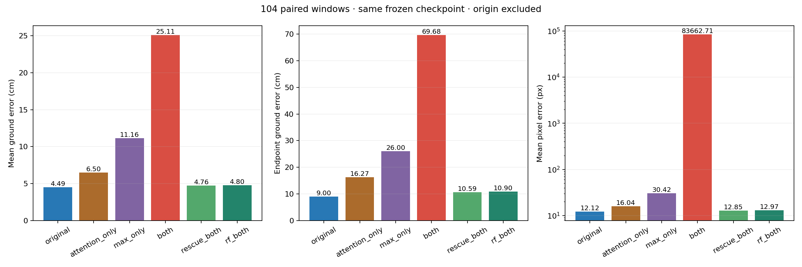
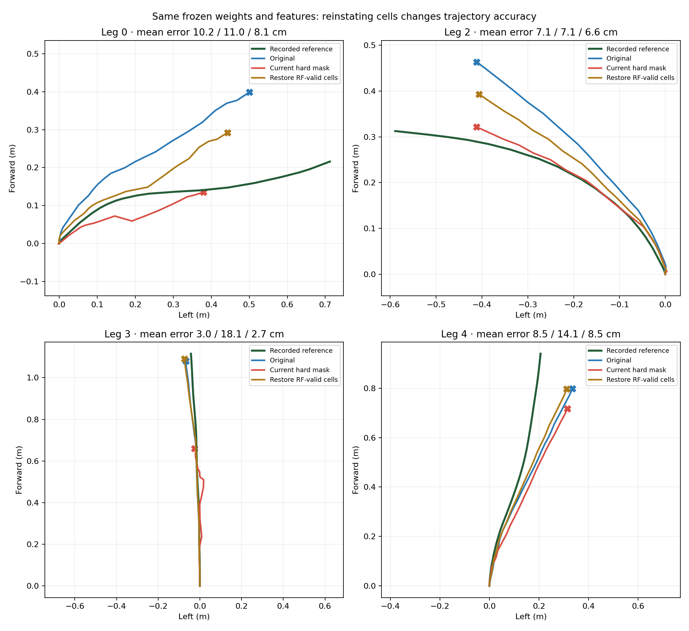
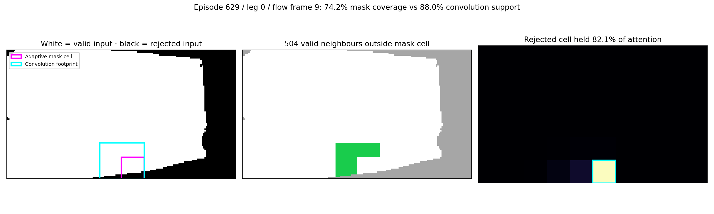

# Masking isolation — completed on GPU 2

These are frozen-weight interventions, completed on 15 October 2026. No training, checkpoint modification, flow regeneration or locked-test evaluation was performed. The authoritative six-policy run is `20261015_gpu2_pooling_v2`; the earlier five-policy validation run is preserved in `v1`.

## What was isolated

The current hard mask changes two pooling branches at once. All six policies below reuse exactly the same CNN feature tensor, trained weights, camera, query and temporal history. Original and joint-mask encoder outputs match the production implementations **bit for bit**. Episode original/joint predictions also exactly reproduce all four saved probes.

Input preprocessing changed **zero** input values and **zero** feature values in all 108 windows: invalid flow/confidence values were already zero in these caches. The observed differences therefore come from the pooling interventions.

| Policy | Attention branch | Max branch | Eligibility rule |
| --- | --- | --- | --- |
| Original | Original | Original | No new spatial rejection |
| Attention only | Masked | Original | Adaptive-cell valid coverage ≥75% |
| Max only | Original | Masked | Same adaptive-cell rule |
| Both | Masked | Masked | Current hard mask |
| Restore cells | Masked | Masked | Current mask OR convolution-footprint coverage ≥75%; only restores cells |
| RF replacement | Masked | Masked | Convolution-footprint coverage ≥75% replaces current rule |

“RF” means the **local convolution footprint**, not a strictly local functional receptive field: GroupNorm introduces global spatial dependence.

## Matched validation: 104 windows

Scene `D7G3Y4RVNrH`; 26 sequences; 104 windows; stride 5; deterministic reference history 30, evaluated causal prefix 24; one repeated anchor `(480,809)`; seed 20260820; original `sequence_floor` labels; float32; no augmentation. All 2,496 target-valid post-origin points are scored for every policy. No threshold was tuned in this run.

| Intervention | Mean ground error cm ↓ | Endpoint ground error cm ↓ | Mean pixel error px ↓ | Depth failures / 2496 |
| --- | ---: | ---: | ---: | ---: |
| Original | 4.492 | 8.999 | 12.121 | 0 |
| Attention only | 6.496 | 16.270 | 16.043 | 0 |
| Max only | 11.156 | 26.003 | 30.418 | 0 |
| Both (current hard mask) | 25.113 | 69.676 | 83,662.705 | 77 |
| Restore rejected / RF-valid cells | 4.758 | 10.595 | 12.850 | 0 |
| Replace mask with RF coverage | 4.798 | 10.896 | 12.974 | 0 |

Reinstating only the rejected / RF-valid cells reverses **98.71% of the added aggregate ground error** relative to the original. This is a numerical recovery fraction for this fixed experiment, not a percentage attribution of physical causes.

The max-only intervention adds 6.664 cm mean ground error; attention-only adds 2.004 cm. The joint effect is larger than their sum: the error-level factorial interaction is +11.953 cm. This demonstrates a harmful interaction under this frozen checkpoint; it does not identify a unique internal Transformer mechanism.

The large joint-mask pixel mean includes **77 nonpositive-depth predictions**. The projector clamps Z to `1e-4`, so these values are numerical failure diagnostics rather than meaningful visible-image distances. Its median per-window pixel mean is 35.56 px; even its positive-depth-only pixel mean is 380.68 px. Ground error is the primary comparison. Positive-depth-only scores are supplementary and cannot replace the shared-domain score.

Restoring cells is still slightly worse than original on aggregate validation: 4.758 vs 4.492 cm ground mean; 12.850 vs 12.121 px pixel mean. It improves ground mean in 56/104 windows. RF replacement improves 60/104 but is also worse on aggregate. **Neither is an established replacement model.**



## Episode 629: the same four saved windows

| Intervention | Mean ground error cm ↓ | Endpoint ground error cm ↓ | Mean pixel error px ↓ |
| --- | ---: | ---: | ---: |
| Original | 7.203 | 18.676 | 33.182 |
| Attention only | 7.357 | 19.057 | 32.684 |
| Max only | 9.490 | 21.207 | 35.260 |
| Both (current hard mask) | 12.570 | 30.584 | 43.380 |
| Restore rejected / RF-valid cells | 6.485 | 17.452 | 24.390 |
| Replace mask with RF coverage | 6.302 | 17.276 | 23.668 |

Restoring cells improves these four diagnostic windows overall, including 3/4 windows individually, but this cannot override the validation aggregate. Each window contains the first 24 flow pairs from legs 0, 2, 3 and 4, with 24 post-origin points.



## Direct test of neighbouring valid pixels

Four 3×3 stride-2 convolutions have a 31×31 local footprint and a 16-pixel centre spacing. The old mask instead averages 6×10 adaptive grid bins. These are different input regions.

For leg 0, flow frame 9, final feature row 5 / column 5:

- Adaptive-cell valid coverage: **74.17%**, so the 75% rule rejects it.
- Convolution-footprint valid coverage: **88.00%**.
- Original learned attention on this one cell: **82.09%**.
- **504 valid neighbouring pixels** lie within its convolution footprint but outside the adaptive mask bin.
- Perturb only their normalized flow by `du += 0.001`, `dv -= 0.001`: target-feature L2 changes by **0.14155** with baseline GroupNorm statistics frozen.
- Perturb the same number of valid pixels outside the footprint by the same amount: target-feature change is **exactly zero** with those same frozen statistics.

This controls GroupNorm statistics so the effect follows the local convolution path. Ordinary unfrozen GroupNorm also lets distant pixels affect this cell; those measurements are saved separately. All four episode windows show nonzero local-neighbour influence with zero outside-footprint control.



The intervention proves neighbouring valid flow affects a rejected cell. Restoring the identified class of cells proves their rejection caused most of the added error under this setup. It does **not** prove that every rejected cell is useful, or that neighbouring flow alone accounts for the entire recovery: each restored feature also contains coordinate, normalization and other learned information.

## Boundaries and next decision

The active production mask remains unchanged and defaults to `none`. Keep the unmasked checkpoint as the reference. Next isolate attention-only soft reliability / retained max against the same validation protocol, then decide whether matched mask-aware training is justified. Keep any supervision (`sequence_floor` vs `fixed_rig`) experiment separate. Do not select a variant using test or these four episode windows.

The 104 windows overlap and come from one validation scene; they are not 104 independent trials. This run holds the Attention+Yaw checkpoint fixed and does not isolate yaw itself. Float32 GPU results are not guaranteed bit-identical to a different PyTorch build, although the saved episode predictions match exactly in this environment.

## Files and reproduction

- [Runner](isolate_masking.py): strict loading; prepared shared features; two-by-two pooling intervention; selective rescue; RF replacement; local perturbation experiment; depth/prefix diagnostics.
- [CPU verification](verify_isolation.py): token equivalence, unchanged inputs/features, direct-neighbour control and finite missing-observation handling.
- [Validation machine-readable report](isolations/20261015_gpu2_pooling_v2/validation/report.json) and [104 per-window records](isolations/20261015_gpu2_pooling_v2/validation/windows.jsonl).
- [Episode report](isolations/20261015_gpu2_pooling_v2/episodes/report.json) and [four per-window records, predictions and neighbour tests](isolations/20261015_gpu2_pooling_v2/episodes/windows.jsonl).
- [Local verification and artifact hashes](isolations/20261015_gpu2_pooling_v2/verification.json).

On ISL, from `/data/robotics/toshith/vivekananda/gqft_algorithm_sharing_vivekananda`, after uploading `isolate_masking.py` to `gqft_mask_review/`:

```bash
CUDA_DEVICE_ORDER=PCI_BUS_ID CUDA_VISIBLE_DEVICES=2 PYTHONDONTWRITEBYTECODE=1 \
  /data/robotics/toshith/envs/agentvln/bin/python -B \
  gqft_mask_review/isolate_masking.py --mode validation --device cuda

CUDA_DEVICE_ORDER=PCI_BUS_ID CUDA_VISIBLE_DEVICES=2 PYTHONDONTWRITEBYTECODE=1 \
  /data/robotics/toshith/envs/agentvln/bin/python -B \
  gqft_mask_review/isolate_masking.py --mode episodes --device cuda
```

Default outputs use fresh UTC timestamp directories, preserving prior results. GPU 2 is the latest authorized device for this experiment. GPU 7 was used only for the earlier episode probes; it was not used for this isolation run. The existing `agentvln` environment is reused without installing packages.

Checkpoint SHA-256: `40729f0f537c28e5b07565aba01133bb594c7781cc59eedf90bc3fafa939ee8d`.

Executed runner SHA-256: `1068665a21ea03eb90f5ff2f315f0a96b8547110bbcccb00eb985b5742b95dd7`. Local and server hashes match. Earlier `v1` predates the rescue/depth additions and is supplementary only.
