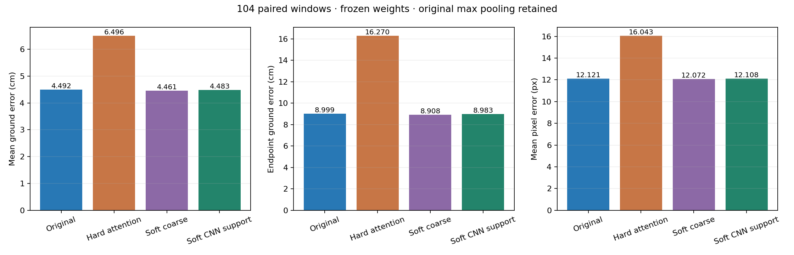

# Soft attention with original max pooling — GPU 2

Completed 15 October 2026 with the existing frozen Attention+Yaw checkpoint. This is an analysis-only policy trial, not a new trained checkpoint. No training, production-model change, SEA-RAFT regeneration or locked-test access occurred.

## Fixed policy, declared before running

The primary candidate is **soft CNN-support attention**; coarse-cell soft weighting is a control. Both keep the original max-pooling vector exactly and reuse the original CNN inputs/features. Reliability is supplied validity density, not semantic segmentation or an additional confidence threshold.

```text
reliability[i] = 0.25 + 0.75 * valid_coverage[i]
soft_attention[i] = original_attention[i] * reliability[i]
soft_attention /= sum(soft_attention)
max_pooling = original_max_pooling
```

Coverage for the primary is the 31×31 convolution footprint, stride 16, padding 15 with outside-image padding excluded. The coarse control uses the previous adaptive 6×10 grid coverage. GroupNorm still adds global feature dependence. No cell is hard rejected by the soft rule. Spatially constant reliability cancels, and an explicit bypass preserves original behavior bit for bit for all-valid/all-invalid frames.

Floor 0.25 was fixed before inference. No floor sweep, confidence tuning or retrospective change of primary candidate was performed. [Predeclared plan](soft_attention_plan.json).

## Validation: 104 paired windows

Same scene `D7G3Y4RVNrH`, 26 sequences × four overlapping windows; reference history 30; evaluated causal prefix 24; stride 5; anchor `(480,809)`; seed 20260820; original `sequence_floor` labels; float32; no augmentation. All 2,496 post-origin target-valid points are scored for every policy.

| Policy | Ground mean cm ↓ | Ground endpoint cm ↓ | Mean 3-D error cm ↓ | Pixel mean px ↓ | Pixel endpoint px ↓ |
| --- | ---: | ---: | ---: | ---: | ---: |
| Original | 4.491709 | 8.999301 | 5.545796 | 12.120684 | 15.305364 |
| Hard attention only | 6.496007 | 16.270056 | 7.868936 | 16.043385 | 27.316992 |
| Soft coarse (control) | 4.460674 | 8.907689 | 5.522884 | 12.071960 | 15.171986 |
| Soft CNN support (primary) | 4.483005 | 8.983151 | 5.542095 | 12.107598 | 15.290958 |

The primary reduces ground mean by **0.194%**, only **0.087 mm**. The coarse control reduces it by **0.691%**, or **0.310 mm**. Both avoid the hard attention-only regression and add zero depth or prefix failures.

The primary passes the predeclared numerical screen: lower aggregate ground mean, no aggregate endpoint/3-D/pixel regression and no added depth/prefix failures. That screen has no minimum effect-size requirement, so passing it does not establish a practically useful improvement.



## Consistency and uncertainty

| Soft policy | Windows improved | Sequences improved | Mean ground change mm (negative better) | Sequence-bootstrap 95% interval mm |
| --- | ---: | ---: | ---: | --- |
| Soft coarse (control) | 61/104 | 16/26 | -0.310 | [-0.756, 0.040] |
| Soft CNN support (primary) | 53/104 | 14/26 | -0.087 | [-0.214, 0.043] |

Both intervals include zero. These are exploratory resamples of **sequence means**, not independent-window confidence claims; all sequences still belong to one scene. No reliable cross-scene gain or multi-seed benefit is established.

| Motion family | Windows | Original cm | Soft coarse cm | Soft CNN support cm |
| --- | ---: | ---: | ---: | ---: |
| 0: Straight | 16 | 4.47133 | 4.47311 | 4.47583 |
| 1: Constant arc | 16 | 4.16079 | 4.01075 | 4.12600 |
| 2: Gradual turn | 12 | 3.29975 | 3.30512 | 3.30646 |
| 3: S-curve | 12 | 5.08744 | 5.03912 | 5.05474 |
| 4: Random smooth | 12 | 4.31819 | 4.30207 | 4.31895 |
| 5: Stop-go | 12 | 2.97785 | 2.98125 | 3.00100 |
| 6: Straight-then-turn | 12 | 5.40190 | 5.37996 | 5.38030 |
| 7: MPPI-like | 12 | 6.33351 | 6.33984 | 6.32215 |

The primary slightly regresses on straight, gradual-turn, random-smooth and stop-go families while improving the other four. The stop-go mean rises from 2.97785 to 3.00101 cm. Aggregate improvements therefore do not mean every motion family benefits.

## Episode 629: diagnostic only

The same first 24 flow pairs from legs 0, 2, 3 and 4 were evaluated after the fixed policy was declared. All 96 post-origin reference points are scored. These windows do not select the policy.

| Policy | Ground mean cm ↓ | Ground endpoint cm ↓ | Pixel mean px ↓ |
| --- | ---: | ---: | ---: |
| Original | 7.20305 | 18.67587 | 33.18174 |
| Hard attention only | 7.35713 | 19.05707 | 32.68374 |
| Soft coarse (control) | 7.15302 | 18.48843 | 32.68322 |
| Soft CNN support (primary) | 7.18910 | 18.60993 | 32.92233 |

Both soft variants improve aggregate episode ground mean slightly and improve two of the four windows individually. Neither reproduces the severe joint-hard-mask regression. Full per-leg predictions and attention-change diagnostics are in the episode JSONL.

## Training decision

**Do not launch a large training run based on these small frozen-weight gains.** Keep the original reference. The candidate is eligible for planning a **small, matched mask-aware training pilot**, because its fixed-policy screen passes without the hard-mask failure; training may allow the attention/CNN to adapt to the pooling change. That adaptation benefit remains a hypothesis.

Before a pilot: add an explicit differentiable soft-attention mode to the trainable model/config with a default-off compatibility check; retain original max pooling; test gradients/checkpoint round trips; fix one architecture, initialization, labels, seed, batch, histories and budget for both unmasked/soft runs. Keep the separate ground-label experiment independent. A no-yaw pair is a new experiment, not a direct continuation of this yaw-checkpoint probe.

The existing `--spatial-mask validity` flag is **hard joint masking**, not this soft attention rule. These analysis scripts do not make soft training available through that flag. No production training code was changed or training launched in this trial. The primary remains CNN-support weighting despite the coarse control showing a larger observed gain; switching primaries after seeing these results would be a new declared experiment.

## Verification and artifacts

Nine CPU semantic checks passed. GPU original and hard attention-only scores reproduce the previous isolation run exactly across all windows. Max pooling, original tokens and CNN inputs/features remain bit-identical; soft weights are finite and normalized; recorded original episode displacements match exactly.

- [Runner](probe_soft_attention.py) and [CPU verification](verify_soft_attention.py).
- [Validation report](soft_attention/20261015_gpu2_v1/validation/report.json), [104 window records](soft_attention/20261015_gpu2_v1/validation/windows.jsonl).
- [Episode report](soft_attention/20261015_gpu2_v1/episodes/report.json), [four window records](soft_attention/20261015_gpu2_v1/episodes/windows.jsonl).
- [Sequence sensitivity](soft_attention/20261015_gpu2_v1/sequence_sensitivity.json), [CPU verification output](soft_attention/20261015_gpu2_v1/cpu_verification.json), [artifact verification](soft_attention/20261015_gpu2_v1/verification.json).

Reproduce on ISL from the GQFT project root after uploading the runner and plan alongside the unchanged `isolate_masking.py`:

```bash
CUDA_DEVICE_ORDER=PCI_BUS_ID CUDA_VISIBLE_DEVICES=2 PYTHONDONTWRITEBYTECODE=1 \
  /data/robotics/toshith/envs/agentvln/bin/python -B \
  gqft_mask_review/probe_soft_attention.py --mode validation --device cuda

CUDA_DEVICE_ORDER=PCI_BUS_ID CUDA_VISIBLE_DEVICES=2 PYTHONDONTWRITEBYTECODE=1 \
  /data/robotics/toshith/envs/agentvln/bin/python -B \
  gqft_mask_review/probe_soft_attention.py --mode episodes --device cuda
```

Default outputs use fresh UTC timestamps. Only GPU 2 was used in this run. The working existing `agentvln` environment was reused without package changes.

Executed runner SHA-256: `66b062726c36e428aaf280d0432c236ca8aa7c5af973728d39939701a4d4b228`.

Predeclared plan SHA-256: `7703ddf098f9ab5f7bfa935907d5251b06cf4b18daab532ab50387cd40792e72`.
