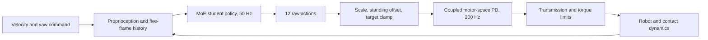
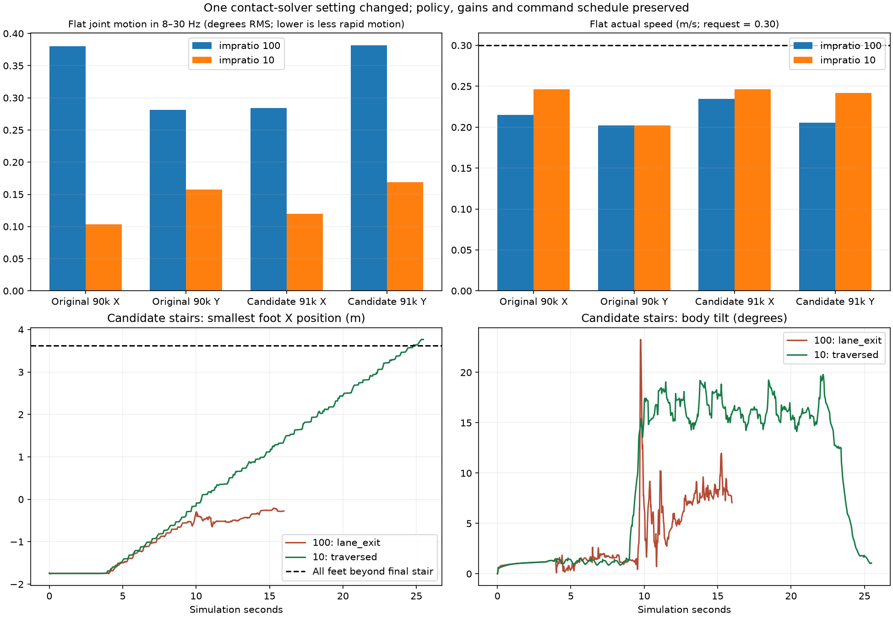

# Task 3 — SvanM2 MoE locomotion, jitter, and control-contract analysis

**Mid-evaluation status, 10 October 2026:** hardware-log audits, recorded-policy diagnostics, reward trials, and controlled simulator comparisons are available. The strongest recent controlled result is sensitivity to the simulated contact setting: four matched 10 cm stair cases complete at `impratio=10` and fail at 100. A real-robot jitter fix remains unvalidated.

[Project overview](../README.md) · [Portable quantitative evidence](../docs/mid_evaluation/evidence/task3/) · [Latest interpretation and hardware qualification](notes/17_REVIEW_OF_ACTUATOR_DELAY_AND_GATE_SUGGESTIONS.md) · [Interactive recording guide](notes/19_RECORD_MY_INTERACTIVE_RUN.md)

## Objective and control pipeline

Understand why the SvanM2 quadruped's MoE policy produces jitter or unstable stair motion; reproduce the relevant control contract; evaluate changes without confusing commanded targets, actual angles, saturation, and physical capability.



The MoE student input is 5 × 45 = **225 values**; action order is FL, FR, RL, RR with hip/thigh/calf per leg. The student uses commands and proprioceptive history, without an explicit stair-height map. The repository also contains flat-PPO, HIMLoco, and ISL-port work; their interfaces, model cards, and training records are separate from the MoE jitter experiments. Imported model-card benchmark claims are not fresh measurements from this audit.

## Attempts, outcomes, and lessons

| Period / attempt | Method | Outcome supported by saved evidence | Analysis |
| --- | --- | --- | --- |
| September hardware/simulator audit | Examine deployment adapter, two hardware logs, action replay, and offline simulation | Calf/hip bounds, command shaping, reset, observation timing, delay, and contact settings differ from the documented viewer | Contract mismatch must be resolved before blaming policy architecture |
| Hardware target/angle analysis | Compare moving windows and timing/velocity telemetry | Target-band oscillation strongly correlates with measured-angle oscillation; asymmetrical calf limit occupancy persists | Supports a target/closed-loop association, not a single hardware root cause |
| Reward and target-bound continuation, candidate 90500 | Compare preserved 90000 with a combined candidate under matched starts and sensing modes | Less target removal and better early speed tracking; jitter changes have mixed signs; no stair traversal in 12 distinct cases | The combined change is not an isolated reward ablation or a reliable jitter fix |
| Flat/stair intervention | Disable stair collisions while preserving the rest of the setup | Candidate/viewer joint-band RMS 0.331° flat vs 0.833° stairs in the same post-contact interval | Terrain contact changes the closed-loop response; this does not uniquely identify the internal mechanism |
| Interactive keyboard recording | Preserve attempts, reset events, commands, contacts, raw chunks, plots, and source/checkpoint hashes | Recorded-run comparisons and spike/gate diagnostics can be reproduced offline | Manual attempts and scripted simulations need separate provenance and equal-duration comparisons |
| Time-aware target-rate penalty | Penalize large target changes per elapsed policy time; validate manager integration and reset handling | Exploratory thresholds derived from recordings; local integration checks pass; later candidate retries are saved | Valid implementation does not prove improved locomotion |
| 0.13 m swing-preference / newest 91000 continuation | Lower rate weight to −0.01, use explicit viewer-wide bounds and saved continuation settings | Newest checkpoint is distinct from older 91000; matched sideways recordings still show tradeoffs | Update number alone is insufficient to identify a policy or its training conditions |
| Gain / actuator-response study | Paired gain sweeps, torque reconstruction, fixed-target checks | Gain effects differ by policy; no universal damping-only explanation established | Treat gain tuning as a measured sensitivity, rather than an automatic remedy |
| October 6–7 contact-solver audit | Change only `impratio` within matched policy/control/contact setups | 44.0–72.9% lower flat joint-band RMS at current gains; 4/4 paired stair cases complete at 10 versus 0/4 at 100 | Strong simulation intervention evidence; hardware contact validity remains unknown |
| Tier-1 solver probe | 28 saved grid/confirmation cases vary contact settings/substeps while holding policy/PD rates explicit | Solver iterations, slip proxies, penetration, speed, and vibration recorded | Additional simulator diagnostics; these are not 28 independent trained policies or hardware trials |

## Hardware evidence and its limits

The September audit records an initial **4,141-sample, ~20 Hz** incident log and a later **122,607-sample, ~200 Hz** full-control log with **30,175 exact policy I/O records**. The first log cannot resolve an 8–30 Hz band because its Nyquist frequency is about 10 Hz. The later log is the main high-frequency source.

- During later commanded motion, measured 8–30 Hz angle RMS is approximately **0.19–0.45° per joint**; sent-target RMS in that band is **0.63–1.84°**.
- Across four-second moving windows, target/angle oscillation Spearman correlation is **0.962**. Correlation does not establish that targets independently cause the hardware response.
- Calf target limit occupancy is **17.7%, 20.0%, 19.4%, 64.8%** for FL/FR/RL/RR. Occupancy is distinct from target removal, torque clipping, and physical stop contact.
- Reported joint velocity agrees with differentiated angles; the audit found no evidence of a velocity sign/unit error.
- Telemetry contains repeated nonzero motor fault/status integers whose firmware-specific meaning is unresolved. Terrain labels and synchronized hardware video were not recorded for the main log.
- Saved original training lateral range is ±0.3 m/s; operation at ±0.6 m/s extrapolates beyond it. This needs explicit evaluation.

These are historical audit results, not new robot measurements collected for this README. The original audit's external `svanm2_moe_hardware_audit` implementation is not present in this repository; its retained report and outputs document the analysis, but the parent repository alone cannot fully recreate that external workflow.

## October 2: original 90000 versus candidate 90500

Two checkpoints × two sensing modes × three starts produce **12 distinct stair cases**. All fail traversal. The central flat controls and sensitivity repetitions are separate from this count.

| Early-motion measure, common 4–8 s window | Original | Candidate | Result |
| --- | ---: | ---: | --- |
| Viewer, nominal-start joint 8–30 Hz RMS | 0.270° | 0.222° | Improves in this case |
| Refreshed sensing, nominal-start joint RMS | 0.298° | 0.386° | Worsens in this case |
| Viewer, three-start mean target-removal fraction | 13.71% | 9.90% | Less removal |
| Refreshed sensing, three-start mean target removal | 14.13% | 10.10% | Less removal |
| Viewer, three-start mean forward-speed RMSE | 0.127 m/s | 0.098 m/s | Better tracking |
| Refreshed sensing, three-start mean speed RMSE | 0.143 m/s | 0.097 m/s | Better tracking |

Every first loaded stair contact is a front-foot/riser event, with foot-centre height about 3.7–6.3 cm. The contacting leg is not target/torque clipped at that instant. Support transfer, clearance, heading, and contact response therefore deserve investigation; frequent clipping elsewhere remains relevant. One candidate startup also unloads the rear-left foot before movement.

The candidate changes several settings together and represents one continuation checkpoint. The observed effects cannot be attributed to one reward term. See the [matched report](tools/results/20261002_matched_v1/REPORT.md) and [three-start report](tools/results/20261002_stair_repeats_v1/REPORT.md).

## Time-aware reward and checkpoint identity

The exploratory reward uses final clamped position targets:

```text
allowed_delta[j] = rate_reference[j] * policy_dt
excess[j] = max(abs(target[t,j] - target[t-1,j]) / allowed_delta[j] - 1, 0)
cost = sum(excess[j]^2)
```

The reference was derived from six tighter-bound approach windows / 1,200 policy intervals within a 41-attempt review. The initial family thresholds are **7.093 / 11.275 / 20.365 rad/s** for hip/thigh/calf, using a 1.25 × P99 margin. They are exploratory target-rate references, not measured motor speed limits. The broader calibration uses 19 qualifying four-second windows. Reset masking and reward-rate/time scaling matter; existing saturation pressure is retained once.

The saved later integration check reports 0.02 s policy steps, viewer-wide targets, 0.13 m clearance/swing preferences, and weights −0.15 action rate, −0.01 second difference, −0.01 saturation, −0.01 rate excess. Its synthetic-action smoke establishes code integration, not policy performance.

| Policy identifier | SHA-256 / distinguishing evidence |
| --- | --- |
| Original 90000 | `440bbb28d554f75db38bfd163351c04ea4a32d9d06764c37b7e6071d41daa5cb` |
| Earlier 91000 recording | Hash begins `f74e62bf`; saved arguments indicate rate weight −0.05 and learning-rate cap 0.0003 |
| Newest 91000 (`moe_swing013_latest/latest.pt`) | `dec9775d4b368b69964dde679985455d8b723d5af7fb2d24e8798fa4fdd66da4`; saved arguments indicate −0.01, viewer-wide, 0.13 m, cap 1e−5 |

The matched +Y 0.15 m/s recorded comparison gives speed RMSE **0.1107 → 0.1335 m/s**, about 20.7% worse for newest 91000. Rapid target changes can occur on flat sideways motion as well as after stair contact. Gate/actor decomposition is useful for locating associated changes, but does not prove an independently defective gate. See [note 17](notes/17_REVIEW_OF_ACTUATOR_DELAY_AND_GATE_SUGGESTIONS.md).

## October 6–7: controlled contact-setting result

At `kp=18`, `kd=0.7`, requested speed 0.30 m/s, all rows use the same **5–11 s** interval and legacy viewer sensing. Checkpoint, starts, targets, gains, friction, contact time constants, 50 Hz policy, and 200 Hz PD/physics are matched within each pair. Only `impratio` changes.

| Policy / direction | Joint 8–30 Hz RMS: 100 → 10 | Reduction | Mean actual axis speed: 100 → 10 |
| --- | ---: | ---: | ---: |
| Original 90000 / forward | 0.380 → 0.103° | 72.9% | 0.215 → 0.246 m/s |
| Original 90000 / sideways | 0.281 → 0.157° | 44.0% | 0.202 → 0.202 m/s |
| Newest 91000 / forward | 0.284 → 0.120° | 57.8% | 0.235 → 0.246 m/s |
| Newest 91000 / sideways | 0.382 → 0.169° | 55.7% | 0.205 → 0.242 m/s |

Twelve additional refreshed-sensing pairs at `kp=20`, `kd=0.7` across three starts reduce this band by **32.9–75.2%**, with axis speed maintained or increased.

| 12-riser staircase, 10 cm per riser | `impratio=100` | `impratio=10` |
| --- | --- | --- |
| Original 90000, gains 18 / 0.7 | Lane exit | Traversed at 24.605 s |
| Newest 91000, gains 18 / 0.7 | Lane exit | Traversed at 25.475 s |
| Original 90000, gains 20 / 0.7 | Incomplete timeout | Traversed at 23.700 s |
| Newest 91000, gains 20 / 0.7 | Lane exit | Traversed at 25.370 s |

Traversal is independently checked from traces: all feet beyond x=3.622 m, inside the lane, each having loaded the platform above 1 N, tilt <30°, base clearance >0.18 m, maintained for ≥0.5 s. These are two checkpoints × two gains at one nominal start, not four independent seeds or a general success-rate estimate.



`impratio` is a simulated frictional/normal contact-constraint setting; it is separate from friction coefficient and motor gains. The current training configuration says 10 and the viewer says 100, but the original 90000 training contact setting remains unverified. Lower force/torque oscillation and simulated slip proxies accompany the intervention. This supports a simulation feedback effect; it does not identify the robot's physical cause of shaking. A real robot has no corresponding `impratio` switch.

## Measurement and reproducibility rules

- Joint angles at 200 Hz support an 8–30 Hz analysis band. Policy targets sampled at 50 Hz use **8–20 Hz** in the recent scripted comparisons. Do not compare different-band amplitudes as if the bands were identical.
- Band RMS measures oscillatory content and can include gait harmonics, impacts, and useful corrective motion. It is not a complete measure of unwanted jitter.
- Keep request, clamped target, measured angle, torque, contacts, speed, and heading separate. Compare complete equal-duration, equal-command windows; retain aborted or failed attempts.
- The coupled transmission is `J_LEG=[[8,0,0],[0,8,0],[0,8,16]]`. Position bounds do not alter this transmission matrix. Physical gear/belt accuracy is a separate calibration question.
- Reuse source/checkpoint hashes and manifest timing; distinguish stale viewer-derived sensors from refreshed observations. Observation freshness changes trajectories and is not uniformly beneficial in the earlier tests.

Historical software checks cover passive-recording trajectory equality, frequency/units and Nyquist guards, traversal criteria, torque reconstruction, reward time/reset semantics, checkpoint replay, and environment integration. Those checks establish analysis consistency, not deployment safety. The portable evidence files and their hashes are indexed in [the manifest](../docs/mid_evaluation/evidence/task3/manifest.json).

## Where things belong

## Where things belong

| Folder | Contents |
| --- | --- |
| [xterra_mjlab/](xterra_mjlab/) | Simulator, training code and Python environment. Existing checkpoint paths are retained. |
| [xterra_mjlab/evaluation_runs/](xterra_mjlab/evaluation_runs/) | Copied trained candidates and their saved training configuration |
| [notes/](notes/README.md) | Learning notes, experiment history and current instructions; images are grouped in `notes/assets/` |
| [tools/jitter_analysis/](tools/jitter_analysis/) | Recording, saved-data plotting and diagnostic scripts |
| `tools/results/interactive/<session>/` | Your new keyboard-controlled recordings, one folder per session |
| [tools/results/](tools/results/) | Existing scripted comparisons; their provenance distinguishes them from your new interactive recordings |
| [tools/archive/](tools/archive/) | Loose historical debug exports and an exact record of files reorganized |
| [Videos/](Videos/) | Your screen recordings; not numerical sensor logs |
| [moe_jitter_audit_20260921/](moe_jitter_audit_20260921/index.html) | Historical audit, retained in place so existing links work |

No checkpoints, videos or results were deleted or renamed. New runs must use a new session directory; the recorder refuses to overwrite an existing one. Keep raw data under its session and put generated plots in each attempt's `plots/` subfolder. Do not drop new plots/debug dumps into this directory or the code repository root.

The historical scripted results are MuJoCo measurements under scripted commands. The interactive recorder labels the separate keyboard-operated attempts in their manifests.

For saved dashboards without running a simulator:

```bash
python3 -m http.server 8000 --bind 127.0.0.1 --directory Task_3
```

Open `http://127.0.0.1:8000/tools/results/control_loop_audit_20261006_v2/FINDINGS.html` for the latest saved contact-setting findings. This reads local files; it does not start policy inference. For a new viewer recording, use the [recording guide](notes/19_RECORD_MY_INTERACTIVE_RUN.md) after selecting a specific checkpoint and control contract. Its Python environment, robot assets, and checkpoints are in the separate local `xterra_mjlab` checkout and are not all tracked by the parent repository.

## Remaining work and presentation takeaway

Freeze and revalidate the actual deployed bounds/gains/transmission/rates/observations; establish which contact and delay conditions the saved continuation actually used; compare existing robot response with calibrated simulator assumptions; then evaluate isolated policy changes with tracking, vibration, heading, and stair outcomes together. Preserve both successful and failed cases and evaluate more starts/seeds before a broad robustness claim.

**Presentation statement:** “We moved from visual jitter reports to logged contract checks and controlled comparisons. Reward continuation improved some tracking measures without reliably fixing jitter. Changing simulated contact enforcement strongly changed vibration and stair outcomes, motivating contact-model validation before making hardware claims.”
