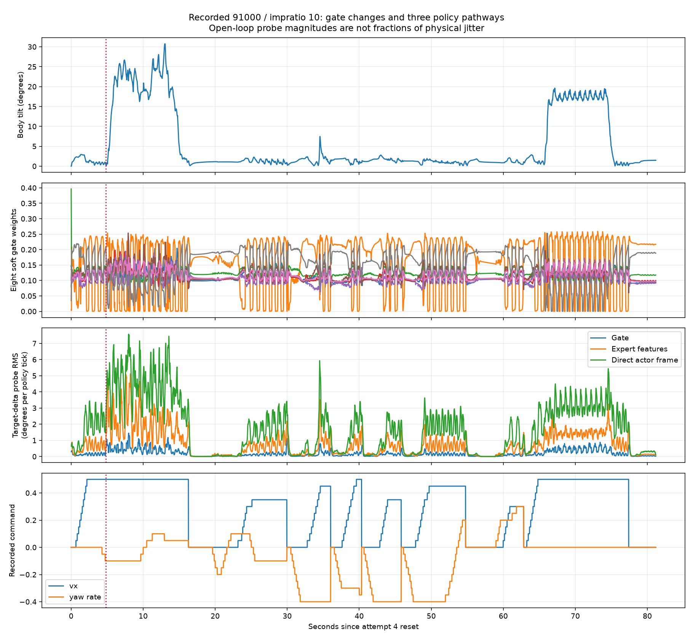
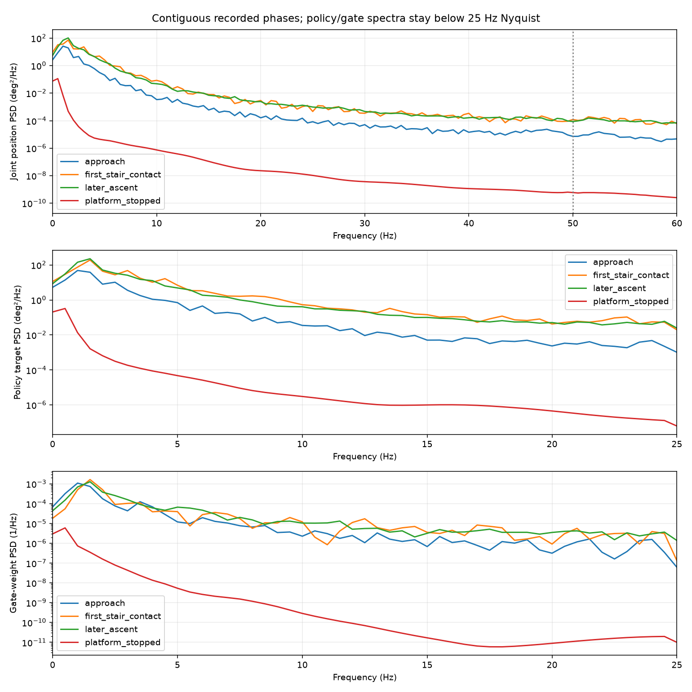
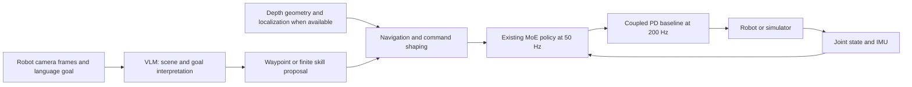

# Audit beyond impratio: gate, frequency, actuator contract, and VLM integration

Reviewed 2026-10-11. **The evidence supports additional work on evaluation consistency, actuator identification, and the training/deployment contract. It does not establish that changing MoE gating or policy frequency is required.** A VLM can add visual navigation and instruction following around the current locomotion policy; that is a separate capability from removing joint jitter.

This follow-up reads the September audit, its accepted raw traces and hardware arrays, the October control-loop/gain interventions, current source, and the new user recording. It includes new CPU policy replay and saved-data measurements. **No new physics rollouts, training, GPU evaluation, VLM downloads/API calls, hardware commands, or runtime/controller changes were made.** New code is confined to the offline analysis tool.

[Exact new measurements](../tools/results/gate_frequency_audit_20261011_v2/analysis.json) · [Reproducible analysis script](../tools/jitter_analysis/audit_gate_frequency.py) · [Full experiment history](23_DEEP_JITTER_ANALYSIS_20261010.md) · [September report](../moe_jitter_audit_20260921/REPORT.md).

## 1. Evidence examined and what was independently verified

The September folder contains 120 accepted final rollouts, their traces/XML/metrics, hardware arrays with 122,607 control rows, saved replay results for 30,175 policy inputs, two hardware-incident summaries, plots, and eight simulator videos. All 120 accepted traces are present. `pre_sensor_refresh_runs/`, `invalidated_prototype/`, and interrupted batches remain excluded, as stated in its manifest. The video filenames containing `hardware` describe simulator runs using deployed target bounds; they are not hardware footage.

This follow-up recomputed the September hardware correlations from the retained raw arrays over **65 separate four-second moving windows**. It also recomputed **12 accepted raw simulation traces**: flat forward and 15 cm stair ascent, two starts each, with baseline/20 ms/40 ms target filtering. Their saved RMS values match within 1e-8 degrees. We inspected the hardware spectra/gate plot, ablation plot, and retained stair contact sheet. This is not a claim to have watched every video frame or rerun every historical experiment.

The copied September folder does not retain the original full hardware policy-history archive or firmware/status source at the old absolute paths used by its scripts. Consequently, the September 30,175-output parity and gate summaries are retained results with provenance, rather than a newly executed hardware-history replay here. The raw hardware arrays are sufficient to independently reproduce the timing/target correlations below; they do not contain synchronized terrain labels or the raw firmware fault rows.

For the newest recording, we rebuilt all **4,059 policy histories** in attempt 4 from saved `obs_policy` frames, repeating the first frame after reset and maintaining oldest-first order. CPU inference from the exact checkpoint matches the recorded GPU actions to **1.05e-5 maximum absolute error** and gate weights to **4.77e-7**. Action and target clamp identities also pass. This validates the inputs used by the new network-pathway probes.

## 2. What the September hardware data actually supports

| Hardware finding | Measurement | Engineering interpretation |
| --- | --- | --- |
| Joint motion tracks target oscillation | Recomputed window Spearman correlation 0.96184 | Policy targets and the mechanical response are closely associated; initiating cause within the feedback loop remains unresolved. |
| Scheduling outliers have weaker association | Maximum control interval 0.15380; sensor age 0.02050; action age 0.09668 | Isolated scheduler stalls are not the strongest explanation in this recording. This does not establish that latency is harmless. |
| Joint velocity consistency | Retained differentiated-q fit 0.993–1.008, correlations >0.997 | No support for removing dq or correcting a supposed factor/sign error. |
| Persistent target bounds | Calf occupancy FL/FR/RL/RR ≈17.7/20.0/19.4/64.8% of motion samples | Check per-leg action realization and reachability; occupancy is not physical stop contact. |
| Actuator telemetry remains unresolved | Retained 500 nonzero-status rows, codes 98/99/100/102; estimated thigh torque peaks ≈23.2 Nm | Decode firmware fields and identify torque-limit semantics. These are repeated samples, not 500 independent mechanical faults. |
| Larger sideways commands exceed the saved range | Saved training ±0.3 m/s versus expanded operator profile ±0.6 m/s | Diagnose within the trained command distribution before calling poor tracking a gate defect. |

The original tip incident was logged near 20 Hz, so it cannot resolve an 8–30 Hz vibration band. Its 72.6° MoE tilt peak documents a severe event, not the high-frequency spectrum. The later ~200 Hz log is the appropriate source for that spectrum, but its terrain was unlabelled.

The retained motor-status comparison reports more high-frequency joint motion during nonzero-status rows, approximately 0.69° versus 0.32°. That comparison is unmatched for terrain and commands. It motivates actuator investigation, without identifying what those firmware values mean.

## 3. Does the gate need changing?

**Retain the current gate for the next baseline.** It computes eight softmax weights from five observation frames; the experts produce latent features, and a shared actor receives both the normalized mixture and the newest observation frame. There is no hard argmax selection of one motor controller.

In the new first-contact window, the largest gate weight is **0.254**, and mean entropy corresponds to about **7.26 effective experts**. This describes distributed soft weighting; it does not prove the experts are distinct, or that the gate is optimal. Mean L1 weight change rises from **0.0344** per tick during approach to **0.0609** during first contact. Contact changes the inputs to the gate, experts, and actor simultaneously, so the rise alone is not evidence that gating initiates the vibration.

### New three-pathway probe

For consecutive saved inputs, the tool evaluates all eight combinations of old/new gate weights, expert features, and direct actor frame. It averages each component's marginal effect across all six possible orders, then applies the actual raw-action and target clamps. This is an exact vector decomposition of the instantaneous commanded-target change. Its components sum to the full change; their RMS energies need not add because components can reinforce or cancel.

| Recorded phase | Gate pathway RMS | Expert-feature pathway RMS | Direct actor-frame pathway RMS | Actual target-difference RMS |
| --- | ---: | ---: | ---: | ---: |
| Approach, 0–4.825 s | 0.21° | 0.80° | 2.09° | 1.93° |
| First stair contact, 4.825–8 s | 1.03° | 3.49° | 5.63° | 5.69° |
| Later ascent, 8–16 s | 0.76° | 2.42° | 4.94° | 4.87° |
| Descent segment, 65–77 s | 0.59° | 1.55° | 3.23° | 3.11° |

Units are RMS degrees of commanded-target change per policy transition, pooled across joints and ticks. They are not joint vibration amplitudes or percentages of a physical cause.

The actor's direct newest-frame pathway has the largest probe magnitude in these phases. Focusing exclusively on gate frequency would miss a larger output-sensitive pathway. These counterfactual combinations are not necessarily physically reachable histories, and do not predict what a modified controller will do after its next feedback cycle.

Existing closed-loop gate freezing supplies a stronger task check. In the October study, newest91000 sideways joint RMS fell **0.3703→0.1575°**, while actual speed fell **0.2202→0.0386 m/s** against a 0.30 m/s request. Original90000 forward RMS instead increased **0.4128→0.4293°**. Those tests used older wider target bounds and kp=20, not today's exact tight-bound run. They show that freezing can disable useful motion and is not a universal fix. They do not rule out a carefully tested mild gate filter.

A gate filter, slower gate update, recurrent gate, or top-k gate should therefore be treated as a named experiment, selected only if it retains tracking, heading, foot support, and full traversal. A recurrent gate adds untrained parameters; top-k changes the mixture's behavior. Both require deliberate architecture and evaluation work, and adoption may require fine-tuning. Successful checkpoint loading alone does not establish compatibility.



## 4. Does frequency need changing?

**Keep the policy/gate at 50 Hz and the current external PD baseline at 200 Hz while identifying the remaining error.** In every new attempt, saved simulation-time policy intervals are exactly 20 ms within floating-point tolerance. In attempt 4, the recorded inference-plus-bookkeeping span has median/p99/max **2.68/4.34/4.91 ms**. Attempt 1 has a 218 ms first-use outlier; fixed simulation-time stepping remains intact. These spans include logging/hooks and are not isolated GPU inference latency measurements.

Simulation wall-time overruns slow the viewer; this controller still finishes inference before stepping the model and immediately applies the target. That behavior is different from an asynchronously delivered target on real hardware. The hardware mean control sampling is approximately 198.9 Hz, but firmware's internal servo rate remains unverified. A bridge configured at 500 Hz does not establish a measured 500 Hz motor PD loop.

| Recorded phase | Mean joint 8–30 Hz RMS | Mean joint 45–55 Hz RMS |
| --- | ---: | ---: |
| Approach | 0.144° | 0.0096° |
| First stair contact | 0.578° | 0.0317° |
| Later ascent | 0.488° | 0.0303° |
| Descent segment | 0.312° | 0.0223° |

The measured joint spectrum does not show a dominant narrow 50 Hz component. Within the selected 8–30 Hz band its largest PSD bins are around 8–8.5 Hz, near the band's lower edge; this is not an identified mechanical resonance. Much of the total motion power is at lower gait frequencies. A sampled loop can still oscillate below its update rate, so weak motion near 50 Hz does not prove the policy rate is irrelevant. It means the data does not justify calling ordinary target holding the root cause.

Changing the policy rate also changes the checkpoint's temporal inputs: five frames at 50 Hz span **80 ms from oldest to newest**; at 25 Hz that span becomes 160 ms, and at 100 Hz it becomes 40 ms. Holding only the gate introduces a different lag while leaving the rest of the policy active. Neither is a harmless runtime speed setting.

Physics substeps, PD torque refresh, policy rate, and camera/VLM rate are four different clocks. A numerical-resolution experiment should retain 50 Hz policy and 200 Hz external PD, hold torque between substeps, and hold the effective contact timeconstant fixed. Otherwise a timestep reduction also changes MuJoCo contact behavior. The September fixed-contact 1 ms physics cases still failed 15 cm ascent; finer physics did not establish a hardware cure.



## 5. Other changes: what is justified, and what remains a hypothesis

| Item | Concrete evidence | Recommended next action | Retraining implications |
| --- | --- | --- | --- |
| Complete reset | Current `reset()` writes pose/velocity/history and calls `mj_forward`, but does not clear all simulation state | Repair reset together with recorder timestamps, real-time pacing, and policy-tick phase; compare repeated resets with fresh-process starts | Evaluation correction; no weight retraining needed for the reset itself |
| Consistent observation time | Legacy uses current q/dq with preceding derived gyro/orientation; new first-contact gyro discrepancy RMS ≈0.110 rad/s; q/dq discrepancy is zero | Compare the existing `fresh` option against `legacy` under the same checkpoint/contact/commands; establish the deployed timing convention | No training needed to run the diagnostic; altered deployed observation semantics need validation |
| Target reachability | Newest91000 checkpoint arguments specify `viewer-wide`; present viewer uses tighter hip/calf targets | Verify the complete trained/deployed mapping and per-leg limits before choosing a continuation; retain hardware-safe bounds | A continuation under a verified contract may be appropriate; no evidence requires training from zero |
| Actuator dynamics and limits | Coupled torque reconstruction fits hardware estimates better than diagonal PD; torque-limit/fault semantics remain unverified | Preserve coupling; identify loaded target-to-q response, command latency, current limiting and firmware status meanings | Fit/calibrate the training plant first if measurements show a mismatch |
| Gains | kp/kd sweeps change results by checkpoint; all eight saved stair gain follow-ups fail completion | Keep kp=18/kd=0.7 as the current comparison baseline; select gain changes from measured response rather than “more damping” | Diagnostic gain changes can use existing weights; validate any adopted plant change |
| Operator commands | Viewer latches independent key increments; audited hardware shaper includes slew/deadzone/shared budget | Use a deterministic command schedule for comparisons and match the deployment shaper for transfer tests | No architecture change needed to shape commands; evaluate tracking under the intended distribution |
| Target filters/rate limits | September flat RMS baseline 0.546°, 20 ms filter 0.507°, 40 ms filter 0.802°; both 20 ms filtered stair starts tip | Do not adopt those filters as a fix; any new limiter must preserve lift, recovery and progress | A limiter changes the realized policy/plant interaction and needs task validation |

MuJoCo documents that derived quantities can be outdated after integration, and that `mj_resetData` resets state/control fields. Those mechanisms support the sensing/reset findings, without proving they caused sustained jitter here. [Simulation loop and reset documentation](https://mujoco.readthedocs.io/en/stable/programming/simulation.html#simulation-loop). **Adding `mj_resetData` alone is incomplete:** it resets `data.time`, which the viewer uses for wall-time pacing and the recorder uses for episode timestamps. The loop's global policy-tick phase also currently continues across teleports.

Target clipping deserves investigation, but it is not sufficient to explain oscillation. In the new stopped-platform interval, FL/RR targets are clipped about **98.8%/94.6%** of samples while physical joint 8–30 Hz RMS is only **0.0014°**. During first stair contact the corresponding fractions are about **17.0%/37.6%**, while joint RMS is 0.578°. Constant saturation can coexist with quiet standing; constrained recovery is a different issue. The positive action thresholds for the calf upper bound are approximately **0.946 front / 0.821 rear**, because the reference poses differ. Do not widen targets to remove an ugly clipping statistic without verifying hardware reachability.

The local training reference config uses kp=20/kd=0.7 and randomized 0–2 physics-step target lag, while this viewer uses kp=18/kd=0.7 and immediate delivery. Those are additional differences to evaluate. They do not justify copying arbitrary gains or adding a fixed delay: historical delay interventions have mixed outcomes. The newest checkpoint's complete server environment/source snapshot remains unavailable locally, so reference configurations are not a substitute for recovering it.

## 6. Current stair result: stronger verification than the first summary

The saved attempt 4 **passes the existing full-foot ascent criterion at 16.265 s after reset**. All four feet have individually loaded the platform above 1 N, all remain beyond x=3.622 m and within the stair lane, tilt is below 30°, and clearance exceeds 0.18 m for 0.5 s. At completion, the minimum foot x is 3.972 m, tilt 1.22°, and clearance 0.343 m. No earlier tip/low-body/lane-exit threshold occurs in the post-hoc check. The first three attempts do not reach that condition before their recordings end.

This upgrades the earlier “reached the platform region” finding to a verified **operator-assisted ascent in simulation**. It remains one variable-command, steered attempt at vx up to 0.50 m/s, with a 30.8° tilt peak during the climb. It is not a 0.30 m/s controlled trial, a population success rate, or a hardware validation. The complete check is stored under each attempt's `traversal_recheck` in the new JSON.

## 7. Where a VLM fits in this project

**A VLM is a useful addition for semantic navigation and instruction following.** Proposed examples include interpreting “go to the upper landing,” recognizing the relevant staircase/obstacle, selecting a route or waypoint, and checking whether the destination is reached. These are tasks not addressed by the current blind 45-value proprioceptive policy.

Keep the existing feedback controller as the locomotion layer. The VLM supplies a bounded goal/skill suggestion to a deterministic navigation/command layer, which converts it into the existing `(vx, vy, yaw_rate)` input. The MoE policy and coupled PD continue on their own clocks. VLM calls should run asynchronously, outside that control loop; model response time must not block motor control. A specific VLM update rate should be chosen after measuring inference latency and navigation requirements, rather than equating it to the 50 Hz policy rate.



This is a proposed integration design, not an implemented controller. Metric stair height/edge distances should come from calibrated depth or geometry when available; a VLM's verbal guess is not a calibrated foot-placement measurement. The current student cannot exploit an added RGB/depth tensor without changing its input architecture and training. High-level command integration can preserve its existing weights and observation layout. On the laptop, a separate worker can still contend with policy inference if it shares the same GPU; evaluate CPU/offboard inference or a measured compute allocation and log control timing with the VLM enabled before selecting that arrangement.

A directly relevant research precedent is **NaVILA**, which separates vision-language navigation actions from a locomotion policy. Its released results use their own trained visual locomotion system; they do not validate the SvanM2 checkpoint. We can borrow the layered architecture without claiming equivalent performance. [NaVILA project](https://navila-bot.github.io/) · [Original paper](https://arxiv.org/abs/2412.04453). Grounding high-level model choices in executable skills and current feasibility also follows the design principle demonstrated by [SayCan](https://say-can.github.io/).

For a first prototype, compare the existing manual/scripted-command controller against the same controller receiving VLM-derived goals, with checkpoint/gains/contact identical. Log camera times, selected goals, command times, navigation success, incorrect skill selections, heading/path error, replans, jitter, and traversal. Test multiple scenes/instructions and retain failures. This separates a navigation improvement from a contact/gain change or a slower-motion artifact. Passing a VLM goal to the existing command interface does **not require restarting locomotion training**. Adding visual observations inside the MoE or learning direct joint actions is a separate training project.

## 8. Recommended order

1. Preserve the newest91000/impratio10 recording and its verified ascent. Establish a clean fixed-command baseline and deterministic resets. Keep failed and incomplete attempts.
2. Verify the deployed target/gain/delay/observation contract, then compare existing fresh/legacy sensing with every other setting held fixed. Inspect commanded targets and actual motion together.
3. Resolve the firmware status and actuator/current-limit questions with appropriate recorded hardware measurements. Select any further gain, delay, or plant-model change from that evidence.
4. Add a VLM above the command/navigation interface as a separately evaluated project capability. Its initial integration can reuse the locomotion weights.
5. Consider gate/rate/reward fine-tuning only after one isolated candidate improves jitter **and** tracking/support/traversal under the verified contract. Discuss training and GPU availability before launching it. Nothing in this audit requires starting from zero.

Reproduce the saved-data analysis from Task_3 with a **new output directory**:

```bash
CUDA_VISIBLE_DEVICES='' OMP_NUM_THREADS=1 OPENBLAS_NUM_THREADS=1 \
  xterra_mjlab/.venv/bin/python -B tools/jitter_analysis/audit_gate_frequency.py \
  --session tools/results/interactive/newest91000_impratio10_20261011_022418 \
  --out tools/results/my_gate_frequency_audit
```

The script rejects an existing output directory, explicitly loads the policy on CPU, and never instantiates or steps MuJoCo. September Butterworth HF measurements and new Welch phase measurements have different definitions; their absolute values are not interchangeable.
