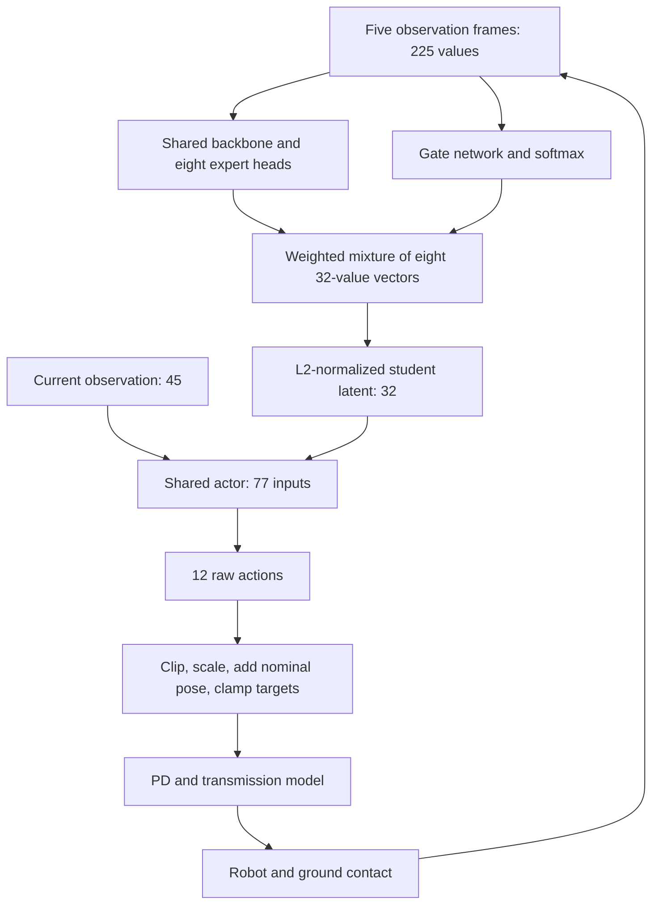

> Historical note. For current commands and decisions, start at [Task 3](../../README.md).

# Step 1 — RL, this MoE architecture, and robot control

Created: 2026-09-25. Purpose: a detailed beginner's lesson for the Task 3 MoE 90k jitter project.

[Master checklist](01_PROJECT_CHECKLIST.md) · [Audit explanation](02_JITTER_AUDIT_EXPLANATION.md)

## How to use this lesson

Read in four sittings rather than trying to memorize everything at once:

1. Sections 1–6: the task, RL, observations, neural networks and experts.
2. Sections 7–11: the actual architecture, teacher/student learning, PPO and training updates.
3. Sections 12–17: rewards, motor control, timing, jitter and simulator differences.
4. Sections 18 onward: checkpoints, experiments, source references and self-check questions.

For each concept, ask: what does it mean, where does it appear in our code, and how
could it matter for the robot shaking or failing at a stair?

Evidence labels used here:

- **Local code:** inspected in this repository; current behavior may differ from the historical training source.
- **Checkpoint:** metadata/tensor shapes read from the shipped `model_90000.pt` on CPU.
- **Pinned upstream:** public algorithm code at the commit named by the local training script.
- **Audit:** findings reported by the saved audit; not a new experiment performed for this lesson.
- **Teaching example:** invented numbers or simplified equations to explain a concept, not measured robot results.

The upstream files are now readable online, but the original saved training-source
path is absent locally. We have not matched every historical source hash or recovered
the full original environment configuration. This lesson is not a claim that the
training environment has been reproduced or that jitter has been fixed.

## 1. What exactly are we trying to teach this robot?

The robot is a quadruped: four legs, with three controlled joints on each leg.
That gives 12 joint actions. FL/FR mean front-left/front-right; RL/RR mean
rear-left/rear-right. The joint order here is hip, thigh, calf within each leg.

At the locomotion level, the operator supplies desired motion, such as:

```text
vx = 0.3 m/s       move forward
vy = 0.0 m/s       no requested sideways motion
wz = 0.0 rad/s     no requested turn
```

The policy must coordinate 12 joints so the body follows that command while
remaining balanced and negotiating the terrain. The command does not tell each
foot exactly where to land. The learned policy produces the joint-level behavior.

A request for 0.3 m/s is not proof that the robot actually moves at 0.3 m/s. The
actual velocity must be measured. A robot can receive a forward command and still
stall, turn or fall.

This policy is a locomotion component. Its deployed inputs contain no camera image,
language instruction or explicit stair-height label. The repository's broader VLM
navigation context does not turn this specific network into a vision-language model.
A navigation system could supply velocity commands to it, but that is another layer.

## 2. The learning problem in plain language

Reinforcement learning, or RL, improves a decision rule by collecting interactions
and evaluating their consequences. For this project, the interaction is:

```text
Observe the robot -> choose joint actions -> simulate movement/contact
                  -> calculate reward -> observe the new situation
```

During training, many such interactions are collected. The learning algorithm then
updates neural-network parameters. During ordinary inference, those parameters stay
fixed while the network repeatedly computes actions.

The core vocabulary is:

| Term | Meaning | Example in this project |
|---|---|---|
| Agent | The decision-making learner | The locomotion policy and its learning process |
| Environment | The world it interacts with | Robot dynamics, terrain, sensors, commands and task rules |
| State | Information sufficient to describe the relevant world dynamics | Body pose/velocity, joints, terrain and actuator state |
| Observation | Information actually supplied to a network | IMU-derived signals, joint signals, command and past actions |
| Action | The decision produced by the policy | Twelve numerical joint-action values |
| Policy | Rule mapping available information to actions or an action distribution | Student encoder plus actor during deployment |
| Reward | Scalar feedback associated with a transition | A combination of tracking and other task terms |
| Return | Accumulated future reward | Quality of a sequence of movements |
| Transition | One interaction record | Observation, action, reward, successor observation and ending flags |

A state can include information absent from the observation. The robot may not know
the precise friction of a foot on a stair. This is partial observability. In an MDP,
a complete state supports predicting the next-state distribution from the current
state and action; with incomplete observations, history can help. It does not restore
all hidden information automatically. These definitions follow standard RL notation;
see [OpenAI's RL introduction](https://spinningup.openai.com/en/latest/spinningup/rl_intro.html).

**Project interpretation:** the student must react using what the robot can sense.
The simulator can supply additional information for training the teacher and critic.
Those are different information pathways, explained below.

## 3. Rewards, returns and delayed consequences

A positive training outcome need not happen immediately after a useful action.
Lifting a foot may temporarily reduce forward progress but allow the body to climb
and continue moving. RL needs a way to credit earlier actions for later outcomes.

A common teaching expression for discounted return is:

```text
G_t = reward_t + gamma * reward_(t+1) + gamma^2 * reward_(t+2) + ...
```

`gamma`, the discount factor, sets how strongly future rewards are weighted.
The current local MoE training call passes `gamma = 0.99`.
For an illustrative three-step reward sequence `1, 2, 3`, the return is:

```text
1 + 0.99 * 2 + 0.99^2 * 3 = 5.9203
```

This does not mean that the robot predicts only three steps. The example is small
so the arithmetic is visible. Returns in PPO training are estimated using collected
rollouts and a value function.

A **dense reward** supplies frequent feedback, such as tracking performance each
control step. A **sparse reward** might occur only after completing a staircase.
Do not assume this project contains an explicit stair-completion reward: terrain
exposure, a locomotion reward and a curriculum can also teach stepping. The exact
active reward list is a later audit task.

A **penalty** is normally a contribution that lowers total reward. It is not a
physical punishment, firmware fault or automatic motor shutdown. An ending rule
can terminate an episode separately from a penalty.

Source for the project's discount setting: [train_other.py](../../xterra_mjlab/scripts/train_other.py), MoE algorithm construction around lines 87–92.

## 4. What does this student actually observe?

One observation frame has 45 values. This layout is explicit in
[controller.py](../../xterra_mjlab/svanm2_moe_stair_sim/controller.py), `get_current_frame`,
and corresponds to the actor terms in the local environment configuration.

| Python slice | Count | Signal | Plain meaning |
|---|---:|---|---|
| `0:3` | 3 | Command: vx, vy, yaw rate | What movement is requested |
| `3:6` | 3 | Body angular velocity × 0.25 | How fast the body rotates |
| `6:9` | 3 | Projected unit gravity | Which way down points in the body frame |
| `9:21` | 12 | Joint position minus nominal pose | How each joint differs from the reference posture |
| `21:33` | 12 | Joint velocity × 0.05 | How fast each joint moves |
| `33:45` | 12 | Previous clipped raw action | What the policy requested at the previous update |
| Total | **45** | | |

A slice such as `9:21` includes indices 9 through 20. Joint ordering must match
across observations, actions and actuators.

Important details:

- Projected gravity communicates tilt; it does not independently reveal absolute yaw.
- Joint-position observation is `q - q0`, not the tracking error `q_target - q`.
- Commanded linear velocity is present, but directly measured base linear velocity
  is not in this student frame. The privileged pathway includes additional signals.
- Multiplication by 0.25 or 0.05 is fixed input scaling. It is different from learning
  running means/variances; do not insert another normalization without evidence.
- Previous action is the clipped raw action before the final joint-target clamp.
  Replacing it with the applied angle changes the observation meaning and units.

The student receives five consecutive frames:

```text
[o_(t-4), o_(t-3), o_(t-2), o_(t-1), o_t] -> 225 numbers
```

In the inspected deployment loader, this is oldest first. At 50 Hz, adjacent frames
are 20 ms apart, so the oldest and newest timestamps are 80 ms apart. History helps
distinguish a joint that is moving through an angle from one that is stuck there.
It cannot tell the robot the exact height of an unseen stair before any revealing
sensor interaction.

The model processes the finite history with feedforward networks. It is not an LSTM
with indefinitely carried hidden memory. At demo initialization, the first frame is
repeated five times; later frames shift through the buffer.

**Why different files say six frames:** the base task configuration also supports
other algorithms. The MoE adapter requests single-frame actor observations and builds
a separate five-frame history. The flat policy and HIMLoco use different histories.
Always trace the selected algorithm's actual path rather than copying a nearby default.

## 5. Neural-network terms needed to understand MoE

A neural network is a parameterized numerical function. Its **weights** and **biases**
are learned numbers. A simple layer computes:

```text
output = activation(W * input + b)
```

An **MLP**, or multilayer perceptron, chains fully connected layers. A layer size
`225 -> 512` means 225 input features are mapped to 512 output features. It does not
mean 512 separate robots or experts.

An **activation function** introduces nonlinearity, allowing the network to express
more than one linear transformation. The local inference network uses ELU between
hidden layers. You do not need to memorize ELU's derivative to understand the policy.

A **feature** is an intermediate numerical description. A **latent vector** is a
compact learned representation. Here the student latent has 32 values. They need not
have individually named physical meanings such as stair height or friction.

**Forward pass/inference:** calculate outputs from fixed parameters and inputs.
**Backpropagation:** calculate how a training loss changes with each parameter.
**Gradient:** that local sensitivity. **Optimizer:** the rule using gradients to
update parameters. **Learning rate:** a scale controlling optimizer step sizes.

Do not confuse these three quantities:

| Quantity | What it controls | Does it change every inference? |
|---|---|---|
| Network parameters | The learned mapping itself | No, ordinary inference keeps them fixed |
| Gating weights | How expert features are mixed for the current input | They can change with the input |
| Reward weights | Relative contributions to the training objective | Usually fixed within a controlled experiment |

Robot speed is another quantity: `vx` is a motion command. Increasing an optimizer
learning rate does not directly increase the commanded walking speed.

## 6. What is an expert, and what is gating?

MoE means **Mixture of Experts**. Several learned computational branches produce
outputs. A **gating network**, also called a router, computes how strongly each
output contributes to the mixture.

For this student there are eight experts. They produce eight **32-dimensional latent
vectors**, not eight independent sets of motor torques. A shared actor later converts
the blended latent and current observation into the 12 actions.

An analogy: eight specialists each propose an internal description of the situation;
a coordinator combines those descriptions; a shared decision-maker chooses the
movement. The specialists are learned numerical functions, not manually programmed
labels such as 'stairs specialist' or 'front-left leg specialist'.

Let `e_i(H)` be expert i's vector for history H. The gate produces eight scores,
converted by softmax into weights:

```text
g_i = exp(score_i) / sum_j exp(score_j)
z_before_normalization = sum_i g_i * e_i(H)
```

Mathematically, softmax weights are positive and sum to one; finite-precision code
may make extremely small values effectively zero. An illustrative gate could be:

```text
[0.40, 0.25, 0.10, 0.10, 0.05, 0.04, 0.03, 0.03]
```

This means expert 1 contributes 40% of the weighted mixture before normalization.
It does not mean '40% confidence the terrain is stairs', '40% motor torque', or
'40% chance of success'. The model has no such interpretation built into those weights.

For a two-expert toy example:

```text
expert A = [2, 0], expert B = [0, 4]
weights  = [0.75, 0.25]
mixture  = 0.75 * [2, 0] + 0.25 * [0, 4] = [1.5, 1.0]
```

Our real model performs this operation across eight vectors of length 32, then
L2-normalizes the result. Normalization divides a nonzero vector by its length
(with a numerical epsilon safeguard). This keeps the latent scale controlled; it
is not joint-angle smoothing.

**Dense routing** evaluates and combines all experts. **Sparse routing** selects a
subset, often through top-k selection. This local model is dense: there is no hard
argmax expert selection in its forward path. This is why an explanation based purely
on abrupt single-expert switching is unsupported here.

Soft weighting does not guarantee smooth motion. Gate values can change quickly,
expert outputs can vary, and the actor plus physical feedback loop can amplify
sensitivity. Conversely, changing gate weights alone is not proof of a problem.

**Specialization** means experts become useful in different input conditions.
**Expert collapse** means one or a few dominate and others contribute little.
**Load balancing** encourages broader usage, but does not guarantee meaningful
terrain specialization. To demonstrate specialization we need logged gate behavior
under labelled conditions and careful comparisons, not names assigned by intuition.

Evidence: [checkpoint_policy.py](../../xterra_mjlab/svanm2_moe_stair_sim/checkpoint_policy.py),
`Experts`, `MoE` and `StudentMoEEncoder`; the same pattern is visible in the
[pinned upstream module utilities](https://github.com/wty-yy/go2_rl_gym/blob/30e74dc507bec7a642a8c98be26081f2c6f0822d/rsl_rl/rsl_rl/modules/utils.py).

## 7. The actual student architecture, layer by layer

This table comes from the local inference reconstruction, which loads the checkpoint's
student and actor weights strictly. Teacher/critic dimensions below were also checked
from checkpoint tensor shapes.

| Component | Dimensions | Function |
|---|---|---|
| Observation history | 5 × 45 = 225 | Recent sensor/command/action information |
| Expert shared backbone | 225 -> 512 -> 256 -> 2048 | Construct features for all expert heads |
| Expert heads | 8 groups of 256 -> 32 | Produce eight latent proposals |
| Gate MLP | 225 -> 512 -> 256 -> 8 | Produce expert scores |
| Softmax | 8 -> 8 | Convert scores to mixture weights |
| Weighted sum and L2 normalization | 8 × 32 -> 32 | Produce the student latent |
| Actor input | 32 + 45 = 77 | Latent plus the newest observation |
| Shared actor | 77 -> 512 -> 256 -> 128 -> 12 | Produce raw joint actions |

The expert heads are implemented as a grouped 1D convolution with kernel size one.
Here it acts as eight separate feature projections after a shared backbone. It is
not processing a camera image or sliding a temporal filter over the five frames.



Text equivalent: history branches into experts and gate; their mixture becomes a
32-value latent; latent plus current frame enters one actor; its 12 outputs go
through the controller before affecting the robot.

During normal deployment, the teacher and critic are unnecessary. The inference
loader deliberately selects only `student_moe_encoder.*` and `actor.*` weights.
That does not mean they were absent during training.

## 8. Teacher, student, actor and critic are different roles

| Component | Job | Extra information? | Needed in deployed inference? |
|---|---|---|---|
| Teacher encoder | Form a useful training representation | Privileged simulator observations | No |
| Student MoE encoder | Form a representation from deployable history | Only its 225-value history | Yes |
| Actor | Produce action means from latent plus current frame | Indirectly through the selected latent | Yes |
| Critic | Estimate future return for training | Privileged observations and latent | No |

The **teacher is not a human instructor**, and it is not automatically a perfect
controller. It is learned. The critic is also learned; it estimates return rather
than supplying the true reward function or directly controlling motors.

Checkpoint tensor shapes show:

```text
Teacher encoder: 255 -> 512 -> 256 -> 32
Critic:          287 -> 512 -> 256 -> 128 -> 1
```

The critic's 287 inputs are consistent with 255 privileged-observation values plus
a 32-value latent. The current local critic configuration includes command,
proprioceptive signals, base linear velocity, terrain-height samples, foot air time,
contact indicators and contact forces. The full historical 255-value layout still
needs source/configuration parity checking; tensor dimensions alone cannot prove
which physical quantity occupies every index.

**Privileged** means available to training through the simulator but not assumed to
be an input to the deployed student. A terrain-height scan in the teacher pathway
does not mean the deployed student sees that scan.

**Distillation** teaches the student representation to resemble the teacher's on
corresponding samples. One illustrative latent-matching objective is:

```text
mean squared error = average((student_latent - teacher_latent)^2)
```

This asks the student to infer useful hidden context from its history. If history
cannot reveal some property, distillation cannot create information from nothing.
A small matching error is also not a guarantee of stair success.

**Concurrent Teacher–Student (CTS)** trains the two pathways during the same overall
learning process, using interaction data from both. This differs from completing a
teacher run and only then training a student. Background:
[original CTS project](https://clearlab-sustech.github.io/concurrentTS/).
The project's SvanM2 adaptation is not an exact reproduction of every original
paper's robot, simulator, terrain or reward configuration.

## 9. Which parameters actually learn from which losses?

The pinned algorithm assigns 75% of environments to teacher-conditioned actions and
25% to student-conditioned actions: 6,144 and 2,048 respectively at 8,192 environments.
It shares the actor across both groups. Optimizer 1 updates teacher encoder, actor,
critic and action standard deviations. Student features are detached for the PPO
actor update; critic input latents are detached too. Optimizer 2 updates the student
MoE using latent matching plus load balancing on student-group samples. The balance
term is mean squared deviation of batch-average gate usage from 1/8, with default
coefficient 0.01. PPO combines separately averaged teacher and student surrogate
losses, so the 75/25 sample split is not a 75/25 loss weighting.

Source: [pinned MoE learner](https://github.com/wty-yy/go2_rl_gym/blob/30e74dc507bec7a642a8c98be26081f2c6f0822d/rsl_rl/rsl_rl/algorithms/moe_cts.py)
and [pinned actor/critic](https://github.com/wty-yy/go2_rl_gym/blob/30e74dc507bec7a642a8c98be26081f2c6f0822d/rsl_rl/rsl_rl/modules/actor_critic_moe_cts.py).

**Why this matters for reward changes:** a new movement penalty changes the experience
and learning signals used by the training system. You cannot assume every expert is
directly receiving its own independent PPO reward gradient. The learning pathways
must be respected when diagnosing whether a changed reward reaches the behavior you
want to improve.

An important conceptual distinction: averaging expert use over many samples can
encourage coverage while still allowing a strongly nonuniform gate for an individual
sample. Demanding equal weights at every instant would defeat much of the point of
input-dependent routing. That is not what the inspected balance objective does.

The public commit is `30e74dc507bec7a642a8c98be26081f2c6f0822d`, named by the local
training manifest code. We have inspected it online; matching the historical run's
saved source hashes remains a separate reproducibility task.

## 10. Actor–critic and PPO: how experience changes the policy

The actor proposes actions. The critic estimates the future return associated with
the situation. Comparing outcomes with that estimate helps judge which sampled
actions were better or worse than expected.

For a teaching example, suppose the estimated return from a situation was 10 and
the collected experience suggests 13. That suggests a positive advantage of about
3. Another outcome worth 7 suggests about -3. Real training uses return/advantage
estimators, not these invented numbers.

**Advantage** describes relative action quality. **Value** describes expected future
return. Neither is the joint position `q`: the RL symbol `Q(s,a)` for an action-value
function and the robot-control symbol `q` for a joint angle refer to different things.

**PPO, Proximal Policy Optimization**, alternates collecting trajectories with several
optimization passes over that batch. Its clipped objective discourages overly large
incentives to change action probabilities based on one batch:

```text
ratio = probability_density_new(action | information)
        / probability_density_old(action | information)

maximize average(min(ratio * advantage,
                     clip(ratio, 1-epsilon, 1+epsilon) * advantage))
```

For continuous actions these are probability densities. Positive advantage favors
making the sampled action more likely; negative advantage favors the reverse.
Clipping limits the objective's incentive, not the actual change in every network
output, and does not guarantee stability. PPO clipping is different from joint-target
clipping. See the [original PPO paper](https://arxiv.org/abs/1707.06347).

The **value loss** trains the critic to fit estimated return targets. An **entropy
bonus** encourages exploration by maintaining variation in sampled actions. A
**KL-divergence estimate** measures distribution change; an adaptive learning-rate
schedule can respond when policy change becomes too large or too small.

For this project's current training call, explicit settings include:

| Setting | Value passed by local trainer | Meaning |
|---|---:|---|
| Learning epochs | 5 | Revisit the collected batch for five passes |
| Minibatches | 4 | Split each pass into four batches for optimization |
| Discount gamma | 0.99 | Weight future reward |
| GAE lambda | 0.95 | Set advantage estimator's temporal weighting |
| Entropy coefficient | 0.01 | Weight the exploration-related term |
| Schedule | adaptive | Allow policy-update learning rate to change |

These are current code settings, not a replacement for checking the historical run's
resolved configuration. Other arguments come from upstream defaults or restored
checkpoint/optimizer state.

During training, this actor supplies a mean for each joint action and a learned
standard deviation sets Gaussian sampling noise. Conceptually, a sample is
`mean + std * random_normal_sample`. This exploration lets the learner try variations.
The deployed student graph returns deterministic actor outputs without that sampling.
Therefore jitter in the deterministic demo cannot automatically be blamed on injected
training exploration noise; a fixed policy can still oscillate through feedback.

**GAE**, Generalized Advantage Estimation, combines value prediction errors across
successive steps. Away from episode boundaries, the teaching equations are:

```text
delta_t = reward_t + gamma * V(next_information) - V(current_information)
A_t = delta_t + gamma*lambda*delta_(t+1) + (gamma*lambda)^2*delta_(t+2) + ...
```

It balances noisy long-term estimates against reliance on the imperfect critic.
Termination masks and timeout handling matter at trajectory boundaries.
Reference: [original GAE paper](https://arxiv.org/abs/1506.02438).

Do not interpret decreasing loss as proof of a better robot. For example, predicting
poor returns accurately can yield a small value loss while the policy still falls.
The independent measures we care about include tracking, balance, full traversal
and jitter during comparable movement.

## 11. What happens during one training update?

The checkpoint records 8,192 environments and 24 rollout steps per environment.
This gives:

```text
8,192 * 24 = 196,608 environment transitions per rollout batch
```

Thousands of simulated robots collect different experiences in parallel. They do
not each have an independently trained policy. They generally share the current
network parameters, with different states, commands and sampled variations.

| Term | Meaning in this workflow |
|---|---|
| Environment step | Advance one simulated environment through one policy action interval |
| Physics substep | One integration step inside that action interval |
| Episode | A trial from reset until its ending condition/time limit |
| Rollout | Collected segment of experience; it can span partial or multiple episodes |
| Batch | Collection used for the current learning update |
| Minibatch | Smaller subset used for one optimization operation |
| Epoch | One pass through that batch |
| Training update | Collect a rollout and perform the scheduled learning operations |
| Checkpoint | Saved snapshot of weights and available training state |

A conceptual update in this project is:

1. Read current observations and histories for all environments.
2. Obtain actions through the teacher or student pathway assigned to each environment.
3. Apply actions, simulate dynamics, compute rewards and detect ending conditions.
4. Save observations, histories, actions, values and action probabilities.
5. Reset ended environments correctly and repeat until 24 steps are collected.
6. Estimate returns and advantages, including the correct boundary handling.
7. Run the learning passes, including PPO-related updates and student learning.
8. Log results and save checkpoints at the configured intervals.
9. Collect a fresh batch with the updated parameters.

The current call's five epochs and four minibatches correspond to 20 minibatch
iterations per optimization phase. This learner has distinct optimization phases;
'one update' is therefore not a single gradient step.

At a 50 Hz policy interval, 24 steps would cover 0.48 seconds per environment before
the next learning update. That is simulated experience, not necessarily 0.48 seconds
of wall-clock time. Training throughput depends on GPU, physics and software costs.

**On-policy** learning primarily uses experience from the current or recently used
policy. PPO does not normally keep training forever from a fixed old replay dataset.
Replaying recorded inputs to verify outputs is an inference check, not PPO training.

**Termination** and **truncation** differ. A genuine task terminal condition ends
future task value. An externally imposed collection time limit can require a value
estimate of the successor state. Bootstrapping means using that estimated value.
The reset state's observation must not replace the final state's observation in this
calculation. See [Gymnasium's time-limit explanation](https://gymnasium.farama.org/tutorials/gymnasium_basics/handling_time_limits/).
The local trainer explicitly computes terminal values before resetting histories.

The exact physical ending rules are task-specific. The current MoE environment
adds a 60-degree tilt backstop and retains relevant illegal-contact termination.
A 60-degree cutoff is a definition used by the implementation, not a universal
boundary between a healthy and unhealthy robot.

## 12. Rewards and penalties: what can we manipulate?

A useful conceptual model is:

```text
total reward = sum over terms(weight_i * raw_term_i)
```

The reward manager may also apply timestep scaling, masks or other handling.
Therefore the function, its configuration and the manager must all be inspected.

There are three distinct levels:

| Level | Example | What changing it means |
|---|---|---|
| Environment reward | Velocity tracking or slipping penalty | Change which behavior receives training credit |
| Learning loss | PPO surrogate, value loss, student matching | Change how parameters learn from collected data |
| Physical/controller setting | Target bounds, PD gains, delay, friction | Change the robot response or action interpretation |

Changing target bounds is not simply 'changing a punishment'. A bound can remove
part of an action before physics executes it. A penalty instead changes the learning
signal; it may encourage better requests over future training updates.

The audit reports these existing penalties in the saved training configuration:

| Term | Reported coefficient | Question to resolve before changing it |
|---|---:|---|
| Action rate | -0.1 | Does it penalize raw actions, clipped actions or physical targets? |
| Foot slip | -0.1 | Which contact mask and foot velocity are used? |
| Foot clearance | -2.0 | How is clearance error defined relative to terrain? |
| Soft landing | -1e-5 | Which impact/velocity signal is squared or accumulated? |
| Joint limit | -1.0 | Is it based on actual angle or requested target, and which limits? |

The current robot configuration also sets linear tracking +6, angular tracking +3,
upright +0.5, pose +0.25, and several collision terms -0.1. This is a preliminary
inventory, not a complete historically verified reward table. See
[env_cfgs.py](../../xterra_mjlab/xterra_mjlab/tasks/velocity/config/svanm2/env_cfgs.py)
and [the audit's recommendations](../../moe_jitter_audit_20260921/REPORT.md).

**Teaching example: coefficients alone are misleading.** Suppose a tracking term
has raw value 0.8 and coefficient +6: its contribution is +4.8. A penalty with raw
value 0.1 and coefficient -0.1 contributes -0.01. Another with raw value 100,000 and
coefficient -0.00001 contributes -1. These numbers are invented, but the arithmetic
shows why a small coefficient can still matter.

An overly strong smoothness penalty might make the robot avoid lifting its feet.
An overly strong velocity incentive might reward aggressive attempts that harm
balance. The correct question is: which tradeoff improves the requested task over
the evaluated distribution, with acceptable motion quality?

Additional pitfalls:

- A negative coefficient on an already negative raw function could reverse the intended effect.
- A penalty active while a foot is swinging might behave differently from one active only in stance.
- A torque penalty, a power penalty and an energy penalty are different quantities.
- A large return can hide failure if the robot earns easy reward before stalling.
- A new reward scale makes total-return curves across old/new objectives hard to compare directly.
- A reward for a position angle may not penalize rapid oscillation around that angle.

This is why Stage 4 requires formulas and measured contributions by locomotion phase.
We have not selected new reward weights in this lesson.

## 13. From network actions to actual movement

The neural network's 12 outputs are not directly the measured angles and are not
motor torques. In the inspected stair controller the transformation is:

```text
a = clip(raw_action, -6, +6)
q_requested = q0 + action_scale * a
q_commanded = clip(q_requested, target_min, target_max)
```

The per-leg action scales are `[0.15, 0.15, 0.30]` for hip, thigh and calf.
Angles are in radians; the raw action is a scaled control quantity.
`q0` is a reference standing pose. Scaling and adding it turns the numerical action
into a joint-position request.

For a front calf, the demo's nominal value is -1.1716 rad. A raw action of +1 gives:

```text
q_requested = -1.1716 + 0.30 * 1 = -0.8716 rad
```

With the reported deployed upper bound -0.88776 rad, that request becomes
-0.88776 rad. With the original demo upper bound +0.5 rad, -0.8716 rad is allowed.
This example illustrates command semantics; it does not prove which limit was used
in the original 90k training environment.

**Saturation** means a signal reaches a limit and additional requested change is
removed. Raw-action clipping, target clamping and torque clipping are separate stages.
A saturated target is a requested angle at a software boundary; it does not establish
that the physical joint reached a mechanical hard stop.

The robot then needs a controller to turn angle errors into torque. A simplified
single-joint PD law is:

```text
torque = kp * (q_commanded - q_measured) - kd * dq_measured
```

- `kp`: response to position error.
- `kd`: damping-related response to velocity, assuming zero target velocity in this law.
- `q_commanded`: desired joint angle.
- `q_measured`: current joint angle.
- `dq_measured`: current angular velocity.

In the actual demo, the belt transmission couples the thigh and calf. Its motor-space
mapping is represented by a matrix J. The code computes motor-space error/velocity,
motor torques, then the joint torques through the transmission. For one leg:

```text
J = [[8, 0,  0],
     [0, 8,  0],
     [0, 8, 16]]

At kp = 20, effective joint stiffness is:
K = [[20,  0,  0],
     [ 0, 25, 10],
     [ 0, 10, 20]]
```

The off-diagonal terms mean calf error contributes to thigh torque and vice versa.
This is more than three independent springs. The demo also clamps the resulting
joint torques. The audit says the precise hardware torque-saturation semantics
remain uncertain, so the implementation should not be treated as a fully measured
physical motor model.

Changing `kp` or `kd` changes the physical response seen by the trained policy.
Adding damping is not automatically an improvement: delay, contacts, required
stepping forces and the coupled mechanism all matter. Parameter tuning needs evidence.

Source: [controller.py](../../xterra_mjlab/svanm2_moe_stair_sim/controller.py),
`policy_step` and `physics_step`; interpretation limits in the audit report.

## 14. Timing, history, delay and GPU are different issues

| Quantity | Original demo setting | Meaning |
|---|---:|---|
| Policy frequency | 50 Hz | Compute a new network action every 20 ms |
| Physics frequency | 200 Hz | Integrate simulation every 5 ms |
| External PD update | 200 Hz | Recompute torque every 5 ms in this demo |
| Decimation | 4 | Four physics/PD steps per policy interval |
| History length | 5 frames | The student sees five policy-rate observation frames |

The corrected audit can vary physics resolution while keeping PD at 200 Hz and policy
at 50 Hz. Therefore a smaller physics timestep need not mean faster action inference
or a faster motor controller.

**Zero-order hold** means a target stays unchanged until the next policy update.
A staircase-like target signal may reflect that hold even when there is no unwanted
oscillation. Repeated reversals and physical responses need separate inspection.

**Latency** is delay between sensing, decision and application. **Timing jitter** is
variation in the intervals/delays. **Mechanical or motion jitter** is unwanted motion
oscillation. They are related possibilities, but they are not interchangeable terms.

If a sensor value describes an earlier state, the policy may react to stale information.
If a target filter introduces lag, a correction may arrive at an unhelpful time.
A simulator must also refresh sensors and reset all relevant state consistently.

The demo's `--device cuda` sends network inference to the GPU. Standard MuJoCo physics
in that script still runs on CPU. The training pipeline uses a different parallel
GPU simulation stack. Enabling CUDA for inference does not repair reward design,
physical-model mismatch or action limits, and it does not mean retraining has begun.

Rendering speed, simulated time, wall-clock throughput, requested walking velocity
and learning rate are five separate quantities. Whenever saying 'increase speed',
specify which one.

## 15. How these ideas relate to jitter

The feedback loop is the main object we are investigating:

```text
Policy target -> motor response -> foot contact/body motion
     ^                                      |
     |-------------- observations ----------|
```

An illustrative possibility: a foot cannot achieve a request because it meets a
riser; joint/body signals change; the next action requests a correction; that
correction changes contact again. Under some conditions this may repeat. This is
a hypothesis about a feedback interaction, not a proven reconstruction of your run.

| Signal to inspect | What it tells us | What it cannot establish alone |
|---|---|---|
| Raw action | Network's numerical request | Final target or executed motion |
| Commanded target | Request after scaling and target limits | Actual joint position |
| Measured q | Actual joint motion | Whether policy, actuator or contact initiated it |
| Measured dq | Joint angular speed | Motor health from one trace |
| Torque and contact | Actuation demand and ground interaction | Exact firmware behavior if torque is estimated |
| Gate weights | How features are mixed | Expert meaning or causality of a failure |

The plotted gap `q_commanded - q_measured` is tracking error. It can reflect finite
motor strength, inertia, contact constraints or delay. Some lag is expected; a gap
by itself does not prove a damaged motor or broken policy.

**Frequency** measures cycles per second. A 10 Hz component repeats approximately
every 0.1 seconds. **RMS**, root mean square, summarizes signal magnitude; it is not
a peak-to-peak angle. **Spectrum** describes how signal variation is distributed
across frequencies. Filtering to 8–30 Hz isolates a band, not all leg movement.

The audit reports larger target than measured-angle oscillation in that band and
strong association across time windows. This supports examining target generation
and physical response together. It does not identify the direction of causation
because the policy also reacts to the robot's motion.

Sampling matters: a 20 Hz recording has a 10 Hz Nyquist limit, so it cannot reliably
resolve the entire 8–30 Hz band. The audit's approximately 200 Hz recording is better
suited to it. Normal gait harmonics and impacts can also contribute to band energy;
we should compare equivalent commands and motion phases.

For the displayed 465–469 s hardware plot, full angle/target curves are shown. The
frequency-band score was used to select that window. Large slow leg swings in the
plot are not all '8–30 Hz jitter'. Terrain labels were absent, so that window cannot
be labelled a staircase incident solely from those curves.

## 16. Simulator, training environment and deployed controller

These are related but separate things:

| Name | Meaning here |
|---|---|
| Training environment | Parallel task used to generate learning experience |
| Original stair simulator/demo | Local interactive MuJoCo script for running the policy |
| Corrected audit simulator | Separate implementation described in the audit |
| Deployed controller | Robot-side observation/action/control conventions referenced by the audit |
| Real physical robot | Actual motors, transmission, inertia, friction, contacts and sensors |

A **control contract** is the agreed meaning of exchanged values: ordering, scaling,
units, history order, timing and action interpretation. A **sim-to-real gap** includes
physical or interface differences between simulation and real operation.

The same neural weights can behave differently if one setup changes what inputs mean
or how outputs are applied. That is why loading the correct checkpoint is necessary
but insufficient evidence that a simulation reproduces deployment.

The calf upper-bound example is:

```text
Original demo:        +0.50000 rad
Reported deployment: -0.88776 rad
Difference:           1.38776 rad = approximately 79.5 degrees
```

This is a difference between permitted endpoints, not a measured instantaneous
79.5-degree leg movement. It is a plausible contributor to different behavior.
It is not established as the sole jitter cause: the audit found failures under both
limit profiles. The approximately 72.6-degree incident figure is body tilt, a separate
measurement.

**Curriculum** varies difficulty as training progresses, for example moving to higher
terrain levels. **Domain randomization** varies physical or observation properties,
for example friction, added mass, gains or noise, to expose the learner to variation.
Neither is a guarantee of success outside the tested distribution.

Current local MoE configuration includes flat, ascending/descending stairs and slopes.
Its stair-height range extends to 0.27 m, but a configured upper range is not evidence
that this checkpoint mastered every height. Actual curriculum exposure and evaluation
outcomes matter. The command setup uses lateral velocity in +/-0.3 m/s; its staged
expansion concerns forward speed. Running at 0.6 m/s sideways therefore goes beyond
that reported training range. It does not explain a trial with zero lateral command
by itself.

## 17. What we know, and what still needs checking

| Finding | Evidence level | Remaining limit |
|---|---|---|
| Five 45-value frames, eight latent experts, shared 12-action actor | Local inference code and checkpoint | Full training-source parity still separate |
| Teacher/critic are present in the checkpoint | Tensor blocks and dimensions inspected | Dimensions alone do not define every input |
| Separate PPO and student optimization pathways | Pinned upstream plus local loader/trainer | Historical source hashes not yet matched |
| Original demo and deployed target bounds differ | Local demo code plus saved audit | Not proof of historical training bounds |
| Saved outputs were replayed within tolerance | Audit report | Not proof of locomotion success |
| Stair ascent unreliable in audit trials | Audit outcomes | Small sample and incomplete physical identification |
| Rewards already include relevant penalties | Audit and partial current configuration | Full formulas/contributions still pending |

The report's independent corrected implementation was not found in the local copy
in prior inspection. Its README reference must be recovered or the relevant behavior
reconstructed and checked. Reading its report does not make the current original demo
identical to it.

The model card has sections for multiple policies. Its flat-policy history and
performance must not be assigned to MoE, and an aggregate benchmark result must not
be treated as a guarantee for this dashboard's different staircase cases.

## 18. What model_90000.pt contains, and what continuing training means

The shipped checkpoint was inspected on CPU for this lesson. It records:

| Item | Observed value |
|---|---|
| Algorithm | `moe` |
| Update | 90,000 |
| Parallel environments | 8,192 |
| Steps per rollout | 24 |
| Seed | 103001 |
| Optimizer states | Two |
| Model blocks | Actor, critic, teacher encoder, student MoE encoder, action std |
| Saved algorithm learning rate | Approximately 0.000050625 |
| Terrain state fields | `terrain_levels`, `terrain_types` |
| Random-state fields | Torch CPU/CUDA, NumPy and Python |
| Recovery setting | `stabilize=True` in saved arguments |

The saved learning rate is the algorithm's field at this checkpoint. Do not assume
it describes every optimizer parameter group; restoration must inspect those states.
The saved arguments' target update count can exceed 90,000: a snapshot is an
intermediate save, not necessarily the final planned training update.

`90000` means the saved training update counter. It does not mean 90,000 experts,
90,000 episodes, or 90,000 different checkpoints that we must load. The model weights
represent learning already performed before that snapshot.

| Operation | What happens |
|---|---|
| Evaluate 90k | Run the saved policy with fixed parameters |
| Resume training | Restore compatible model and optimizer/training state, then collect new experience and update parameters |
| Fine-tune | Continue learning while deliberately changing some training conditions/objective |
| Weights-only initialization | Start from saved weights but initialize other training state anew |
| Export | Produce an inference artifact, such as TorchScript or ONNX |

The existing direct-checkpoint demo loads student and actor for inference only.
Its successful load does not demonstrate training-state restoration.

The local recovery code checks matching algorithm, environment count, rollout length
and seed. It restores both optimizer states and the update counter. The training
script also restores available random and curriculum state, but resets simulator
episodes and explicitly records that continuation is not bit-exact. This is a
meaningful continuation from learned state, not replay of precisely the same future
simulation trajectory.

The original upstream path recorded by this checkpoint is:

```text
/data/robotics/toshith/m2_algorithm_sources20260913/go2_rl_gym
```

That path does not exist in this local environment. Public pinned files can now be
read online, but the compatible local training setup still has to be prepared.
Restoring training on a smaller GPU may require fewer environments; that adaptation
changes batch/update conditions and currently conflicts with strict resume checks.
It must be validated and shared by control/candidate runs, not changed silently.

When rewards change, we will preserve the original checkpoint and save new runs
separately. The baseline comparison should include unchanged-reward continuation
from the same 90k snapshot, because extra training itself may change performance.

## 19. How the concepts guide a reward-change experiment

We want a testable chain of reasoning:

```text
Observed failure -> candidate explanation -> relevant signal/reward
 -> one controlled change -> further training -> independent evaluation
```

For example, suppose measured data shows rapidly reversing commanded targets before
failure. Before adding a penalty, inspect whether the existing action-rate penalty
already discourages that behavior and whether its actual contribution is meaningful.
Also check contact, limits and timing, because the same pattern may arise through
physical feedback.

Two audit-proposed ideas, with teaching examples:

**A. Penalize abrupt changes in target increments.**

```text
second_difference = q_cmd[t] - 2*q_cmd[t-1] + q_cmd[t-2]
cost = sum((second_difference / action_scale)^2)
reward contribution = -weight * cost, with weight >= 0
```

For three target samples `0, 5, 10` degrees, successive increments are both +5, so
the second difference is zero. For `0, 5, 0`, the increments are +5 then -5 and the
second difference is -10 degrees. Squaring makes the reversal costly regardless of
its sign. Real implementation must use consistent radians and masks/reset history.

This is a discrete target-acceleration proxy. Physical acceleration approximation
also involves dividing by timestep squared; changing policy rate changes the meaning
of an unadjusted discrete penalty. Penalizing all target acceleration too strongly
can suppress stair corrections. It is not automatically a better objective.

**B. Penalize requests removed by target limiting.**

```text
q_requested = q0 + action_scale * clip(raw_action, -6, +6)
saturation_error = q_requested - q_commanded
cost = sum((saturation_error / action_scale)^2)
reward contribution = -weight * cost, with weight >= 0
```

Suppose a target request is -0.60 rad and the upper limit is -0.88776 rad. The removed
amount is +0.28776 rad. This proposed term would discourage relying on unavailable
extension. It does not establish that the limit itself is physically correct or
that the existing joint-limit term lacks equivalent coverage.

No numerical weight is recommended yet. For either hypothesis we need the actual
reward implementation, contribution measurements and a validated baseline.

For each experiment hold the other variables fixed and compare:

- Jitter during matched, upright commanded movement.
- Full 10 cm stair traversal, with the number of trials recorded.
- Falls, stalls, lane exits and unintended yaw.
- Tracking error, clearance, slipping, contact impacts and saturation.
- Flat-ground and other-terrain regressions.

A robot that barely moves may achieve a low jitter score. A robot that falls early
may produce a misleadingly short analysis window. Neither should count as a fix.

Also do not choose a model solely by the new total reward: altering reward weights
changes that numerical yardstick. Compare physical/task metrics independently.
The audit's modest flat-ground smoothing improvement did not generalize to stairs;
this is a reason to evaluate the whole task, not evidence that every reward idea
will fail.

## 20. A compact glossary for future code reading

| Term or symbol | Remember it as |
|---|---|
| Proprioception | Sensing the robot's own motion/configuration |
| Privileged observation | Training-only information supplied by the simulator |
| History | Several recent observation frames in a defined order |
| Encoder | Network producing an internal representation |
| Latent | Learned feature vector, not necessarily labelled physical variables |
| Expert | One learned feature-producing branch in this model |
| Gate/router | Computes input-dependent expert mixture weights |
| Softmax | Turns scores into nonnegative weights summing to one |
| Dense MoE | All experts evaluated and mixed |
| Sparse/top-k MoE | Only a selected subset used |
| Actor | Produces action means/distribution parameters |
| Critic/value | Estimates future return |
| Teacher | Training representation pathway with privileged information |
| Student | Deployable representation pathway with limited observations |
| Distillation | Match useful teacher outputs/representations |
| Loss | Numerical objective minimized by an optimizer |
| Reward | Environmental learning feedback, generally maximized through return |
| Advantage | Estimated action quality relative to the policy's baseline expectation |
| PPO | Policy update method using recently collected experience |
| Entropy | Measure of action-distribution spread used in exploration |
| KL divergence | Measure of change between action distributions |
| GAE | Temporally weighted advantage estimation |
| Gamma | Future-reward discount factor |
| Lambda in GAE | Temporal weighting parameter; not automatically a penalty coefficient |
| Gradient clipping | Limit gradient norm; different from action or target clipping |
| Seed/RNG | Initialization and random-number state for stochastic operations |
| Curriculum | Difficulty schedule/adaptation |
| Domain randomization | Training variation in physical/sensing properties |
| Ablation | Controlled experiment changing/removing one factor |
| q / dq | Joint position / joint angular velocity |
| q0 | Nominal reference joint pose |
| q_cmd | Commanded joint target after the relevant processing |
| Torque | Rotational effort applied by actuators |
| Stance / swing | Foot supporting contact / foot moving between contacts |
| Clearance | Foot height relative to relevant terrain |
| Saturation | A signal reaching a configured boundary |
| PD | Position-error response plus velocity-dependent damping |
| RMS | Root mean square magnitude over samples |
| Hz | Cycles or updates per second, depending on context |
| Sim-to-real gap | Difference between simulated and physical behavior/interfaces |
| Regression | A previously acceptable behavior becoming worse after a change |

## 21. Where to look in the code, and which sources support this lesson

Paths below are relative to this notes folder. Function names are more stable than
line numbers; the listed starting lines refer to the version inspected for this lesson.

| Question | Source | Starting point |
|---|---|---|
| What are the 45 inputs? | [controller.py](../../xterra_mjlab/svanm2_moe_stair_sim/controller.py) | `get_current_frame`, line 101 |
| What are the experts and gate? | [checkpoint_policy.py](../../xterra_mjlab/svanm2_moe_stair_sim/checkpoint_policy.py) | `Experts`, line 34; `MoE`, line 45 |
| Where is the actor input formed? | Same checkpoint loader | `CheckpointPolicy.forward`, line 71 |
| Where are target limits and action scales? | Same controller | Constants near line 17; `policy_step`, line 137 |
| How does PD become coupled torque? | Same controller | `physics_step`, line 166 |
| Where are MoE training arguments passed? | [train_other.py](../../xterra_mjlab/scripts/train_other.py) | MoE construction near line 87 |
| Where are rollouts collected and updates called? | Same training file | Loop near line 129 |
| Where are training states restored/saved? | Same training file | Resume near line 94; save near line 180 |
| Which terrain and command overrides apply? | [m2_algorithm_env.py](../../xterra_mjlab/scripts/m2_algorithm_env.py) | `make_cfg`, line 26 |
| How is external algorithm code loaded? | [other_backends.py](../../xterra_mjlab/scripts/other_backends.py) | `load`, line 11 |
| Where are actor and critic sensor terms? | [env_cfgs.py](../../xterra_mjlab/xterra_mjlab/tasks/velocity/config/svanm2/env_cfgs.py) | Actor near line 130; critic near line 163 |
| Where are some rewards configured? | Same environment file | Reward modifications near line 233 |
| Where are strict resume checks? | [training_recovery.py](../../xterra_mjlab/scripts/training_recovery.py) | `restore`, line 24 |
| What was previously observed about jitter? | [REPORT.md](../../moe_jitter_audit_20260921/REPORT.md) | Hardware evidence and terrain/fix experiments |

Primary background sources were linked near the relevant explanations:
RL introduction, PPO paper, GAE paper, CTS project, and Gymnasium time-limit handling.
Pinned upstream links identify code at a fixed commit, rather than an evolving main
branch. Their purpose is to substantiate the algorithm structure; they are not proof
that this local robot adaptation reproduces the papers' performance.

A similarly named online project can use experts on action outputs, terrain perception
or multiple critics. Do not transfer those details to this policy based on the phrase
'MoE-CTS' alone. Our local student contains eight latent experts and one shared actor.

## 22. Misunderstandings to avoid

| Misunderstanding | Correction |
|---|---|
| Each expert controls one leg | Eight experts produce internal features; there are four legs |
| Expert 1 is automatically the stair expert | Expert meaning needs evidence |
| Gate weights are fixed after training | Parameters are fixed at inference, but gate outputs depend on inputs |
| Softmax means there can be no jitter | Smooth mathematical mixing does not guarantee stable physical feedback |
| MoE and PPO are alternatives | MoE is architecture; PPO is part of the learning method |
| The teacher must run on the robot | Deployed inference uses student plus actor |
| Changing rewards immediately changes 90k behavior | Network weights must be updated by further training |
| A smaller penalty coefficient must matter less | Raw magnitude, scaling and frequency also matter |
| All 12 actions are joint angles already | Scaling, reference pose and limits transform them into targets |
| 79.5 degrees is observed joint shaking | It is the difference between two upper-bound settings |
| Correct weights prove correct stair behavior | Interface, dynamics, coverage and task competence still matter |
| Configured stair range proves mastery | Actual training exposure and evaluation determine capability |
| Low jitter alone means success | Motion, tracking, balance and traversal must also be acceptable |
| GPU inference means GPU training is ready | Training has separate dependencies, source and memory requirements |
| A full resume is bit-for-bit continuation | This runner resets simulation episodes and explicitly says otherwise |

## 23. Self-check questions with answers

Try answering before looking at the answer sentence. These test understanding;
writing the lesson does not mark your learning complete.

1. **Why are there 225 student inputs?** Five frames multiplied by 45 values per frame.
2. **What does each expert output?** A 32-value internal feature vector.
3. **What does the gate output?** Eight input-dependent mixture weights.
4. **Why are there 77 actor inputs?** The normalized 32-value latent plus the newest 45-value frame.
5. **Does the deployed student see a terrain-height scan?** Not in its inspected input layout.
6. **How many joint actions leave the actor?** Twelve, one per controlled joint in the defined ordering.
7. **Are these motor torques?** No; they become joint targets before the PD/transmission stage produces torque.
8. **Why can actual angle differ from target?** Dynamics, force limits, contacts and delays constrain the response.
9. **What is the teacher for?** Learn a useful representation from privileged training information.
10. **What is the critic for?** Estimate return to support learning; it is not the reward function.
11. **Does every expert receive a separate terrain reward in the inspected method?** No such assignment was found; student learning follows the identified latent-matching/balance path.
12. **Why compare with unchanged-reward continuation?** To distinguish the candidate change from effects of additional training.
13. **What does 90k identify?** The checkpoint's update counter, not sample count or expert count.
14. **Can reward edits fix inference without training?** No; a frozen network does not relearn from edited reward code.
15. **Why must reward formulas be read?** Names and coefficients omit signals, masks, units and scaling.
16. **What could go wrong with a strong smoothness penalty?** It may suppress the fast corrective stepping required by the task.
17. **Does the calf-limit mismatch prove historical training/deployment mismatch?** No; historical training limits still need verification.
18. **What would convince us of improvement?** Matched-case reductions in unwanted motion together with acceptable or improved tracking, balance and traversal across enough trials.

A useful explanation to practice in your own words:

> The robot observes its commands and body/joint signals over five recent frames.
> Eight learned experts produce features, and a gate mixes them into one representation.
> A shared actor uses that representation and the current observation to request
> twelve joint actions. Limits and the motor controller turn those requests into
> physical motion. During training, rewards guide learning with a privileged teacher
> and critic, while the student learns a deployable representation. We must measure
> failures and reward contributions before changing the objective and continuing
> training from the 90k checkpoint.

## 24. Progress and what we do next

Completed for this lesson:

- [x] Read local student/controller and relevant training-wrapper code.
- [x] Inspected checkpoint metadata and teacher/critic tensor dimensions on CPU.
- [x] Located and read relevant public upstream algorithm files at the named commit.
- [x] Saved the detailed conceptual lesson, examples, source map and self-check questions.

Still pending:

- [ ] Your reading, questions and self-check review.
- [ ] Full historical training-source/configuration parity audit (Stage 2).
- [ ] Complete dashboard observation table (Stage 3).
- [ ] Complete reward formulas and measured contributions (Stage 4).
- [ ] Corrected evaluation baseline, training setup, experiments and demonstrated improvement.

Next session: work through this lesson in order and clarify any difficult concept.
Then begin `04_TRAINING_CODE_MAP.md`: trace entry point -> environment overrides ->
observation/action definitions -> upstream losses/optimizers -> checkpoint/resume,
recording what is verified and what remains unresolved. The lesson has supplied
useful evidence for that stage but has not completed its full reproducibility work.

This session changed documentation only. Checkpoint weights, rewards, controller
behavior and training runs were not changed.

## Follow-up clarification — teacher/student, estimated returns and slices

### A. Is teacher–student learning related to MoE?

They are separate ideas combined in this project.

| Idea | Question it answers | Meaning here |
|---|---|---|
| MoE: Mixture of Experts | How is the student network structured? | Eight expert feature vectors are combined using a learned gate. |
| Teacher–student learning | How can the student learn a useful representation with limited inputs? | A teacher uses extra simulator information; the student learns to match its representation from deployable history. |
| PPO | How are policy/critic parameters improved using experience and rewards? | The identified learner uses PPO-related updates alongside student learning. |

A MoE does not inherently require a teacher, and a teacher–student system can use a
single ordinary student network with no experts. Here the combination is called
MoE-CTS: Mixture of Experts with Concurrent Teacher–Student learning.

For this implementation:

```text
TRAINING
Privileged simulator observations -> teacher encoder -> teacher latent
Observation history -> student MoE -> student latent
                                     |
                 latent matching compares these representations

The shared actor and critic also participate in the identified RL training loop.

DEPLOYED INFERENCE
Observation history -> student MoE -> shared actor -> actions
```

The teacher is another learned network, not a person giving demonstrations. The
student MoE contains the eight experts. The inspected teacher encoder is an MLP;
there is not one separate teacher assigned to each of the eight experts.

A useful analogy is learning with an instructor who has access to more information.
The learner must eventually act with its own available information. In this project,
that information transfer is numerical representation matching, not verbal teaching.

### B. What does estimating returns from rollouts and a value function mean?

A reward is feedback for a step. A return combines rewards across future steps,
usually with discounting. A rollout is a collected segment of interaction, which
may stop before the episode or useful motion has finished.

The rewards inside the segment have already been observed. Rewards after the
segment ends are unavailable. The value function supplies an estimate of that
remaining future return. Using this estimate is called bootstrapping.

Teaching example, with gamma = 0.99 as in the current local training call:

- First collected reward: 2.
- Second collected reward: 3.
- The rollout segment ends while the episode is still ongoing.
- At the successor state, the critic estimates remaining discounted return as 4.

A simple two-step bootstrapped estimate is:

```text
estimated return = 2 + 0.99 * 3 + 0.99^2 * 4
                 = 8.8904
```

The number 4 is an invented critic prediction of the remaining return, not an
observed third-step reward. This example explains the principle; the actual learner
uses its GAE/return-estimation implementation rather than this fixed two-step rule.

At a genuine terminal state, there is no remaining episode return to add. An
external time-limit truncation can require different handling, as explained in
section 11. The successor state before reset must be used correctly.

Why useful for stairs: an action that lifts a foot may help later even if its
immediate progress reward is small. Considering future outcomes helps train actions
for sustained locomotion. An imperfect critic can make the estimate inaccurate;
it does not certify that an action will succeed.

### C. What is a slice?

In Python, a slice selects a range of entries from a list, array or tensor.
For the ordinary positive-step form:

```python
values[start:stop]
```

Start is included; stop is excluded. Python indexing starts at zero.

```python
values = [10, 20, 30, 40, 50]
# indices  0   1   2   3   4

values[1:4]  # [20, 30, 40]: indices 1, 2, 3
```

The same convention explains the observation table:

- `frame[0:3]`: indices 0, 1, 2; three command values.
- `frame[9:21]`: indices 9 through 20; twelve relative joint-position values.
- `frame[33:45]`: indices 33 through 44; twelve previous-action values.

There are 45 values total, indexed 0 through 44. The stop value 45 means take
entries up to the end; it does not request an element at index 45.
A slice is a programming operation, not an RL loss, expert or extra sensor.

Related notation used by the policy is `history[:, -45:]`: keep every batch row
(`:`), and within each row take its last 45 entries (`-45:`). With the oldest-first
flattened history used here, these entries are the newest observation frame.

### D. What does the 32-dimensional latent contain?

A 32-dimensional vector is an ordered collection of 32 numerical values:

```text
z = [z1, z2, z3, ..., z32]
```

Here it is a learned internal representation, often called a latent or embedding.
It is not a list of 32 predefined sensor quantities. The observation layout explicitly
assigns slots to commands, angular velocity, gravity and joint signals; the latent
coordinates have no corresponding human-written dictionary.

| Representation | Size | Meaning |
|---|---:|---|
| One observation frame | 45 | Known, explicitly ordered sensor/command/action quantities |
| Student observation history | 225 | Five observation frames |
| Gate weights | 8 | How strongly to mix the expert outputs |
| Each expert's output | 32 | One learned feature proposal |
| Mixed and normalized student latent | 32 | Internal feature vector supplied to the actor |
| Actor input | 77 | 32 latent values plus the current 45-value frame |
| Actor output | 12 | Raw joint actions |

All eight experts produce their own 32-value vectors. For coordinate k, the gate
forms a weighted sum across the eight expert values at that coordinate:

```text
u[k] = g1 * expert1[k] + ... + g8 * expert8[k]
z = L2_normalize(u)
```

The mixture therefore remains 32-dimensional; it is not a concatenated 256-value
actor input. Its entries may be positive, negative or zero. L2 normalization controls
the vector's magnitude; it does not turn the entries into probabilities. The eight
softmax gate weights, in contrast, sum to one.

Why use such a representation? It lets training construct features useful for
choosing actions from limited observation history. For example, changes in joint
signals over time may help distinguish a freely moving foot from a constrained
movement. That is an intuitive possibility, not a verified label for any coordinate.
We have not demonstrated that a specific entry encodes contact, friction, stair height
or any other physical property.

Avoid interpreting `z1` as speed, `z2` as stair height, and so on. Information can be
distributed across several coordinates, and one coordinate can respond to several
physical changes. The teacher's corresponding 32-value representation supplies a
learning target, but it is also learned, not a hand-labelled sensor vector.

The number 32 is an architecture choice in this checkpoint. It does not mean 32
experts, joints or terrain classes. Changing it changes network shapes and would
break straightforward compatibility with the existing weights.

The actor receives both this learned summary and the newest observation. This allows
it to use recent-history features alongside directly available current signals; the
summary is not guaranteed to preserve or reconstruct every original observation.

Latent values are activations: they can change with each input during inference.
They are different from the learned network parameters, which stay fixed during
ordinary deployment. We can inspect latent numerical values, but assigning physical
meaning requires additional analysis, such as controlled input changes, labelled
rollouts and predictive probes. A single printed vector does not reveal its meaning.

### E. Which script shows that there are eight experts?

The direct-checkpoint inference implementation is
[checkpoint_policy.py](../../xterra_mjlab/svanm2_moe_stair_sim/checkpoint_policy.py).
Read these lines together:

| Location | Code detail | Evidence |
|---|---|---|
| `Experts.__init__`, line 38 | `nn.Conv1d(2048, 256, kernel_size=1, groups=8)` | Eight grouped expert heads |
| `Experts.forward`, line 42 | `.reshape(-1, 8, 32)` | Output axes are batch, eight experts, 32 features |
| `MoE.__init__`, line 49 | Gate MLP ends in `8`, followed by softmax | One gate weight for each expert |
| `MoE.forward`, line 53 | Multiply by gate weights and sum over expert axis | Combine the eight feature vectors |

Here `-1` in reshape asks PyTorch to infer the batch dimension. It is not an expert
count. The output per batch item contains 8 * 32 = 256 feature values before mixing.

This inference script was added during our earlier direct-checkpoint work; it
reconstructs the shipped network rather than documenting an architecture newly
chosen for retraining. Independent supporting evidence is available:

- The pinned upstream `ActorCriticMoECTS` constructor has `expert_num=8`.
- The local [other_backends.py](../../xterra_mjlab/scripts/other_backends.py), line 18,
  loads that upstream class; [train_other.py](../../xterra_mjlab/scripts/train_other.py),
  line 87, constructs it without overriding the expert count.
- CPU inspection of `model_90000.pt` confirmed a final gate weight tensor of shape
  `(8, 256)` and bias of shape `(8,)`. Thus the saved gate itself has eight outputs.
  Combined with the architecture, this supports eight experts already being present
  in the saved model. Expert-head output channels are 256, consistent with 8 * 32.

Upstream reference:
[ActorCriticMoECTS at the commit named by the local trainer](https://github.com/wty-yy/go2_rl_gym/blob/30e74dc507bec7a642a8c98be26081f2c6f0822d/rsl_rl/rsl_rl/modules/actor_critic_moe_cts.py#L28).

Checkpoint tensor keys inspected:

```text
student_moe_encoder.moe.gating_network.0.network.4.weight  (8, 256)
student_moe_encoder.moe.gating_network.0.network.4.bias    (8,)
student_moe_encoder.moe.experts.experts.weight            (256, 256, 1)
student_moe_encoder.moe.experts.experts.bias              (256,)
```

These were read without changing the checkpoint or running training. As elsewhere,
recovering the complete historical training-source/configuration provenance remains
a separate task.

### F. What is observation history, why is it useful, and how does it relate to dense MoE?

History means keeping a few recent observation frames and supplying them together.
A frame is a list of numbers, not a camera image. Here each frame has 45 values:
command, angular velocity, projected gravity, relative joint positions, joint
velocities and previous clipped actions.

At a regular 50 Hz policy rate, the five frames are:

```text
[t - 80 ms, t - 60 ms, t - 40 ms, t - 20 ms, t]
```

Five frames times 45 values equals 225 inputs. The oldest and newest timestamps
are 80 ms apart. On the next update, the oldest frame is removed and a new one added:

```text
Before: [frame1, frame2, frame3, frame4, frame5]
After:  [frame2, frame3, frame4, frame5, frame6]
```

The inspected demo initially repeats its first frame five times. This short buffer
is not all training experience or permanent memory. It changes during inference,
while the learned parameters stay fixed.

Why useful? It shows recent response to commands. A single present angle cannot
summarize that response. Consider two teaching examples for one angle channel:

```text
History A: [-80, -70, -62, -60, -60] degrees
History B: [-60, -60, -60, -60, -60] degrees
```

Both end at -60 degrees. A shows recent movement followed by stopping/settling;
B shows no angle change in the window. This alone does not prove stair contact or
that a joint is stuck. Other signals and commands matter too. Current frames already
include joint velocity, so history is not the only source of motion information.
It additionally shows the evolution of velocity, posture and response over time.

Recent actions and sensor responses may help the policy infer effects of contact,
inertia or delay. History cannot reveal the exact height of an unseen stair unless
the supplied signals contain relevant evidence. It is a useful design choice, not
a guarantee that this policy interprets every condition correctly.

History and dense MoE mean different things: history describes the input, while
dense mixing describes how expert outputs are combined.

```text
Five-frame history -> eight expert feature vectors and eight gate weights
                   -> weighted mixture -> latent
Latent plus current frame -> shared actor -> actions
```

Argmax means selecting the index of the largest value. For a three-expert toy example:

```text
Gate weights:        [0.6, 0.3, 0.1]
Hard top-1 choice:   use expert 1 only
Dense mixture:      0.6*expert1 + 0.3*expert2 + 0.1*expert3
```

Our model computes all eight expert outputs and combines their latent features
with the gate weights. If two weights exchange first place, the implementation
does not abruptly select a different single expert; it changes the mixture.
That is why a hard single-expert switching explanation is unsupported here.
Dense mixing can still change quickly, and physical feedback can still oscillate.
It does not guarantee smooth or stable robot movement.

Source: [controller.py](../../xterra_mjlab/svanm2_moe_stair_sim/controller.py), history
allocation/update near lines 75/139, and
[checkpoint_policy.py](../../xterra_mjlab/svanm2_moe_stair_sim/checkpoint_policy.py),
`MoE.forward` near line 51.
