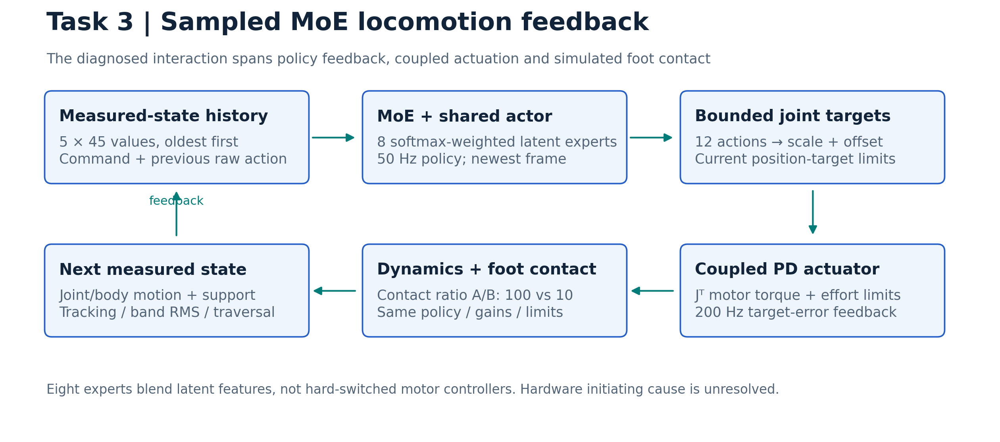
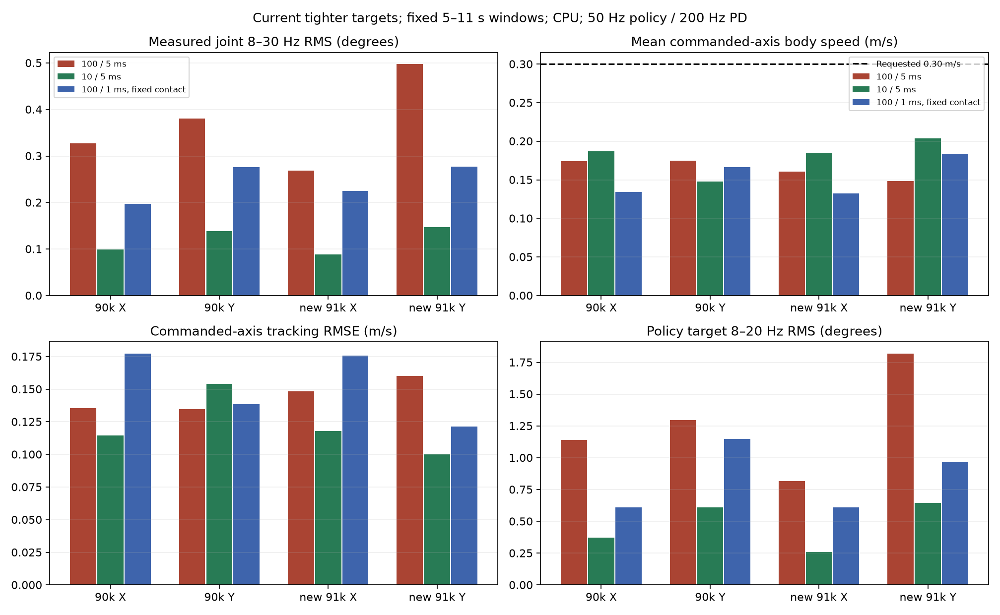
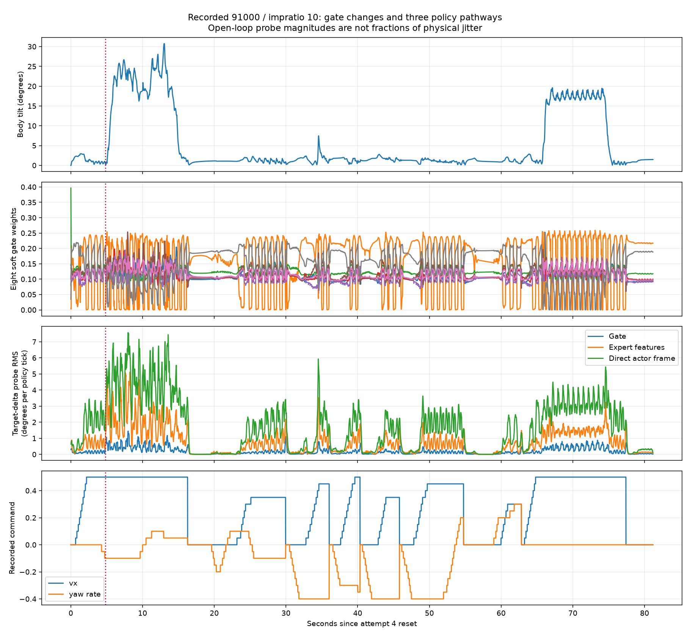

> Archived reference. For current commands and decisions, start at [Task 3](../../README.md).

# Task 3 — SvanM2 MoE jitter and stair failure

[October 11 focused audit: gating, frequency, September raw rechecks, and VLM integration](../24_GATE_FREQUENCY_AND_VLM_AUDIT_20261011.md). The latest manual run passes the full-foot ascent check at 16.265 s. Gate/rate changes are not established fixes; evaluation consistency and actuator/deployment verification remain the next priorities.

## Problem and required fix

Reduce joint vibration while preserving commanded velocity, heading and stair support. Tightening targets or reducing motion alone is insufficient. Establish the deployed observation/actuator/contact contract before claiming a hardware fix.

## Supported causes and analysis

| Finding | Evidence | What it justifies |
| --- | --- | --- |
| Contact–policy–actuator feedback interaction | Matched contact-ratio interventions reduce joint/contact-force/torque-band motion with unchanged weights and controller settings | Calibrate the plant/contact model before another combined reward change |
| Policy targets participate in vibration | Hardware target/angle correlation 0.962; checkpoint replay reproduces outputs | Analyze closed-loop policy behavior; initiating physical cause remains unresolved |
| Train/evaluation contracts differ | Current hips ±0.735, calf upper −0.88776; newest91000 saved `viewer-wide`; viewer ratio 100 versus current training 10 | Verify bounds, delay, sensing and command shaping together |
| Stair failure includes support and heading loss | Lane exits, incomplete rear-foot support, impact-aligned traces | Evaluate traversal/heading alongside band RMS |
| Coupled PD and torque limits affect recovery | Exact transmission reconstruction and clipping bursts | Preserve coupling; measure real saturation/lag before gain selection |

Gate activity and 50 Hz holding do not independently establish the root cause. Hardware backlash/compliance, latency and payload/contact errors remain unmeasured hypotheses. [Detailed cause ranking and history](../23_DEEP_JITTER_ANALYSIS_20261010.md).

## Hardware-contract corrections from the September 21 audit

The historical simulator allowed calf targets up to **+0.50000 rad** and hip targets **±1.0472 rad**; the recorded deployed adapter used **−0.88776 rad** and **±0.735 rad**. Those important corrections are present in the current controller. They align software target realization; they do not modify hardware firmware or establish physical joint-stop angles.

The separate September audit also corrected operator command shaping, observation refresh, full MuJoCo reset, invalid-output handling and stair/contact validation. Not all of those corrections are active in the current viewer: sensor refresh is optional, full-reset parity remains open and nonfinite actions still fall back to zero. The complete per-leg limits, timing, command ranges and torque semantics still require deployment verification.

[Full analysis-to-correction inventory](../../../docs/mid_evaluation/presentation/TASK3_CONTRACT_CORRECTIONS.md) · [September report](../../moe_jitter_audit_20260921/REPORT.md) · [Presentation slide 8](../../../docs/mid_evaluation/presentation/SLIDE_TEXT.md#slide-8--task-3-audit-fixes-improvements-and-analysis).

## Attempts and analysis-driven changes

| Attempt | Analysis → engineering change | Outcome |
| --- | --- | --- |
| Hardware/replay audit | Oscillatory targets and deployment mismatch → trace observation/target/torque signals | 122,607 control samples; 30,175 policy records; hardware cause not isolated |
| −0.10/−0.15 action-rate continuations | Large target variation → stronger smoothness penalty | Raw action-rate training cost declines; physical jitter benefit not established by reward curves |
| October 2 target-cost/bounds bundle90500 | Bound removal and bounded-target changes → second-difference/saturation costs | Training second difference −6.57%, saturation −59.65%; mixed jitter; 0/12 stair traversals |
| Time-aware penalty / newest91000 | Rate depends on elapsed time; retain lift/recovery → rate-excess cost, 0.13 m swing, lower rate weight | Implementation checks pass; low-speed tracking can worsen; changes remain confounded |
| Gain, sensing, gate and delay probes | Contact spikes could reflect feedback semantics/plant → isolated interventions | Checkpoint-dependent response; no universal damping/gate filter fix |
| October 6–7 contact A/B | Training/viewer contact mismatch → ratio 100→10 only | Older wider limits: four matched nominal stair pairs 0/4→4/4 |
| October 10 recheck | Current limits differ from older successful tests → 34 CPU cases with protected settings | Flat band RMS −63.5–70.5%; current stair cases 0/6→3/6; original Y tracking worsens |
| Fixed-contact timestep check | Earlier substeps also changed effective contact stiffness → hold contact timeconstant fixed | No full stair completions at 1 ms; no universal numerical-resolution cure |

## Current measured result — tighter limits, October 10

Two exact policies; `kp=18`, `kd=0.7`; policy/PD 50/200 Hz; requested axis speed 0.30 m/s; common flat 5–11 s window. Hips ±0.735 rad, calf upper −0.88776 rad. Only `impratio` changes in each primary pair.

| Policy / axis | Joint 8–30 Hz RMS: 100→10 | Mean speed: 100→10 m/s |
| --- | ---: | ---: |
| Original90000 / X | 0.32768→0.09900° | 0.17420→0.18716 |
| Original90000 / Y | 0.38009→0.13862° | 0.17463→0.14811 |
| Newest91000 / X | 0.26903→0.08841° | 0.16059→0.18483 |
| Newest91000 / Y | 0.49752→0.14696° | 0.14812→0.20347 |

Stairs: two policies × three deterministic start offsets on twelve 10 cm risers; **0/6 at 100, 3/6 at 10**. Original center/+offset completes at 29.730/30.865 s; newest −offset at 30.585 s. Require all feet beyond x=3.622 m and in lane, every foot loaded >1 N, tilt<30°, clearance>0.18 m, simultaneous hold≥0.5 s. These are simulation cases, not independent seeds or hardware success rates. [Current verification](../../../docs/mid_evaluation/presentation/assets/task3_current_verification.json).

## Code, control contract and references

The second plot decomposes target changes using saved policy inputs. Its pathway magnitudes do not identify independent physical causes. The later post-hoc check verifies one operator-assisted ascent at 16.265 s; it remains separate from the six fixed-command contact cases. [Detailed follow-up](../24_GATE_FREQUENCY_AND_VLM_AUDIT_20261011.md).

225-D oldest-first history plus newest frame → eight softmax-weighted 32-D latent experts → shared actor → 12 actions, FL/FR/RL/RR. Raw action ±6; scale [0.15,0.15,0.30]/leg; position-target clamp; coupled PD; effort clamp ±[12,12,24] Nm. `J=[[8,0,0],[0,8,0],[0,8,16]]`; `tau_joint=J.T @ tau_motor`. Policy targets at 50 Hz support 8–20 Hz analysis; measured joints at 200 Hz support 8–30 Hz.

[Controller](../../xterra_mjlab/svanm2_moe_stair_sim/controller.py) · [Strict checkpoint loader](../../xterra_mjlab/svanm2_moe_stair_sim/checkpoint_policy.py) · [Reward/profile integration](../../xterra_mjlab/scripts/train_other.py) · [Analysis tools](../../tools/README.md). Runtime `--contact-impratio 10` overrides the compiled model per process; XML default remains 100. Manifests record active solver settings. Rate-excess references 7.093/11.275/20.365 rad/s are exploratory recorded-target thresholds, not motor limits.

Upstream architecture: [pinned MoE-CTS implementation](https://github.com/wty-yy/go2_rl_gym/blob/30e74dc507bec7a642a8c98be26081f2c6f0822d/rsl_rl/rsl_rl/modules/actor_critic_moe_cts.py). Related papers: CTS (RA-L, 2024), sim-to-real locomotion (RSS, 2018); [verified references](../../../docs/mid_evaluation/REFERENCES.md). [MuJoCo contact-ratio definition](https://mujoco.readthedocs.io/en/stable/XMLreference.html#option-impratio).

## Next experiments and guidance needed

Supervisor direction: connect the existing MoE command interface to VLM-derived subgoals and calibrated trajectory estimates. The [integration plan](../../../docs/INTEGRATION_PLAN.md) retains the 45-D observation layout and 50/200 Hz control clocks for the first prototype; VLM execution remains outside the motor loop. Integrated navigation evaluation is pending.

Verify deployed limits/scales/history/gains/delay; recover continuation source provenance; identify real actuator lag, saturation and contact slip. Then run one-factor reward/contact ablations over independent starts/seeds, reporting band RMS, tracking RMSE, heading/lane deviation, torque clipping, foot support and completion together. Test deterministic reset against clean-process trajectories; current reset state remains a separate gap. Decide whether actuator/contact calibration or objective design is the next priority. No hardware improvement or end-to-end navigation result is established.
