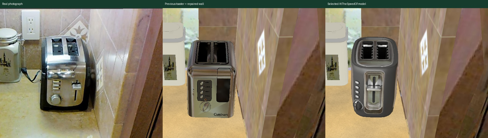
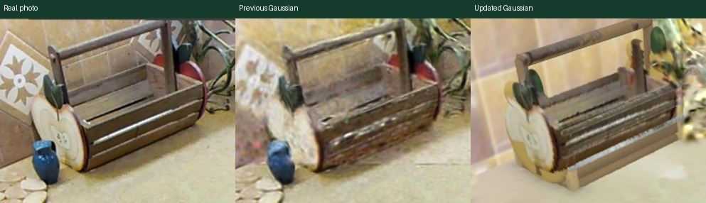
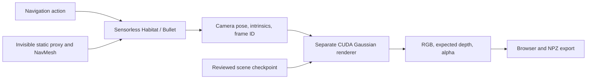

# Task 4 — RxR kitchen repair and separate physics / RGB-D rendering

**Mid-evaluation status, 10 October 2026:** the local records describe a repaired kitchen, licensed/parametric object replacements, comparison dashboards, and a working split-render prototype. The latest saved all-kitchen checkpoint has **4,378,360 Gaussians**, **23 labelled photo-comparison groups**, and a reviewed placement audit. Robust novel-view photorealism and articulated robot integration remain open.

[Project overview](../README.md) · [Portable evidence](../docs/mid_evaluation/evidence/task4/) · [All-object repair report](kitchen_all_objects_upgrade/README.md) · [Dataset and repair guide](kitchen_dataset_repair_guide/README.md)

This status describes saved evidence. The documentation review did not connect to ISL or verify that its services are currently running. Earlier reports use “live” for their recorded publication state.

## Objective and scene context

Improve the visual and geometric usability of the Matterport3D kitchen in building **`2azQ1b91cZZ`**, used by an RxR continuous-navigation workflow. The scene has warped scan surfaces, blurry baked objects, holes, and contaminated background textures. Repair a private derived scene while preserving the original dataset and route-editor state.

Matterport3D provides geometry, calibrated RGB/depth, and camera poses. RxR provides language/navigation annotations. The inspected guide uses episode 218 / instruction 590 (`en-IN`). Repairing its scene does not establish improved language-following success or change the original dataset annotations.

## Attempts, outcomes, and analysis

| Stage | Method | Recorded outcome | Lesson / limitation |
| --- | --- | --- | --- |
| Inspect the dataset and handoff | Compare undistorted photos, calibrated views, scan geometry, and object manifests | Existing 15 replacement entries were found in v15; caddy/knife-block/frog work and appearance cleanup continued | Separate what was inherited from later repairs; camera calibration is central to fitting |
| Private kitchen repair | Replace objects, fit support heights, remove old scan fragments, compare real-photo views | Earlier continuation reports a 32-prop placement audit and preserved route editor | Geometry checks and visual fidelity are distinct validation criteria |
| Toaster realism trial | Fit an available substitute and bake appearance for Habitat | Geometry improves; brand/control mismatch and fixed reflections remain | A plausible substitute is not an exact product reconstruction |
| Free product-model search | Inspect manufacturer photos and licensed model candidates | Exact free Black & Decker T2030 asset not verified; a suitable AtTheSpeedOf toaster was selected | Product photos/online viewers do not automatically provide reusable 3-D geometry |
| Selected toaster installation | Obtain licensed geometry, preserve original PBR maps, uniformly scale/place it | CC BY 4.0 model installed; approximately 17.4 × 29.1 × 20.0 cm; support at z=0.929 m | Original Hamilton Beach branding differs from the photographed Black & Decker appliance |
| Local wall/cabinet repair | Clip damaged triangles and insert photo-informed planar surfaces | 161 scan faces removed, four surfaces added; placement and bounded wall checks report no issues | Hidden wall texture is reconstructed approximately; the whole-room scan is not repaired |
| Material/product viewers and home tour | Preserve PBR geometry, route comparisons, and browser inspection | Actual model loads and navigation/gallery checks recorded | Studio PBR shading and a Habitat bake are different rendering conditions |
| Separate physics and Gaussian visuals | Sensorless Habitat/Bullet + collision proxy; separate CUDA RGB-D process | Pose/intrinsics/frame bridge works, collision probe blocks motion, RGB-D export is synchronized | Static NavMesh navigation is not articulated quadruped contact physics |
| Initial photo-trained Gaussian scene | 24 calibrated views, 22 train / two held out; 4,500 training iterations; local floater cleanup | 349,467 Gaussians after cleanup; reference PSNR 27.52 dB but held-out scores 7.31/10.48 dB | Good training-view appearance does not generalize to unseen cameras |
| Dense toaster-corner repair | Anchor local Gaussians to repaired mesh; refine and stabilize appearance | 1,044,504 Gaussians; local finite-depth coverage improves to 100% in inspected close-ups | Depth consistency improves while reference photo agreement worsens; broader quality gate still fails |
| All-kitchen expansion | Fit remaining objects and photo-matched surfaces; fixed dense samples; preserve prior editor | 4,378,360 Gaussians, 32 props, five counters, two sinks, rangetop, 23 groups and five wide views | Larger coverage is demonstrated; a new matched held-out photorealism benchmark is not saved for this final revision |

Earlier model-search limitations and older 349k/1.04M counts are historical stages. They must not be described as the latest all-kitchen checkpoint.

## How the repair works

1. Identify the object and its support/occluders in calibrated photographs; locate distorted scan faces and texture ghosts.
2. Prefer a suitable licensed mesh, otherwise build a physically sized parametric/lathed replacement or retain a usable fitted object.
3. Fit position/orientation/scale using silhouette overlap and photo projection, constrained by counter heights, wall clearances, and plausible dimensions.
4. Remove the old object's geometry within a documented footprint. Insert repaired walls after appliance deletion to prevent the old deletion region from cutting new holes.
5. Preserve source PBR maps where available; fit visible photo appearance and record approximate hidden detail. Baked reflections remain tied to a lighting/camera setup.
6. Densely sample fixed surfaces for the Gaussian view, verify finite parameters/support/intersections, then compare calibrated and additional camera views.

The final audit reports **33 checked objects: 32 props plus rangetop, zero issues**, with two explicitly reviewed generic-size exceptions: a 4 cm minimum span for the miniature creamer/jug and a 35 cm maximum span for the phone including handset/cord. This is not an unmodified generic-threshold audit. Fit entries, counters, sinks, photo groups, and checked-object counts have different denominators.





## Separate physics and visual architecture



The static proxy was reduced from 1,876,726 to 120,000 triangle faces. NavMesh `try_step` constrains the agent. Bullet is enabled, but the agent is not a simulated articulated robot; dynamic props/doors and editor-to-Gaussian synchronization are outside this prototype.

The raw scene uses Z-up metres. The bridge explicitly converts Habitat coordinates and OpenGL camera axes for the renderer. Gaussian `RGB+ED` output is **opacity-weighted expected optical-axis Z depth in metres**, not a guaranteed first-surface hit. Alpha <0.5 or depth outside 0.05–12 m is invalid; invalid depth stays NaN. NPZ exports include pose, intrinsics, frame ID, depth, validity, and opacity.

## Quantitative results and their scope

| Saved measurement | Result | What it establishes |
| --- | --- | --- |
| Latest all-kitchen checkpoint | 4,378,360 Gaussians | Scene complexity, not visual quality |
| Final reviewed placement audit | 33 objects, zero issues after two size exceptions | Checks against documented support/wall/intersection assumptions |
| Latest production frame, 800 × 640 | 99.0068% valid depth | Coverage at one saved camera; not independent depth accuracy |
| Latest production CUDA raster | 12.0576 ms | One kernel timing; encoding, transfer, queuing, and browser excluded |
| Static NavMesh query benchmark | ~36,835 queries/s | Small isolated navigation-query throughput, not RGB-D FPS |
| Counter/wall movement probe | Requested 2 m move blocked after ~0.392 m | Static obstacle constraint in that test |
| Camera transform check | Maximum error ~5.4e−7 | Numerical consistency of the calibrated frame bridge |
| Dense-corner local close-ups | Finite depth 73.7–84.2% → 100%; median mesh-depth error 7.6–53.5 mm → 2.7–3.4 mm | Agreement with repaired mesh on sampled local surfaces, not measured physical ground truth |

**1,000 FPS RGB-D or realistic robot physics is not demonstrated.** Navigation-query and empty-world Bullet timings are different workloads from rendered frames and legged contacts.

Photo-agreement scores below belong to earlier visual revisions, with the same documented displayed-image metric and synthetic toaster supervision. They are not a final all-kitchen evaluation.

| Revision / camera role | Initial Gaussian baseline | Dense-corner revision |
| --- | ---: | ---: |
| Reference training-view masked PSNR | 27.52 dB | 18.79 dB |
| Held-out camera 1 PSNR | 7.31 dB | 7.28 dB |
| Held-out camera 2 PSNR | 10.48 dB | 10.48 dB |
| Reference measured-depth median error | 8.2 mm | 10.9 mm |

The dense repair reduces local geometric distortion but does not pass broader photorealism validation. The reference appearance tradeoff must be shown alongside the cleaner silhouette/depth. No measured depth is available for those two held-out cameras.

## Assets, attribution, and remaining limits

The selected toaster is **“toaster” by AtTheSpeedOf**, UID `0d39352a32404ce7b71b8ac020844949`, CC BY 4.0. Changes include uniform scale/placement and a separate kitchen-lighting bake; original PBR maps are preserved. Its source/archive/license details are in [the selected-model report](toaster_selected_model/README.md) and [portable archive metadata](../docs/mid_evaluation/evidence/task4/toaster_archive_metadata.json).

The final phone retains a licensed Desk Phone01 01 model by dangkhoa208; additional downloaded candidates were inspected and rejected. Some other objects are parametric approximations. Preserve fit-file credit and source-license records when exporting assets.

Remaining defects include simplified canister/knife materials, sparse frog geometry, approximate jug/phone details, cord/silhouette errors, photo contamination at occluded intersections, invented hidden stone/tile details, and scan distortion outside the repaired surfaces. Gaussian spherical harmonics approximate view dependence under the fixed kitchen lighting; they do not supply a relightable metallic BRDF. Additional camera coverage and a matched held-out evaluation are needed for the final all-kitchen revision.

## Folder map and presentation access

| Directory | Contents / status |
| --- | --- |
| `scenes/v15/` | Earlier local 384 MiB GLB snapshot; later server repairs do not update it |
| `metadata/`, `previews/`, `dashboard/`, `visualization_tools/` | Dataset/scene metadata, saved images, copied tools; several scripts retain server paths |
| `kitchen_dataset_repair_guide/` | Detailed dataset, camera fitting, repair workflow, and directory inventory |
| `toaster_realism_upgrade/`, `toaster_product_search/`, `toaster_selected_model/` | Substitute trial, search history, and final licensed toaster installation |
| `toaster_wall_mesh_repair/`, `toaster_home_tour/`, `kitchen_objects_pbr_dashboard/` | Bounded wall repair, browser/navigation checks, material previews |
| `split_render_pipeline/`, `gaussian_corner_repair/` | Split architecture and initial baseline; later dense-corner repair |
| `kitchen_all_objects_upgrade/` | Latest saved all-kitchen report, evidence, comparisons, source candidates, launcher |
| `dashboard_restore/` | Earlier dashboard restoration and connection notes |
| [Portable presentation evidence](../docs/mid_evaluation/evidence/task4/) | Small copied metric files with source hashes; no server connection required |

The final scene/large Gaussian checkpoints remain on ISL under `/data/robotics/toshith/rxr_author/refined/kitchen_all_upgrade/`. Local reports and copied presentation figures can be opened offline. Current server source paths and launch instructions are documented in [the all-object report](kitchen_all_objects_upgrade/README.md).

For the existing server demo, run locally with campus/VPN access and SSH credentials:

```bash
bash Task_4/kitchen_all_objects_upgrade/open_dashboard.sh
```

The launcher can start missing private server services and create missing SSH forwards. It therefore does more than open local files. Then visit `http://localhost:8767/`, `/comparisons`, `/models`, and `http://localhost:8778/`; the earlier editor is at `/legacy-editor`. Keep the terminal open if it starts a tunnel. Controls are W/S movement, A/D turning, up/down tilt, R reference camera. Existing services, access, and tunnel availability were not tested during this review.

## Next work and presentation takeaway

Evaluate the final revision at the same reference and held-out cameras, with unchanged masks/targets and timing definitions; improve calibrated coverage and remaining materials; validate depth against measured data; integrate articulated robot dynamics and synchronize scene changes; then measure navigation outcomes against an explicitly versioned original/repaired scene comparison.

**Presentation statement:** “We repaired a derived RxR kitchen using calibrated photos and documented object fits, and separated navigation physics from Gaussian RGB-D rendering. Local geometry and inspection coverage improved; novel-view realism and full quadruped navigation are still research work.”
