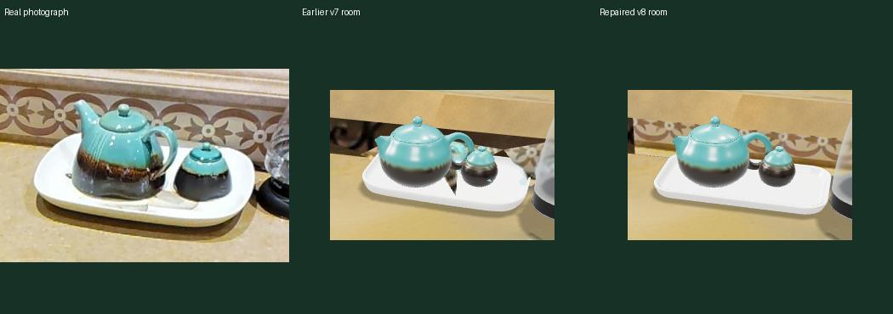
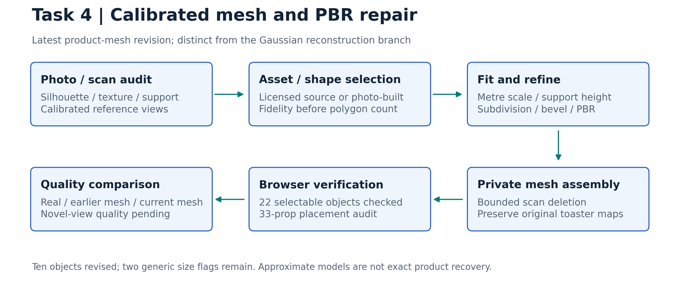
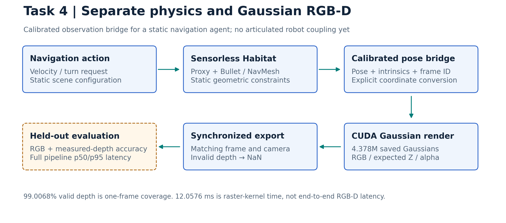

# Task 4 — RxR/Matterport3D kitchen repair in Habitat

## Problem and required fix

The MP3D kitchen `2azQ1b91cZZ` has warped scan geometry, texture ghosts, missing/approximate props and poor reconstruction away from reference views. Repair geometry/materials without invalidating calibrated camera poses, support surfaces or original RxR annotations. Evaluate object-mesh and Gaussian branches separately.

## Causes and analysis

Photo/scan alignment reveals geometric defects and support/scale errors. Limited calibrated coverage and contaminated masks leave hidden surfaces weakly constrained. Gaussian spherical-harmonic appearance does not reproduce a relightable metallic PBR model. Multi-mesh imported GLB children were sometimes classified as scan background, disabling prop materials; hierarchy-aware viewer selection fixes that classification.

## Attempts and analysis-driven changes

| Attempt | Analysis → change | Recorded outcome / limitation |
| --- | --- | --- |
| Private object fitting | Photo silhouette and support mismatch → calibrated mesh fit, bounded scan deletion | Continued inherited 15-entry repair work; approximate caddy/knife/frog substitutes remain |
| Licensed toaster and wall patch | Product-shape/scan artifacts → retained original PBR toaster, removed 161 scan faces, inserted four surfaces | ≈17.4×29.1×20 cm toaster at z=0.929 m; substitute branding differs |
| Separate physics / Gaussian renderer | Detailed visual rendering and navigation have different costs → proxy/NavMesh plus pose-calibrated gsplat service | Static agent/proxy; no articulated robot/contact synchronization |
| Initial Gaussian reconstruction | Fit reference-camera appearance → cleaned 349,467-point scene | Reference PSNR 27.52 dB; held-out 7.31/10.48 dB fails |
| Dense fixed-surface corner | Floating/irregular geometry → 1,044,504 surface samples and appearance refinement | Cleaner local depth; reference 18.79 dB, held-out 7.28/10.48 dB remains weak |
| All-kitchen expansion | Missing wider scene coverage → larger assembled reconstruction | 4,378,360 Gaussians, 23 comparison groups; final matched held-out quality pending |
| Latest product mesh/PBR revision | Faceted/approximate props and material loss → licensed substitutes, silhouette-preserving subdivision/bevels, texture correction, hierarchy-aware viewer | Ten objects revised; 22 browser selections reviewed; no Gaussian retraining |

## Current v8 product-mesh branch

[Current tray/background revision](kitchen_tray_background_repair/README.md) follows the [v7 appliance/material fixes](kitchen_appliance_refinement_20261011/README.md). Unsupported procedural materials were replaced with embedded exportable maps. The v8 tray is a closed rounded basin supported at z=0.935 m; six scan fragments are clipped only inside the local repair region, and a photo-derived tile strip fills the adjoining gap.

Saved v8 verification records **23 calibrated views**, **30 model routes**, **33 props screened**, and **zero support/conservative-overlap flags**. The original toaster's 11 meshes and three texture maps are retained byte-identically. Screening is not a proof that the entire scene is collision-valid. Approximate object silhouettes and remaining scan gaps are documented.

Before is an earlier saved mesh with reduced browser textures, not a verified untouched dataset mesh. The [home-tour implementation](kitchen_home_tour_before_after/README.md) synchronizes the camera; [photographic panoramas](kitchen_panorama_compare/README.md) use a separate baseline.

[Scene verification](../docs/mid_evaluation/evidence/task4/v8_scene_verification.json) · [Browser review](../docs/mid_evaluation/evidence/task4/v8_browser_review.json) · [Placement screening](../docs/mid_evaluation/evidence/task4/v8_placement_audit.json). These are retained checks; this repository update does not access or restart the server.

## Earlier product-mesh revision

[Full object methods and licences](kitchen_product_model_replacements/README.md): glass/stovetop kettles, knife sets, tea setting, frother, phone, grinder, tap and coffee-machine refinement. High-polygon coffee-machine/grinder candidates were rejected when silhouettes were less faithful. Retained photo-built grinder receives licensed wood texture; it is not an exact downloaded grinder.

33 audited props: no reported support/contact or overlap failures; two generic size flags remain (phone includes cord; miniature creamer). Original toaster retains 11 parts and all three texture-map hashes. Saved published checks cover 22 object selections, seven HTTP routes and 88 JPEG panels. These records do not verify present server reachability. Comparisons mean **real photograph / earlier repaired mesh / current repaired mesh**, not untouched dataset versus Gaussian.

## Gaussian branch: architecture and measured limits

Static proxy 120,000 faces from 1,876,726; raw MP3D Z-up metres with explicit Habitat/OpenGL/OpenCV conversion. Expected optical-axis Z depth is opacity weighted; alpha<0.5 or Z outside 0.05–12 m invalid/NaN. It is not guaranteed first-surface depth.

| Saved measure | Result | Meaning |
| --- | ---: | --- |
| Latest 800×640 Gaussian frame valid depth | 99.0068% | One-frame coverage, not measured-depth accuracy |
| CUDA raster kernel | 12.0576 ms | Encoding/transport/browser excluded |
| Static NavMesh queries | ~36,835/s | Query benchmark, not RGB-D FPS |
| Dense-corner local median mesh-depth error | 7.6–53.5→2.7–3.4 mm | Sampled repaired surfaces; separate earlier revision |
| Final all-kitchen held-out RGB/depth quality | Pending | Older corner results cannot validate the final scene |

## Code, sources and next experiments

[Mesh assembly](kitchen_all_objects_upgrade/evidence/assemble_all.py), [product builders/review tools](kitchen_product_model_replacements/README.md), `toaster_wall_mesh_repair/evidence/`, `split_render_pipeline/evidence/`, `gaussian_corner_repair/evidence/`; [code/change index](../docs/mid_evaluation/CODE_INDEX.md). [RxR: EMNLP 2020](https://aclanthology.org/2020.emnlp-main.356/) · [Habitat: ICCV 2019](https://openaccess.thecvf.com/content_ICCV_2019/html/Savva_Habitat_A_Platform_for_Embodied_AI_Research_ICCV_2019_paper.html) · [3DGS: TOG / SIGGRAPH 2023](https://repo-sam.inria.fr/fungraph/3d-gaussian-splatting/).

Next: freeze cameras/masks; evaluate held-out PSNR/SSIM and measured-depth error, novel-view silhouettes and support; measure full RGB-D p50/p95 latency; add edit synchronization and articulated robot collisions. Guidance needed: prioritize calibrated geometric fidelity, exact product/material matching, or novel-view reconstruction first. The product mesh and Gaussian services remain separate; neither establishes improved language-navigation success. Large source assets/scenes/checkpoints remain local or on ISL.
