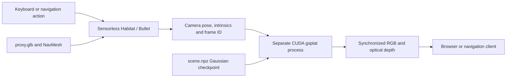

# Separate physics and Gaussian RGB-D visuals

**Current update:** the live renderer now includes a [dense surface repair of the toaster corner](../gaussian_corner_repair/README.md), with 1,044,504 Gaussians, an 800 × 640 UI, a Reference-view button and a [before/after gallery](http://localhost:8778/corner-comparisons). The severe local halo is reduced; broader photorealism still fails validation. The training details and numerical tables below describe the **initial baseline**, retained as historical evidence. Use the linked repair report for current measurements and checkpoint paths.

This implements the requested architecture as a **working experimental prototype** for the repaired kitchen. Habitat/Bullet loads a texture-free collision proxy with no image renderer or visual sensors. A separate CUDA process renders RGB and metric optical depth from photo-trained 3D Gaussians using the live camera pose.

The architecture works, but the reconstruction **does not yet meet the photorealism goal**. Bright/dark artifacts remain around the toaster, and held-out camera views have poor quality. Separating rendering from physics makes a better renderer possible; it does not automatically repair missing geometry, inaccurate depth or reflective surfaces.

## Open the views

| View | Local browser URL |
|---|---|
| Complete repaired kitchen editor, with the selected toaster | http://localhost:8767/ |
| Saved real-photo / previous / repaired object comparisons | http://localhost:8767/comparisons |
| Actual selected toaster with original metallic PBR maps | http://localhost:8767/product-viewer |
| Experimental Gaussian RGB-D navigation | http://localhost:8778/ |

The SSH connection must remain active. If the links stop working, run this **in a terminal on your local computer**:

```bash
ssh -N -o ExitOnForwardFailure=yes -o ServerAliveInterval=30 \
  -L 127.0.0.1:8767:127.0.0.1:8774 \
  -L 127.0.0.1:8778:127.0.0.1:8778 \
  guest-isl@172.26.186.222
```

An “address already in use” message means a local port is occupied; check whether its existing tunnel already opens the page before creating another. The server is reachable only on the appropriate campus network/VPN.

In the prototype, use **W/S** to move, **A/D** to turn and **up/down arrows** to tilt. RGB and depth show the same camera pose. The page provides an NPZ download containing metric depth, validity, opacity, intrinsics, pose and frame ID. This prototype has navigation controls; object editing remains in the complete editor.

## How the two processes connect



The proxy is invisible because the physics process creates no renderer. The current proxy is a simplified static triangle mesh: 120,000 faces, reduced from 1,876,726. It retains the room's floor and obstacle topology. An enclosing solid box would incorrectly fill the room and prevent navigation; simple boxes could instead represent individual solid props.

Movement is constrained by Habitat's NavMesh `try_step`. Bullet is enabled and stepped, but the navigation agent is not an articulated robot body. Dynamic robot contacts, movable props and articulated doors are outside this prototype. Changes to the editor are not automatically synchronized into the Gaussian scene or proxy.

The physics service listens on server port **8778** and the visual service on **8779**, both loopback-only. The original repaired kitchen editor remains an independent process on **8776**, exposed by the presentation proxy on **8774**. Earlier sessions, shared manifests and original scene builds were preserved.

## What the visual scene was trained from

The input is the existing Matterport3D house `2azQ1b91cZZ` used by the RxR navigation work. Its real calibrated photographs, camera poses and available measured depth anchor the reconstruction. This is a local kitchen reconstruction, not a complete Gaussian reconstruction of the whole building.

The experiment uses 24 calibrated views from nine panoramas at 640 × 512 pixels: 22 training views and two views from a completely held-out panorama. Four selected views have aligned measured depth; the remaining initialization uses cached depth rendered from the older scan. Measured Matterport depth is converted from uint16 using `/4000` to metres, with zero invalid. See the [official Matterport data organization](https://github.com/niessner/Matterport/blob/master/data_organization.md).

The old toaster and damaged return-wall regions are removed from the initialization where identified. The current selected toaster and repaired wall are sampled from their replacement meshes. Blender renders the downloaded toaster from the calibrated cameras as a synthetic replacement target over the real-photo background. Those toaster pixels are **synthetic PBR supervision**, not newly captured photographs of that product in this kitchen.

The model starts with 350,000 Gaussians and trains for 4,500 iterations, optimizing positions, scales, rotations, opacity and degree-two spherical harmonics. Geometry movement is bounded, with tighter limits for the selected toaster. A subsequent local surface-distance check removes 533 unsupported Gaussians and caps local scales, leaving **349,467**. It reduces some floaters but does not eliminate the visible halo.

`scene.ply` is exported in standard Gaussian form for compatible viewers. The running renderer reads `scene.npz`, containing the equivalent tensors, to avoid converting the PLY on every startup. A Gaussian PLY is not an ordinary colored point cloud or mesh GLB.

## Camera and depth correctness

The raw scene uses metres and Z-up. This Habitat installation converts its GLB stage using:

```text
raw (x, y, z) -> Habitat (x, z, -y)
```

The bridge converts Habitat's agent pose back to the raw scene frame and adds the camera height. Raw calibrated cameras use OpenGL axes: forward −Z, up +Y. For gsplat, the camera transform is converted to OpenCV axes using `diag(1, -1, -1, 1)`, then inverted to obtain the world-to-camera view matrix. Intrinsics are scaled with the image dimensions, retaining the measured principal point. A startup check reproduces the calibrated reference pose within approximately **5.4e-7** matrix-entry error.

The renderer uses gsplat's `RGB+ED` mode: expected optical-axis Z depth in metres. This is an opacity-weighted Gaussian depth estimate, not Euclidean ray range or a guaranteed first-surface mesh intersection. Pixels with alpha below 0.5 or depth outside 0.05–12 m are invalid and stored as NaN. RGB/depth requests carry a frame ID; stale requests receive HTTP 409. See the [official gsplat rasterization API](https://docs.gsplat.studio/main/apis/rasterization.html).

## Measured checks and performance

These measurements are from GPU 4, an NVIDIA A40. They are individual measurements, not sustained end-to-end application FPS guarantees.

| Check | Result and scope |
|---|---|
| Physics renderer and visual sensors | Renderer disabled; zero visual sensors |
| Counter/wall navigation probe | A requested 2 m move stopped after approximately 0.392 m |
| NavMesh query | Mean 0.0278 ms, about 36,000 isolated queries/s |
| Bullet stepping | Empty dynamic-world stepping only; not a robot/contact benchmark |
| CUDA RGB + expected-depth raster at 400 × 320 | Approximately 8.58 ms in the integration check |
| CUDA raster at 640 × 512 | Approximately 7.9–8.4 ms across three final views |
| One render-info RPC including encoding/transfer | Approximately 111 ms during concurrent evaluation; not a sustained throughput test |
| Camera and RGB/depth agreement | Passed; reversible left/right turns restore the pose; stale frame rejected |

The physics query rate exceeds 1,000/s in this small static test. **1,000+ FPS rendered RGB-D or realistic robot physics was not demonstrated.** JPEG encoding, depth compression, HTTP, queuing, loading and physics are excluded from CUDA raster timing. The slightly different raster times across resolutions come from separate runs and workloads, not a controlled resolution benchmark.

## Visual quality: what still needs repair

Final displayed-image evaluation uses clipped JPEG RGB, a modeled-region mask, and the synthetic selected-toaster target. It therefore does not establish that the inserted toaster matches the real Black & Decker photograph.

| Camera | Role | Masked RGB PSNR | Valid-depth coverage |
|---|---|---:|---:|
| `583483…_i2_4` | Training reference | 27.52 dB | 95.0% |
| `907692…_i1_4` | Held out | 7.31 dB | 83.9% |
| `907692…_i1_3` | Held out | 10.48 dB | 44.2% |

The reference view has 8.2 mm median and 17.9 mm mean absolute depth error over 259,550 evaluated measured-depth pixels. This is a training-view metric on valid pixels, not a novel-view depth guarantee. There was no measured depth for the two held-out views. Masks and depth-validity denominators differ; their percentages should not be compared directly.

The held-out scores and coverage fail the visual quality gate. Reflective toaster surfaces, old scan/depth errors and incomplete view coverage leave bright/black remnants, holes and distorted novel views. Spherical harmonics approximate appearance but do not supply a relightable metal material. For inspecting metallic lustre now, use the separate original-PBR toaster viewer.

Further reconstruction needs better aligned depth and denser kitchen coverage, removal of old-object/background contamination, and validation from additional unseen poses. A hybrid renderer could preserve a true PBR mesh for the toaster while using Gaussians for the room, but that is not implemented here.


## Directories and scripts

Server root: `/data/robotics/toshith/rxr_author/refined/split_visuals/`.

| File or folder | Purpose |
|---|---|
| `proxy.glb`, `proxy.navmesh`, `proxy.json` | Texture-free simplified collision stage, navigation data and provenance |
| `scene.npz`, `scene.ply` | Cleaned Gaussian checkpoint and portable Gaussian export |
| `scene_trained_unfiltered.npz` | Checkpoint before the local surface cleanup |
| `data/` | Calibrated images, masks, depth, initialization and synthetic toaster teacher images |
| `vendor/`, `torch_extensions/` | Private gsplat 1.5.3 dependencies and compiled CUDA cache; shared environments unchanged |
| `physics_server.py` | Sensorless simulation, NavMesh motion, pose publication and browser/API |
| `visual_server.py` | Separate CUDA renderer, depth validity, encoding and pose cache |
| `prepare_data.py`, `render_teachers.py` | Select calibrated views, initialize scene points and render replacement supervision |
| `train_gaussians.py`, `clean_corner.py` | Train the Gaussian scene, then perform local surface checks |
| `build_proxy.py` | Create the independent simplified collision mesh |
| `launch_services.py` | Start private services; preserve already running ports |
| `evaluate_final.py`, `final_previews/` | Evaluate displayed RGB/depth and save reference/held-out comparisons |
| `physics.log`, `visual.log`, `*.pid` | Private service logs and process IDs |

Local `evidence/` contains the corresponding scripts and JSON measurements. `integration.json` records the local browser-facing HTTP/NPZ checks. `final_evaluation.json` is the final clipped/displayed RGB evaluation after cleanup; `training.json` retains earlier unclipped training metrics, which use a different metric convention and should not be substituted for the final table.

To start services after a server reboot, run **on ISL**, after connecting with SSH:

```bash
cd /data/robotics/toshith/rxr_author/refined/split_visuals
/data/robotics/toshith/envs/kitchen3d/bin/python launch_corner_services.py
```

The current launcher preserves already running services; its publication workflow is documented in the linked corner-repair report. The older `launch_services.py` remains a baseline script and starts the older UI. The launcher starts trained services; it does not retrain the reconstruction or install dependencies. Initial CUDA compilation can take several minutes if its cache is absent.

The chosen toaster's source license, original materials, physical fit and repaired-scene files are documented separately in [Selected licensed toaster](../toaster_selected_model/README.md). The broader dataset/repair explanation is in [Kitchen dataset repair guide](../kitchen_dataset_repair_guide/README.md).
