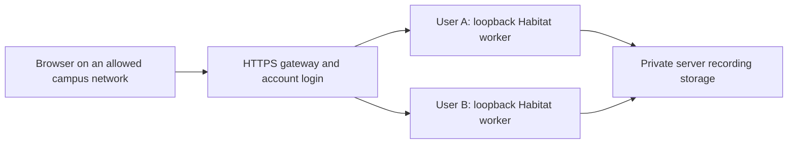

# Memory-guided robot navigation: research and demonstration collection

Task 5 studies how a navigation request can be grounded in remembered household places. It contains an RxR route audit, tools for reviewing and adapting scenes, and a browser application for collecting human navigation demonstrations with speech, screen video and written reasoning.

This is research infrastructure and pilot collection software. The collector uses manual Habitat controls; it does not run a learned navigation policy or demonstrate physical object pickup/delivery.

## Start here

| Purpose | Files |
| --- | --- |
| Research question, method, findings and limitations | [Research overview](docs/RESEARCH_OVERVIEW.md) |
| Benchmark instruction counts and distance definitions | [Benchmark audit](docs/benchmark_route_lengths.md) |
| Reproduce checks and prepare a new checkout | [Reproducibility guide](docs/REPRODUCIBILITY.md) |
| Current recording website and server | [Campus collector](campus_collector/README.md) |
| Administrator certificate/deployment steps | [Collection setup](CAMPUS_COLLECTION_START_HERE.md) |
| Contributor navigation and recording instructions | [Launcher quick start](campus_collector/STUDY_LAUNCHER_GUIDE.md) |
| Individual dashboard startup scripts | [Dashboard launchers](dashboard_startup/README.md) |
| Exact GitHub selection and local-only material | [Publication guide](docs/GITHUB_FILES.md), [file manifest](publication_files.json) |

## Main components

- **Route search:** `rxr_long_route_search/search_rxr.py` measures original validation guide paths using 3D connectivity coordinates. Review scripts inspect goal views and room semantics.
- **Scene experiments:** `rxr_long_route_search/environment_04/` and `room_tasks/environment_06/` contain placement and rendering code. Added school bags/toiletries are authored props; geometric contact fitting is separate from physics or manipulation.
- **Research dashboards:** route, endpoint, room and model review interfaces; `checkpoint_walkthrough_studio/` provides a separate walkthrough/annotation tool.
- **Collection website:** `campus_collector/` provides account login, a network allowlist, HTTPS configuration, separate per-user Habitat workers, recording/upload recovery, sample downloads and audio extraction.
- **Participant launchers:** native Windows/Linux clients and a macOS app keep the study CA inside their HTTPS client, open the recording dashboard locally, close automatically with its last tab and retain account-scoped browser recovery data. [Build notes](campus_collector/study_launcher/README.md) explain external inputs and platform testing limits.
- **Earlier collectors:** `level3_manual_collector/` and `level3_manual_collector_v2/` retain source for the original local collection interfaces. Use the campus collector for shared participant access.

## Recorded research findings

The validation audit examined **22,465 guide records representing 2,761 distinct paths**. **28 original paths** meet the `>=40 m` graph-route threshold: 14 seen and 14 unseen, with 204 instruction variants. [Aggregate results](docs/rxr_validation_summary.json) retain the graph revision and split counts.

The research owner's later visual shortlist contains **12 review indices**: 4, 5, 6, 7, 8, 9, 10, 16, 17, 18, 26 and 27. These are plausible furniture locations, not verified school-bag storage routines. [Selection metadata](docs/reviewed_goal_selection.json) maps review indices to original path IDs.

The study catalog combines forty house-first cases, ten presentation tasks and three authored household cases. Administrators assign available instructions privately. Two earlier pilot examples have reference lengths **41.49 m** and **45.54 m**; the three authored household examples are shorter and must not be reported as `>40 m` routes. Original RxR guide lengths, RxR-CE reference lengths and actual human trajectories are distinct quantities.

## Website and saved data



Each saved sample can contain the request, selected memory IDs, corrected reasoning, events, camera poses, frames, navigation replay, microphone/screen recording and a separate audio-only clip extracted from the screen recording. Evaluation coordinates are stored separately from participant inputs. Account creation is administrator-only; contributors need no SSH account.

The existing deployment stores recordings on the simulation server at:

```text
/home/guest-isl/rishabh/bench/experiments/level3_manual_collector_v2/data_collecting/data/
  contributors/<username>/sessions/<username>/<sample_timestamp>/
```

Server application files are deployed under `Data_from_Dashboard/campus_collector/`. Updating GitHub does not deploy or restart that service. Its deployment-specific paths must be adapted for another server.

## Quick checks

Run from `Task_5` with Python 3.10 or newer:

```sh
python3 -B tools/github_publication.py --check
python3 -B -m unittest discover -s campus_collector -p 'test_*.py'
```

Unit tests use temporary files and synthetic cases and do not need Habitat or scene downloads. Local sockets must be permitted. Full rendering requires a compatible Habitat environment, authorized scene assets and the source presentation; see the [reproducibility guide](docs/REPRODUCIBILITY.md).

The [publication validation record](docs/VALIDATION.md) reports the checks performed and their limits.

## Data and attribution

GitHub contains selected source, web assets, setup examples, research notes and small aggregate results. Recordings, human-session transcripts, account databases, live configuration, certificates, licensed scene imagery, meshes, downloaded models and generated packages remain local. No existing local research artifacts are deleted by this publication setup.

Use the original providers' terms for [RxR](https://github.com/google-research-datasets/RxR), [Matterport3D](https://niessner.github.io/Matterport/), [Habitat-Sim](https://github.com/facebookresearch/habitat-sim) and third-party objects. Source links and asset attribution metadata accompany the placement experiments. This update assigns no new blanket license to third-party data or to the repository.
