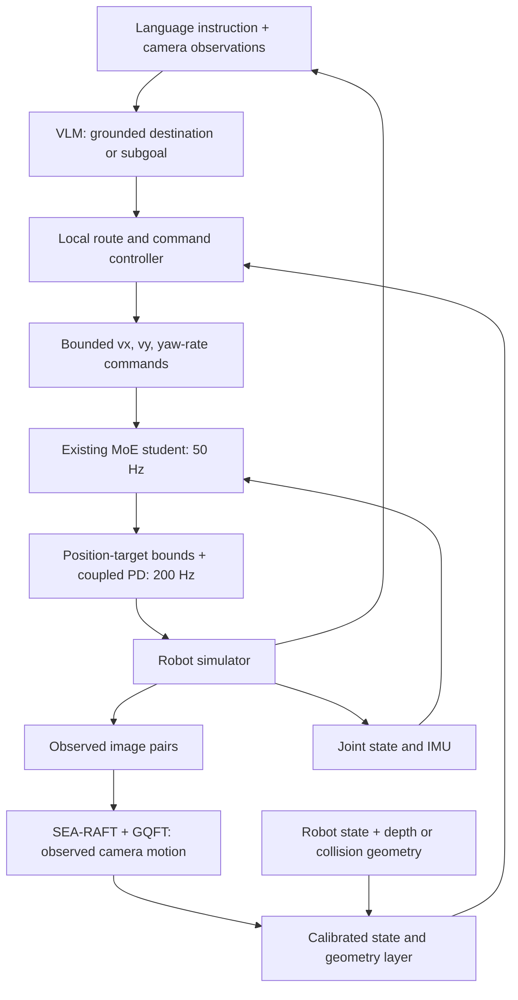

# VLM, trajectory estimation and RL locomotion

Supervisor feedback sets the next direction: connect the VLM, trajectory component and RL locomotion into one navigation system; investigate masked attention in GQFT. **Integration is proposed. No integrated controller or navigation benchmark has been implemented by this documentation update.** The exact GQFT mask remains to be clarified.

## Proposed interfaces

| Component | Input | Output / responsibility |
| --- | --- | --- |
| VLM | Language instruction and timestamped camera observations | Grounded destination or high-level subgoal, with an explicit failure/replan state |
| GQFT | Observed flow history and calibrated camera contract | Camera-relative reconstructed motion/path; reliability handling to be specified |
| State and geometry layer | Motion estimate, robot state, depth/scene geometry when available | Robot-frame state estimate and checked local route/waypoint |
| Local navigation controller | Subgoal, route and current state | Bounded `(vx, vy, yaw_rate)` commands, with command shaping and stale-input handling |
| Existing MoE student | Existing five-frame proprioceptive/command history | Twelve joint actions; retain checkpoint, observation layout and limits for first integration |
| Coupled PD and simulator | Limited joint targets and measured joint state | Torque execution and feedback |

This connects the components through a navigation interface. The VLM interprets the destination, GQFT estimates observed motion, the local controller chooses executable motion, and RL controls the joints. GQFT's reconstructed camera path must not be treated as an already validated future collision-free route.

## Contracts to establish before a demonstration

- **Coordinates:** record camera intrinsics, mounting transform, robot frame, scene frame, time alignment and height/anchor convention. The current GQFT camera configuration cannot be assumed to match a mounted quadruped camera with body pitch/roll and changing height.
- **Trajectory meaning:** distinguish image coordinates, camera-relative 3-D displacement and navigation waypoints. Convert through verified transforms before producing velocity commands.
- **VLM grounding:** validate object/subgoal identity and geometric reachability. Metric distances and obstacle clearance need calibrated geometry rather than an unverified verbal distance estimate.
- **Control timing:** run VLM work outside the 50 Hz policy / 200 Hz PD loop. Measure camera, flow, VLM and command latency; specify timeouts and a controller-defined hold/replan/stop behavior. Shared-GPU contention must be measured before selecting local versus offboard inference.
- **Locomotion baseline:** use one checkpoint, verified target bounds, gains, contact configuration and observation convention. Preserve proprioceptive input size for the initial command-level integration. Directly adding visual tokens to the student is a separate architecture/training experiment.
- **Reliability:** log invalid flow, masked-region coverage, missing observations and stale goals. Proposed masking reduces eligibility of unreliable evidence; it is not yet a demonstrated noise-removal method.

## Milestones and measures

| Milestone | Concrete deliverable | Measures |
| --- | --- | --- |
| 1. Fixed-command baseline | Repeatable reset and recorded execution under one locomotion contract | Tracking, heading, jitter, clipping, support and completion |
| 2. Trajectory interface | Replay known motion through calibrated GQFT-to-robot transforms | Pixel/3-D trajectory error, drift, transform consistency and latency |
| 3. VLM goal interface | Instruction-to-grounded-subgoal records on selected scenes | Correct grounding, invalid proposals and response latency |
| 4. First integrated episode | Same low-level controller executes a checked VLM-derived goal | Goal success, collisions, path/heading error, replans, timing and locomotion stability |
| 5. Controlled improvements | Isolated masked-attention and integration comparisons | Validation quality plus navigation benefit; retain failed episodes |

Compare scripted/known goals with VLM-derived goals using the same low-level controller. Compare the current Attention model with masked Attention under one supervision convention. Keep the separate projection-label experiment explicit. Initial integration can reuse locomotion weights; any retraining follows diagnosed errors and an agreed compute budget.

## Recorded evidence and next decisions

- [GQFT current results and geometry fixes](../Task_2/README.md); [masked-attention experiment specification](../Task_2/MASKED_ATTENTION_PLAN.md).
- [MoE gate/frequency audit and command-level VLM design](../Task_3/notes/24_GATE_FREQUENCY_AND_VLM_AUDIT_20261011.md#7-where-a-vlm-fits-in-this-project).
- [Simulator collision limitations](../Task_1_Simulator_Evaluation/README.md); [scene/observation limits](../Task_4/README.md).

Open decisions: intended mask definition, first scene/instruction, VLM model and compute placement, camera mount, grounding/local-planning method, timeout behavior, and acceptance criteria. Model selection and mask research follow these specifications; no new model recommendation or training result is asserted here.
