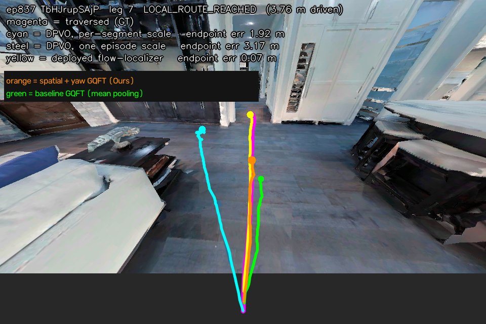
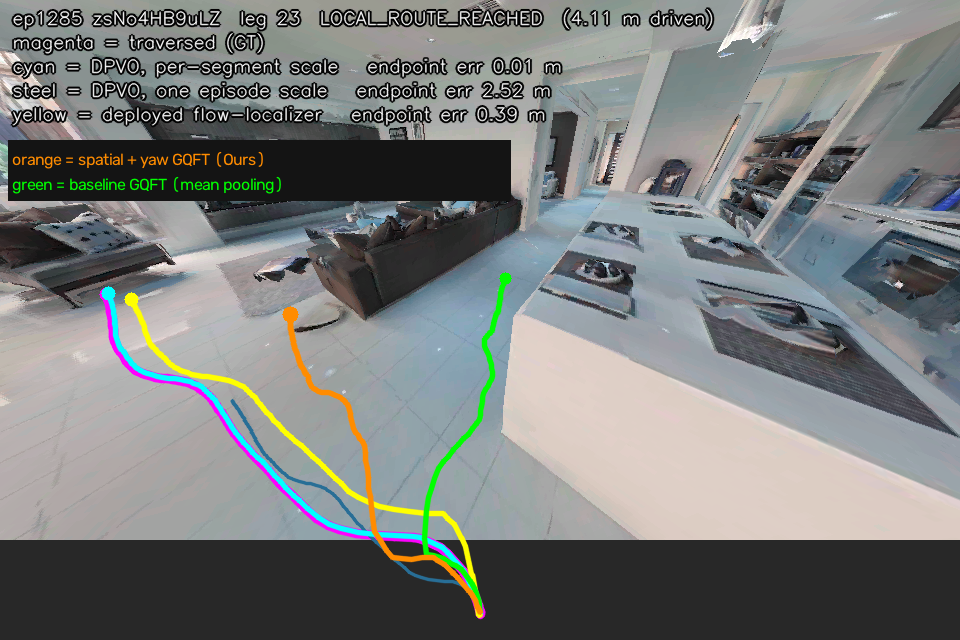
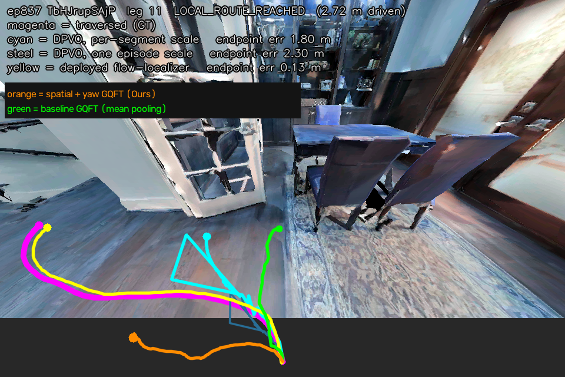
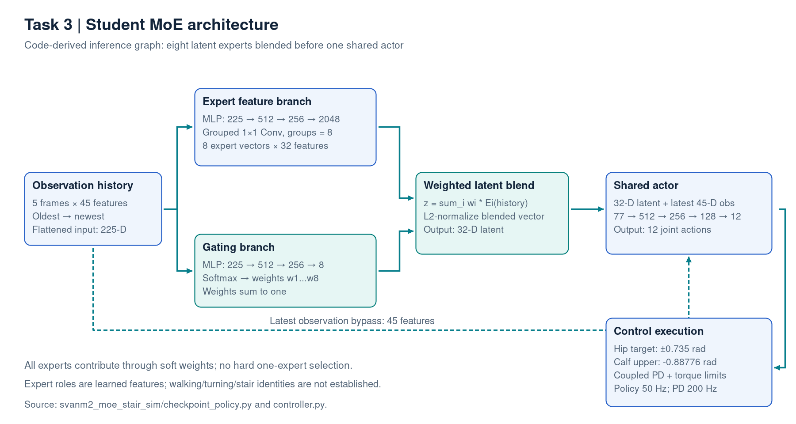
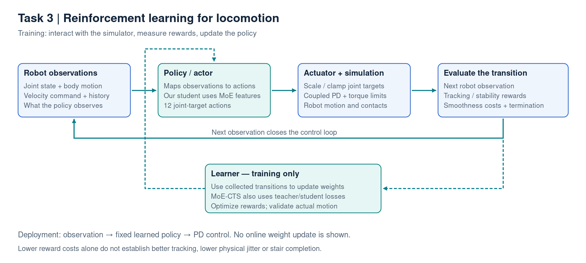
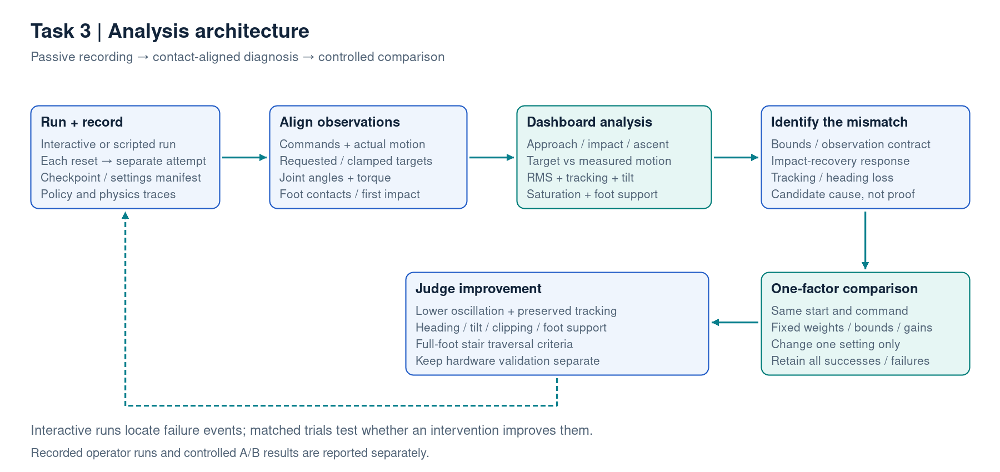
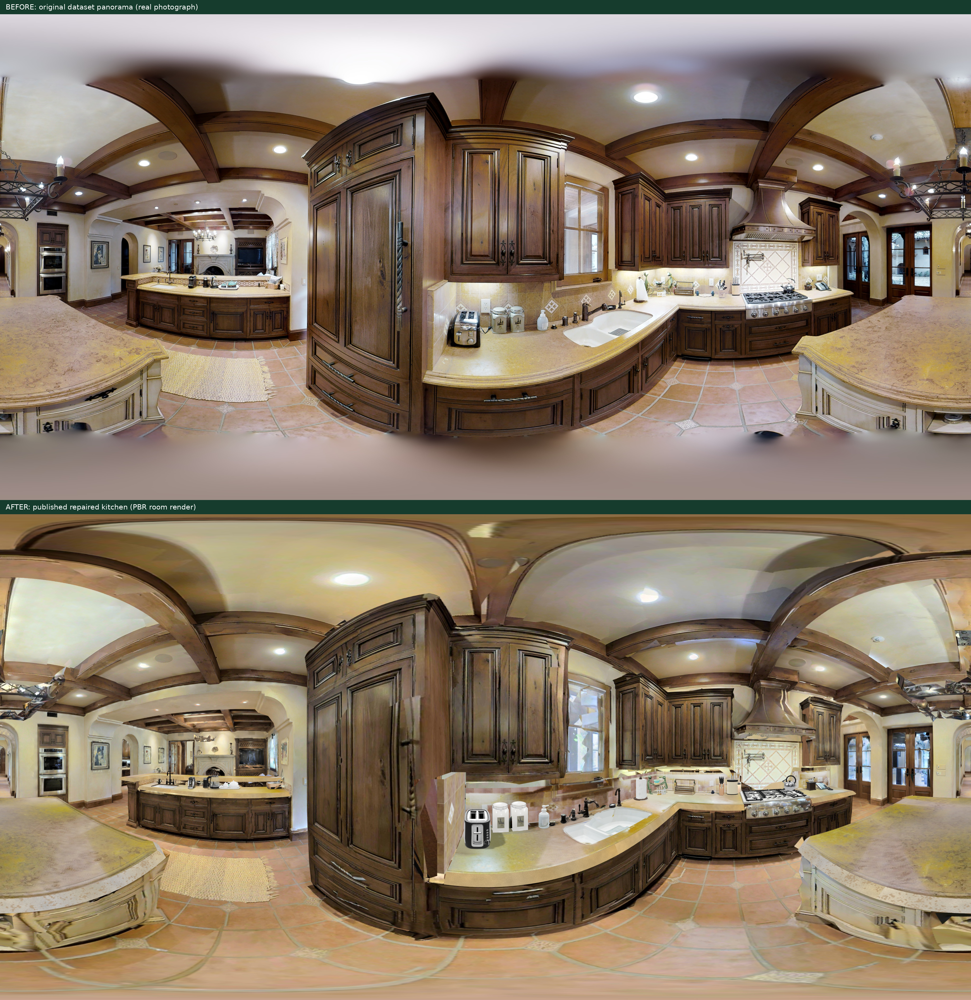
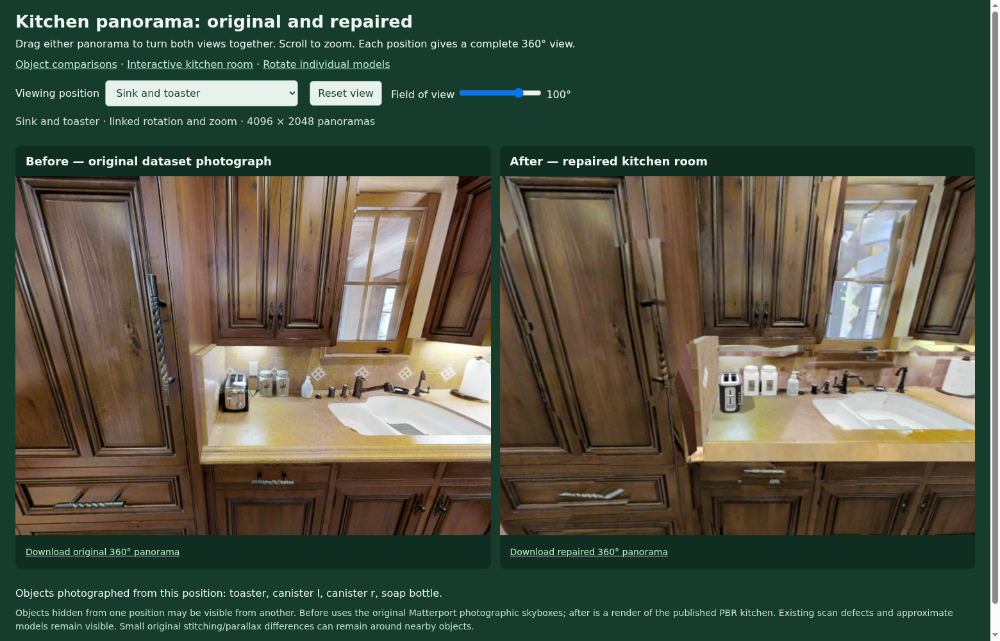
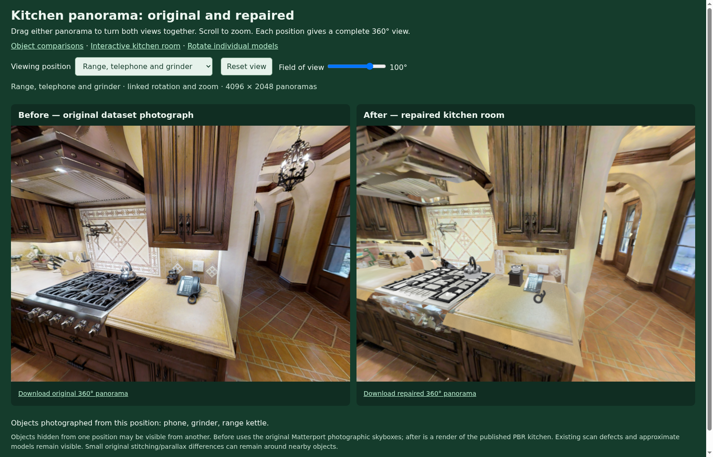

# Mid-evaluation — text for 10 slides

Only **Slide text** is intended for the slides. Visual selections, evidence and qualifications are separate. Each task has its own diagram. [Graph and episode analysis](TASK2_VISUAL_ANALYSIS.md) · [Speaker notes](SPEAKER_NOTES.md).

## Slide 1 — Project scope and current progress

**Slide text**

- **What is it about?** Visual perception, trajectory estimation, locomotion and indoor simulation for language-guided quadruped navigation.
- **Objective:** establish a reproducible simulation and evaluation setup in which visual motion estimates can eventually become executable quadruped commands. Each component must first have a documented input/output convention and measurable failure criteria.
- **Approach:** four independent studies — simulator feasibility; optical-flow trajectory prediction; locomotion stability; scene reconstruction.
- **Results:** simulator and rendering prototypes, trajectory-model comparisons and locomotion evaluations are available. Analysis identified episode-adapter defects, inconsistent projection labels and contact-sensitive locomotion behavior; corresponding local fixes or controlled interventions are documented.
- **Remaining:** implement the language-to-waypoint and waypoint-to-velocity interfaces, then evaluate instruction completion, tracking, collisions and full-pipeline latency in one integrated experiment.

**Research foundations — reference cards**

| Paper / foundation | Venue · Year |
| --- | --- |
| SEA-RAFT — optical flow | **ECCV · 2024** |
| Concurrent Teacher–Student RL — locomotion | **IEEE RA-L · 2024** |
| Sim-to-Real: Learning Agile Locomotion | **RSS · 2018** |
| Room-Across-Room — navigation data | **EMNLP · 2020** |
| Habitat — embodied simulation | **ICCV · 2019** |
| 3D Gaussian Splatting — rendering | **ACM TOG / SIGGRAPH · 2023** |

Full titles, authors and primary sources: [references](../REFERENCES.md).

**Visual:** four separate task cards; GitHub repository link. Do not imply a completed integrated system.
**Evidence:** [main technical README](../../../README.md). GitHub: https://github.com/CODER-7777/VLM_Based_Robot_Navigation.

## Slide 2 — Task 1: Indoor quadruped simulation within 4 GB VRAM

**Slide text**

- **What is it about?** Running Go2 control inside a detailed office scene.
- **Objective:** fit the simulation within the recorded RTX 3050 / 4 GB budget.
- **Approach:** compare simulator options against the hardware and robot-control requirements, then integrate Genesis with a pretrained Go2 policy. The interface maps **45-D observations → 12 joint targets**, with joint-order remapping and separate stand/walk modes.
- **Analysis → fix:** detailed office collision/convex-hull processing reportedly caused out-of-memory failures. The prototype therefore loads the office as visual geometry and uses a simple plane for robot support. This preserves the visible scene while avoiding full-mesh collision processing.
- **Results:** office prototype with stand/walk modes; furniture collisions remain absent.
- **Next / feedback:** hold the scene and controller fixed; compare box and convex-hull furniture proxies. Measure peak VRAM, initialization time, physics/render latency and obstacle collision correctness. Guidance is needed on the acceptable collision approximation for this navigation study.

**Visual:** [independent simulator diagram](../diagrams/task1_simulation.png) + [actual demo frame](assets/task1_genesis_demo.jpg). The frame does not verify collision fidelity.
**Evidence:** [Task 1 technical record](../../../Task_1_Simulator_Evaluation/README.md). OOM is reported; a numerical VRAM profile is pending.

## Slide 3 — Task 2: Visual trajectory estimation — objective and attempts

**Slide text**

- **What is it about?** Estimate camera motion from a sequence of optical-flow observations and project the resulting motion onto a ground-plane pixel trajectory. This is a motion-estimation component; obstacle avoidance and language understanding require additional integration.
- **Objective:** reproduce the released GQFT baseline, identify where its errors originate and test changes that improve trajectory accuracy under an explicit camera, query and history protocol.
- **Approach:** frozen **SEA-RAFT → CNN pooling → Causal Transformer Encoder → 3-D increments → accumulated path → projection**. The CNN extracts regional flow features; the Transformer combines past/current observations without future access. Predicted increments are accumulated into camera displacement and projected using the camera convention.
- **Attempts:** preserve the released **mean+max pooling** baseline; replace the mean term with **learned regional Attention** while retaining max pooling; add an **auxiliary yaw head** to supervise heading-related features. Historical flip experiments are retained as discontinued attempts and are excluded from the planned controlled comparison.
- **Analysis → change:** regional-flow probes reduce yaw MAE from **0.1574 to 0.1223 rad** compared with global summaries, supporting the hypothesis that spatially distributed flow contains useful heading cues. Attention tests selective aggregation; the yaw head tests heading supervision. The probe supports these hypotheses but does not establish pooling as the sole cause.
- **Results:** all three variants have recorded comparisons, but their gains depend on the split and motion family. Attention improves matched validation ADE; Attention + Yaw has the best saved fixed-history test result. Neither establishes a universal improvement across protocols.
- **Next — isolate supervision geometry:** the oracle shows that some pixel labels disagree with the fixed-height projector even when motion is exact. Train two otherwise matched Attention models, changing only the pixel-label convention: **sequence-floor-relative height versus fixed 1.2 m rig height**. Keep architecture, seed, training budget, camera, split and augmentation settings fixed. Evaluate both models under both label conventions to separate supervision effects from architecture effects. **Paired training has not yet been run.**

**Visual:** [detailed independent pipeline SVG](../diagrams/gqft_pipeline_detailed.svg); optionally [encoder detail](../diagrams/gqft_transformer_detail.svg).
**Diagram labels:** Causal Transformer Encoder — 4 layers, 8 heads, 256-D features; attends to past/current observations. Query enters projection/validity after motion encoding.
**Small slide footer:** Optical-flow backbone: SEA-RAFT — ECCV 2024.
**Evidence:** [model analysis](../GQFT_TRANSFORMER.md), [failure analysis](../../../Task_2/gqft_algorithm_sharing_vivekananda/docs/FAILURE_ANALYSIS.md). Regional-flow probe is exploratory within one scene, not proof that pooling is the sole cause.

## Slide 4 — Task 2: Comparison results — gains and failure cases

**Slide text**

- **Objective:** determine whether a model improves the whole trajectory, only its endpoint, or particular motion types. Use **ADE** for average path-point error and **FDE** for endpoint error; report both rather than choosing the more favorable metric.
- **Approach:** matched CPU validation plus separately reported saved fixed-history test results.

| Variant | Val ADE ↓ | Test ADE ↓ | Test FDE ↓ |
| --- | ---: | ---: | ---: |
| Baseline | 11.263 | 9.631 | 15.847 |
| Attention | **10.283** | 10.091 | 16.591 |
| Attention + Yaw | 11.636 | **8.783** | **13.323** |

- **Results:** Attention improves validation ADE **8.7%**; Attention + Yaw improves saved test ADE/FDE **8.8% / 15.9%**.
- **Analysis → decision:** Attention worsens constant-arc ADE **6.961 → 8.285 px** despite its overall validation gain, and it fails the predefined history-selection gate. Yaw improves validation FDE while worsening validation ADE. These patterns motivate motion-family analysis and a fixed evaluation protocol before selecting an architecture.
- **Next / feedback:** agree on one history/query protocol and retain the existing selection thresholds. Regenerate straight, curved and turning episode overlays through the corrected adapter, recording checkpoint identity, camera/anchor convention and ground truth. Use these to inspect path length, curvature and endpoint drift alongside quantitative metrics.

**Primary visual:** [validation comparison graph](../figures/task2_validation_comparison.png), with its interpretation in [visual analysis](TASK2_VISUAL_ANALYSIS.md).

**GQFT / DQR / GRU image comparison:**

**Legend:** Cyan = ground truth; green = GQFT; orange = DQR; magenta = GRU. The saved image labels the method **DQR**.

**Slide caption:** “Qualitative trajectory comparison: ground truth versus GQFT, DQR and GRU.”

**Alternative image:** [Straight-turn comparison](../../../Task_2/gqft_algorithm_sharing_vivekananda/results/hsgm_test_straight_turn.png).

**Interpretation:** Inspect path direction, curvature and endpoint alignment against ground truth. These are saved qualitative figures; the metric table supports the numerical model claims. They do not show newly evaluated outputs from the repaired adapter.

**Small slide footer:** Errors in px · Validation: 104 windows, history 24 · Saved test: history 24.
**Protocol notes (for explanation):** ADE averages path-point error; FDE measures endpoint error. Validation and test use separate protocols. Yaw test repeats one anchor eight times and did not follow its selected validation history. Compare rows within each split.
**Evidence:** [metric snapshot](../evidence/task2/summary.json).

## Slide 5 — Task 2: Episode cases that still need improvement

**Slide text**

- **What is it about?** Residual path-length, curvature and heading disagreement in saved episode overlays.
- **Objective:** identify behavior that aggregate ADE/FDE can hide, and define what corrected episode evaluation must measure.
- **Approach:** inspect a near-straight segment, a curved segment and a stronger turning case against the traversed-path reference.

| Episode case | Visible issue | Improvement to investigate |
| --- | --- | --- |
| **ep837 · leg 7 — near-straight** | Orange follows the route direction but ends short of the traversed path | Path-length/endpoint accuracy; consistent motion scale and segment joining |
| **ep1285 · leg 23 — curved** | Orange and green differ from the reference in curvature and endpoint location | Heading and curvature consistency during turns |
| **ep837 · leg 11 — turning** | Orange enters the extended canvas and visibly departs from the traversed route | Turning-case evaluation; verify projection/anchor and accumulated motion before attributing failure to the model |

- **Analysis → next step:** regenerate these cases through the corrected flow/camera/checkpoint adapter. Measure endpoint drift, path-length error and turning error with one common protocol; record checkpoint hashes and camera/anchor conventions.
- **Status / feedback:** local contract fixes are implemented, but corrected episode performance is not yet established. Prioritize turning/heading consistency or path-length accuracy after the audited rerender?

**Episode images:**

**Legend:** Magenta = traversed-path reference; orange = labeled Spatial + Yaw. The green line is historically labeled baseline, but its released-checkpoint provenance is unresolved. These colors differ from the GQFT/DQR/GRU figure on slide 4.
**Image caption / small footer:** Historical episode overlays — adapter/checkpoint provenance unresolved.
**Evidence notes:** visible differences are qualitative; they do not establish which architecture caused the error or verify released-baseline improvements. Pixel metric tables and historical episode endpoint labels use different measurements. [Detailed visual analysis](TASK2_VISUAL_ANALYSIS.md) · [Metric snapshot](../evidence/task2/summary.json).

## Slide 6 — Task 2: Which analysis led to each fix?

**Slide text**

- **What is it about?** Separating adapter defects, checkpoint provenance and inconsistent training labels from architectural prediction errors.
- **Objective / approach:** audit the flow/camera/checkpoint conventions, then substitute exact ground-truth motion into the projector to test whether the labels are geometrically compatible.

| Analysis finding | Fix / status |
| --- | --- |
| Cached flow divided by 160/90 again; input motion suppressed | Preserve normalized flow; mask invalid vectors — **implemented** |
| Mounting pitch −30° disagreed with +30° geometry; wrong anchor | Explicit sign conversion, camera checks and trained anchor — **implemented** |
| Augmented checkpoint labeled baseline | Archive legacy tools; strict architecture-aware loading — **implemented** |
| Exact 3-D motion still disagreed with pixel labels in **3/104 windows** | Optional height-consistent `fixed_rig` supervision — **implemented, off by default** |

- **Results:** CPU checks confirm normalized-flow preservation, correct pitch/axis conversion, strict checkpoint loading and compatibility with historical architecture outputs. In the oracle diagnostic, matching projection height reduces maximum discrepancy from **65.525 to 0.000126 px**. This attributes the residual exact-motion error to projection conventions rather than neural prediction.
- **Next / feedback:** compare Attention without yaw or flips using **`sequence_floor` versus `fixed_rig`** pixel supervision. Keep seed, effective batch, training budget and dataset split fixed. Evaluate pixel ADE/FDE, direct 3-D error, turning families and history selection under both annotation protocols; report fixed-rig scores separately from the released benchmark. **Paired training pending.**

**Visual:** [geometry graph](../figures/task2_geometry_failure.png), or [independent diagnosis diagram](../diagrams/task2_geometry_diagnosis.png).
**Footer:** Oracle uses exact ground-truth motion; this is a projection diagnostic, not a retrained-model score. Local implementation/CPU verification does not establish deployment or improved benchmark performance.
**Evidence:** [oracle JSON](../evidence/task2/geometry_oracle.json), [CPU checks](../evidence/task2/cpu_contract_checks.json), [fix rationale](../../../Task_2/gqft_algorithm_sharing_vivekananda/docs/FAILURE_ANALYSIS.md).

## Slide 7 — Task 3 background: What are RL and MoE?

**Slide text**

- **Reinforcement learning (RL):** learn a policy through interaction with a simulator. Robot observations produce actions; motion produces rewards; the learner updates the policy to improve long-term performance.
- **Our objective:** track velocity commands while maintaining balance, foot support and smooth joint motion.
- **Mixture of Experts (MoE):** several feature experts process the same observation history. A gating network assigns soft weights and blends their outputs; one shared actor then predicts the joint actions.
- **Our architecture:** **5 × 45-D history → 8 experts × 32-D features → weighted 32-D latent + latest 45-D observation → 12 joint actions**.
- **Control:** scale/clamp actions into position targets; execute coupled PD at **200 Hz**, with policy updates at **50 Hz**. At deployment, the learned weights stay fixed.

**Primary architecture flowchart:**

[Editable architecture SVG](../diagrams/task3_moe_architecture.svg).

**RL background flowchart:**

[Editable RL-loop SVG](../diagrams/task3_rl_background.svg). Each diagram is independent.
**Small slide footer:** CTS — IEEE RA-L 2024 · Eight latent experts, one shared actor.
**Explanation notes:** experts are not assigned verified walking/turning/stair identities, and the network does not hard-switch between eight independent motor controllers. The MoE-CTS trainer also uses teacher/student losses. The current inference architecture is derived from [checkpoint_policy.py](../../../Task_3/xterra_mjlab/svanm2_moe_stair_sim/checkpoint_policy.py) and [controller.py](../../../Task_3/xterra_mjlab/svanm2_moe_stair_sim/controller.py).

## Slide 8 — Task 3: Audit fixes, improvements and analysis

**Slide text**

**Fixes from the audit**

- **Target limits:** calf upper **+0.50000 → −0.88776 rad**; hip **±1.0472 → ±0.735 rad**. These corrections are present in the current controller.
- **Evaluation simulator:** reproduce operator command shaping, refresh observations, clear full simulation state and replace short pre-stair checks with contact/full-foot traversal checks. These were implemented in the separate corrected audit simulator; current-viewer parity remains incomplete.
- **Policy/control conventions:** verify checkpoint and history through replay; preserve raw-action history and coupled PD instead of introducing unsupported changes.

**Measured improvements**

- **Replay verification:** reproduced **30,175 recorded policy outputs**; wrong weights/history were not supported explanations.
- **Controlled contact intervention:** under corrected tight bounds, ratio **100 → 10** reduced flat joint-band RMS **63.5–70.5%** and improved tested stair cases **0/6 → 3/6**.
- **Remaining tradeoff:** original-policy sideways speed fell **0.175 → 0.148 m/s**. Bounds correction alone did not solve jitter or stair failure; hardware improvement remains unverified.

**Our analysis method**

- Record each interactive attempt with commands, requested/clamped targets, measured joints, torques and foot contacts.
- Use the dashboard to align signals to stair contact and compare approach, impact/recovery, ascent and settling.
- The saved run shows increased oscillation at first contact and frequent calf target limiting. Use these findings to choose one-factor tests, then evaluate vibration, tracking, heading and full-foot traversal together.

**Analysis architecture flowchart:**

[Editable analysis architecture SVG](../diagrams/analysis_architecture_flowchart.svg).
**Supporting visuals:** [correction table](../diagrams/task3_hardware_contract_table.svg), [joint-event dashboard](assets/task3_interactive_joint_event.png), [contact/control dashboard](assets/task3_interactive_contacts.png), [controlled contact comparison](assets/task3_current_flat.png).
**Evidence:** [audit corrections](TASK3_CONTRACT_CORRECTIONS.md), [dashboard workflow](TASK3_DASHBOARD_WORKFLOW.md), [current contact verification](assets/task3_current_verification.json).
**Explanation notes:** replay verifies consistency, not better locomotion. Contact improvements come from matched simulator pairs; operator steering runs are diagnostic examples. Software target limits are not changed firmware/mechanical stops. Current-viewer reset/failure handling and optional sensor refresh differ from the separate corrected audit.

## Slide 9 — Task 4: Before/after panoramas and home-tour views

**Slide text**

- **What is it about? / objective:** improve distorted indoor objects and inspect the repaired scene from calibrated views and first-person room views.
- **Approach:** photo-guided mesh fitting, licensed substitutes, PBR material preservation and synchronized **360° before/after panoramas at five camera positions**.
- **Analysis → fixes:** shape/support errors → calibrated fitting; misclassified mesh children → hierarchy-aware materials; missing handset/dock → restore its active mesh and correct object-name selection.
- **Results:** latest v6 records verify **23 calibrated comparisons and 30 room/model selections**. Original toaster keeps **11 parts and its original PBR materials**.
- **Remaining / feedback:** scan holes, texture seams and approximate substitute shapes remain visible. Prioritize geometry/support accuracy, product silhouettes or material fidelity?

**Before/after panorama — overview:**

**Home-tour / POV comparisons:**

[Saved home walkthrough](assets/task4_home_tour_walk.png) · [Saved toaster inspection](assets/task4_home_tour_toaster.png). These home-tour captures are from an earlier revision; the paired panorama screenshots describe v6.

**Important comparisons:**

| Selection | What to inspect | Remaining issue |
| --- | --- | --- |
| Sink/toaster panorama | Toaster silhouette/materials, countertop support and overall room alignment | Substitute product identity and wall/cabinet scan gaps |
| Range/telephone panorama | Kettle, phone and grinder shapes/placement against the original photograph | Approximate silhouettes and lighting differences |
| [Blue jug photograph](assets/task4_blue_jug_real.jpg) / [v6 browser POV](assets/task4_v6_blue_jug_pov.png) | Cobalt body/handle and support placement | Generic proportions remain |
| [Restored phone-dock POV](assets/task4_v6_phone_dock_pov.png) | Active handset/base geometry and photographed lean | Controls and base details remain approximate |
| [Range-kettle comparison](assets/task4_product_comparisons.jpg) | Real photo / earlier repaired mesh / current repaired mesh | Exact product and material appearance remain approximate |

**Image labels / small footer:** Before = original dataset photograph; After = repaired PBR mesh browser capture.
**Evidence notes:** the untouched historical mesh was unavailable; these panoramas do not show an original-mesh/Gaussian comparison. Original/repaired views share calibrated positions; local stitching/parallax differences remain. No Gaussian retraining occurred in this mesh revision. [Visual selection guide](TASK4_VISUAL_SELECTION.md) · [Saved panorama verification](assets/task4_panorama_verification.json) · [Saved v6 browser review](assets/task4_v6_browser_review.json).

## Slide 10 — Task 4: Gaussian RGB-D — coverage versus reconstruction quality

**Slide text**

- **What is it about?** Pose-calibrated RGB-D rendering of the repaired kitchen.
- **Objective:** provide useful visual observations alongside a lightweight collision/NavMesh scene.
- **Approach:** separate static physics geometry from the 3D Gaussian renderer.
- **Analysis → change:** floating/irregular corner geometry motivated dense fixed-surface sampling and appearance refinement. Weak held-out views showed that matching reference cameras was insufficient. Wider missing coverage then motivated an all-kitchen expansion; its final held-out accuracy remains unmeasured.
- **Results:** **4.378 M Gaussians**, **99.01% valid depth** in one saved frame, **12.06 ms raster kernel**. Earlier held-out PSNR remains weak: **7.28 / 10.48 dB**.
- **Next / feedback:** freeze camera splits and masks, then evaluate final-scene held-out PSNR/SSIM, measured-depth error, silhouettes and support geometry. Measure full RGB-D p50/p95 latency including encoding/transport, and identify synchronization requirements for articulated robot interaction. Guidance is needed on prioritizing geometry accuracy versus novel-view appearance.

**Visual:** [independent RGB-D diagram](../diagrams/task4_rgbd_pipeline.png) + [saved Gaussian kitchen](../figures/task4_latest_kitchen.jpg).
**Important Gaussian comparison:** [earlier versus repaired corner](../figures/task4_corner_before_after.jpg). Compare floating/speckled appearance and local surface continuity, then discuss why poor held-out RGB quality remains. This is a separate earlier Gaussian revision, not the v6 PBR mesh panorama.
**Footer:** Depth coverage is not depth accuracy; kernel time excludes transport/display. PSNR belongs to an earlier corner revision, not the final scene. 3DGS — ACM TOG / SIGGRAPH 2023.
**Evidence:** [Task 4 measurements](../../../Task_4/README.md).
