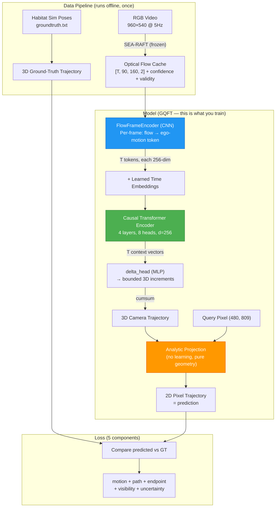
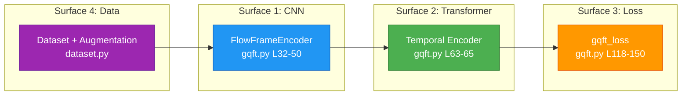

# GQFT Codebase Deep Dive — Every File, Every Component

## The Big Picture: How GQFT Works End-to-End



---

## YES, It Uses a Transformer — Here's Exactly What It Does

The Transformer is the **temporal backbone** of GQFT. Here's the precise role:

### What goes IN to the Transformer
Each video frame's optical flow field is compressed by a CNN ([`FlowFrameEncoder`](file:///home/vivekananda/UGP_1_VLM/VLM_Based_Robot_Navigation/Task_2/gqft_algorithm_sharing_vivekananda/step2/models/gqft.py#L32-L50)) into a single **256-dim token** representing "how the camera moved in this frame." So if you have 24 frames of history, the Transformer receives 24 tokens.

### What the Transformer does
It's a **causal** (autoregressive) `nn.TransformerEncoder` — each token can only attend to itself and all **previous** tokens (not future ones). This makes sense because the robot sees frames sequentially.

```
Frame 1 token → can see: [1]
Frame 2 token → can see: [1, 2]
Frame 3 token → can see: [1, 2, 3]
...
Frame 24 token → can see: [1, 2, ..., 24]
```

**Config**: 4 layers, 8 attention heads, 256-dim, pre-norm, GELU activation.

### What comes OUT of the Transformer
Each output token is a **context vector** that encodes "everything the model knows about the camera's motion up to this frame." These context vectors are fed to:
1. **`delta_head`** → predicts a bounded 3D displacement (Δx, Δy, Δz) for each frame, clamped to ±0.12m
2. **`logvar_head`** → predicts uncertainty (log-variance) over the displacement
3. **`valid_head`** → predicts whether the trajectory is still visible in the image

### The cumulative sum trick
The individual deltas are **cumulative-summed** to form a full 3D camera trajectory. This is clever because it means the model only needs to predict small per-frame steps, not absolute positions.

---

## File-by-File Breakdown

### 📁 Core Model

#### [`step2/models/gqft.py`](file:///home/vivekananda/UGP_1_VLM/VLM_Based_Robot_Navigation/Task_2/gqft_algorithm_sharing_vivekananda/step2/models/gqft.py) — ⭐ THE MOST IMPORTANT FILE

| Lines | Component | What it does |
|-------|-----------|-------------|
| 15-23 | `GQFTConfig` | Hyperparameters: d_model=256, 4 Transformer layers, 8 heads, max_step=0.12m |
| 26-29 | `ConvBlock` | Conv2d → GroupNorm → GELU building block |
| 32-50 | `FlowFrameEncoder` | **The CNN**: Takes one flow frame [4,H,W] + appends 2 coordinate channels → 4 conv blocks → global avg+max pool → linear → 256-dim token. **This is where per-frame visual understanding happens** |
| 53-108 | `GQFT` | **The full model**: CNN encoder → time embeddings → causal Transformer → delta head → cumsum → analytic projection → validity prediction |
| 62 | `time_embed` | Learned positional embeddings, one per frame position |
| 63-65 | `temporal` | **THE TRANSFORMER** — `nn.TransformerEncoder` with causal mask |
| 66 | `delta_head` | MLP: 256→256→3, predicts bounded 3D camera displacement per frame |
| 67 | `logvar_head` | MLP: 256→128→3, predicts uncertainty |
| 69-72 | `query_encoder` + `valid_head` | Predicts if the projected trajectory point is still visible |
| 84 | `torch.tanh(...) * max_step_m` | **Key**: bounds each step to ±0.12 meters — prevents wild predictions |
| 86 | `torch.cumsum(delta, dim=1)` | **Key**: turns increments into a full trajectory |
| 118-150 | `gqft_loss` | **The loss function** — 5 weighted components (see below) |

#### The Loss Function — 5 Components

| Component | Weight | What it measures | Code line |
|-----------|--------|-----------------|-----------|
| `motion` | 4.0 | 3D displacement prediction accuracy (smooth L1 vs ground truth) | L122-123 |
| `motion_nll` | 0.05 | Uncertainty calibration — penalizes overconfident wrong predictions | L126-128 |
| `path` | 1.0 | 2D projected trajectory accuracy (normalized pixel error) | L133-134 |
| `endpoint` | 1.0 | Final point accuracy — where does the trajectory end? | L139-141 |
| `visibility` | 0.25 | Binary cross-entropy for "is this point still in frame?" | L144-145 |

---

### 📁 Geometry (No Learning — Pure Math)

#### [`step2/geometry.py`](file:///home/vivekananda/UGP_1_VLM/VLM_Based_Robot_Navigation/Task_2/gqft_algorithm_sharing_vivekananda/step2/geometry.py) — The Analytic Projection

| Lines | Function | What it does |
|-------|----------|-------------|
| 16-28 | `CameraModel` | Camera intrinsics: focal length, principal point, height, pitch |
| 39-58 | `quat_xyzw_to_matrix` | Quaternion → rotation matrix conversion |
| 61-66 | `load_tum_camera_trajectory` | Reads ground-truth camera poses from TUM format |
| 75-92 | `query_ground_anchor` | **Key**: shoots a ray from a pixel through the camera, intersects it with a flat ground plane. This is how a pixel becomes a 3D point |
| 95-133 | `project_query_path` | Takes ground-truth 3D camera positions → projects them through a query pixel → returns 2D pixel trajectory (used to create training labels) |
| 136-167 | `project_displacements_torch` | **Differentiable version** used during forward pass. Takes predicted 3D displacement → projects to 2D pixels. This is the "analytic" part — no learning needed |

> **Key insight**: The model only learns the 3D camera motion. The 2D pixel trajectory is computed analytically from the 3D prediction using known camera geometry. This is a hard geometric constraint, not learned.

---

### 📁 Data Pipeline

#### [`step2/dataset.py`](file:///home/vivekananda/UGP_1_VLM/VLM_Based_Robot_Navigation/Task_2/gqft_algorithm_sharing_vivekananda/step2/dataset.py) — Training Data Loader

| Lines | What it does |
|-------|-------------|
| 24-61 | `FlowPathDataset.__init__` — Reads manifest, builds sliding windows over sequences |
| 66-95 | `_load_sequence` — Loads flow cache (du, dv, confidence, valid) + ground-truth poses. LRU-caches sequences |
| 97-106 | `_sample_history` — Randomly picks history length from {2,3,4,6,8,12,18,24,30} during training |
| 108-123 | `_sample_queries` — Generates query pixel locations (or fixed bottom-centre anchor) |
| 125-175 | `__getitem__` — Assembles one training sample: flow features + ground-truth trajectory |
| **152-158** | **YOUR AUGMENTATION** — Horizontal flip with 50% probability during training |
| 178-202 | `collate_windows` — Pads batches to the longest history in the batch |

#### [`step2/capture_hsgm_habitat.py`](file:///home/vivekananda/UGP_1_VLM/VLM_Based_Robot_Navigation/Task_2/gqft_algorithm_sharing_vivekananda/step2/capture_hsgm_habitat.py) — Scene Capture
Generates RGB sequences from Matterport3D scenes in Habitat Sim. Creates ground-truth poses. You'd use this to add more training scenes.

#### [`step2/cache_searaft.py`](file:///home/vivekananda/UGP_1_VLM/VLM_Based_Robot_Navigation/Task_2/gqft_algorithm_sharing_vivekananda/step2/cache_searaft.py) — Optical Flow Extraction
Runs the frozen SEA-RAFT model on captured RGB images → saves dense optical flow as `.npz`. This runs offline before training.

#### [`step2/make_hsgm_manifest.py`](file:///home/vivekananda/UGP_1_VLM/VLM_Based_Robot_Navigation/Task_2/gqft_algorithm_sharing_vivekananda/step2/make_hsgm_manifest.py) — Dataset Registry
Creates a JSON manifest listing all sequences, their splits (train/val/test), and whether flow is ready.

---

### 📁 Training & Evaluation

#### [`step2/train_gqft.py`](file:///home/vivekananda/UGP_1_VLM/VLM_Based_Robot_Navigation/Task_2/gqft_algorithm_sharing_vivekananda/step2/train_gqft.py) — Training Loop

| Lines | What it does |
|-------|-------------|
| 52-60 | Multi-GPU setup (DDP with NCCL) |
| 63-78 | Validates train/val scenes are completely disjoint (no leakage) |
| 103-162 | Setup: datasets, data loaders, model, optimizer (AdamW), cosine LR schedule |
| 182-186 | Baseline validation before training starts |
| 198-280 | **Main training loop**: forward pass → loss → backward → gradient clip (max norm 1.0) → optimizer step. Validates every 500 steps, saves best checkpoint by val ADE |
| 267-269 | **Stability gate**: training is "stable" only after 1000 steps, 250 finite gradients in a row, 2+ validations, and val ADE ≤ 98% of initial |

#### [`step2/evaluate_gqft.py`](file:///home/vivekananda/UGP_1_VLM/VLM_Based_Robot_Navigation/Task_2/gqft_algorithm_sharing_vivekananda/step2/evaluate_gqft.py) — Evaluation + History Selection

Sweeps over history lengths {4,8,12,...,30} on validation data. For each history, measures ADE/FDE + **signature ambiguity** (can two different motions produce the same Transformer state?). Selects the shortest history with ambiguity ≈ 0.

#### [`step2/metrics.py`](file:///home/vivekananda/UGP_1_VLM/VLM_Based_Robot_Navigation/Task_2/gqft_algorithm_sharing_vivekananda/step2/metrics.py) — Metric Computation

Accumulates ADE (Average Displacement Error), FDE (Final Displacement Error), endpoint accuracy at 5px and 10px thresholds, and predicted-vs-actual trajectory length.

#### [`step2/history_study.py`](file:///home/vivekananda/UGP_1_VLM/VLM_Based_Robot_Navigation/Task_2/gqft_algorithm_sharing_vivekananda/step2/history_study.py) — History Selection Logic

Implements the signature ambiguity rule: "can a nearest-neighbour retrieval in Transformer-state space correctly match trajectories across different sequences?"

---

### 📁 Inference & Utilities

#### [`infer_gqft.py`](file:///home/vivekananda/UGP_1_VLM/VLM_Based_Robot_Navigation/Task_2/gqft_algorithm_sharing_vivekananda/infer_gqft.py) — Single-Sequence Inference
Loads checkpoint + one flow cache → runs the model → outputs a JSON with the predicted pixel trajectory and 3D displacements.

#### [`verify_setup.py`](file:///home/vivekananda/UGP_1_VLM/VLM_Based_Robot_Navigation/Task_2/gqft_algorithm_sharing_vivekananda/verify_setup.py) — Environment Check
Verifies PyTorch, NumPy, OpenCV versions and checkpoint SHA-256 hash integrity.

---

## Where Improvements Are Needed & Where Novelty Lives

### 🟢 The 4 Editable Surfaces (where you can change things)



### 🔴 What You CANNOT Change (hard constraints)
- Camera parameters (960×540, 135° FOV, 1.2m height, 30° pitch)
- SEA-RAFT optical flow extraction (frozen)
- The analytic projection in `geometry.py` (this is math, not learning)
- The train/val/test scene split
- The evaluation protocol (ADE/FDE on locked test)

### 🟡 Ranked Improvement Ideas (most promising → least)

| Priority | What | Where to edit | Why it could help | Novelty level |
|----------|------|--------------|-------------------|---------------|
| **1** | **Multi-scale CNN features** | `FlowFrameEncoder` in [gqft.py:L32-50](file:///home/vivekananda/UGP_1_VLM/VLM_Based_Robot_Navigation/Task_2/gqft_algorithm_sharing_vivekananda/step2/models/gqft.py#L32-L50) | Current CNN only uses single-scale features. Multi-scale (like FPN) would capture both fine motion details and coarse ego-motion | Medium — engineering |
| **2** | **Attention-based flow aggregation** | Replace `mean+max pool` in [gqft.py:L49](file:///home/vivekananda/UGP_1_VLM/VLM_Based_Robot_Navigation/Task_2/gqft_algorithm_sharing_vivekananda/step2/models/gqft.py#L49) | Global avg+max pooling discards spatial structure. A cross-attention or spatial attention would let the model focus on informative flow regions | **High — novel** |
| **3** | **Adaptive history length** | Add a new head after the Transformer in [gqft.py:L66-67](file:///home/vivekananda/UGP_1_VLM/VLM_Based_Robot_Navigation/Task_2/gqft_algorithm_sharing_vivekananda/step2/models/gqft.py#L66-L67) | Currently history=24 is selected by brute-force. A learned "confidence" head could dynamically decide when enough history has been seen | **High — novel** |
| **4** | **Better loss weighting / curriculum** | [gqft.py:L118-150](file:///home/vivekananda/UGP_1_VLM/VLM_Based_Robot_Navigation/Task_2/gqft_algorithm_sharing_vivekananda/step2/models/gqft.py#L118-L150) | Fixed loss weights (motion=4, path=1, endpoint=1). Dynamic weighting or a curriculum (easy→hard motions) could improve convergence | Low — tuning |
| **5** | **More training data** | Run [capture_hsgm_habitat.py](file:///home/vivekananda/UGP_1_VLM/VLM_Based_Robot_Navigation/Task_2/gqft_algorithm_sharing_vivekananda/step2/capture_hsgm_habitat.py) on new Matterport scenes | Only 4 training scenes. More scenes = more generalization | Low — scaling |
| **6** | **Flow-level augmentation** | [dataset.py:L152-158](file:///home/vivekananda/UGP_1_VLM/VLM_Based_Robot_Navigation/Task_2/gqft_algorithm_sharing_vivekananda/step2/dataset.py#L152-L158) | Already implemented (horizontal flip). Could add: Gaussian noise on flow, dropout random flow pixels, temporal subsampling | Low — engineering |

### 🏆 If You Want a Paper-Worthy Contribution
The highest novelty moves are **#2** (attention-based flow aggregation) and **#3** (adaptive history). These are where a publication reviewer would see actual intellectual contribution beyond "we tried augmentation."

But **first**: run the augmentation experiment (Phase 1-2 in the ROADMAP). If that alone beats 9.63 px, you have a result. Then layer novelty on top.
